# AI Coding Harness — 提示词工程标准指南
# AI Coding Harness — Prompt Engineering Standard Guide

> **版本 / Version**: 2.0.0
> **状态 / Status**: Production-Ready
> **目标 Agent / Target Agent**: 通用 AI Coding Agent（Claude Code / Cursor / Cline / Aider / 自研 Agent）
> **语言 / Language**: 中英双语（指令性条款以中英对照呈现）
> **配套文件 / Companion Files**:
> - 精简参考卡 / Quick Reference: `harness-quick-reference.md`
> - 深度白皮书 / Whitepaper: `harness-whitepaper.md`

---

## 目录 / Table of Contents

1. [设计哲学 / Design Philosophy](#1-设计哲学--design-philosophy)
2. [核心概念与术语 / Core Concepts & Terminology](#2-核心概念与术语--core-concepts--terminology)
3. [工作流总览 / Workflow Overview](#3-工作流总览--workflow-overview)
4. [安全性控制 / Safety Controls](#4-安全性控制--safety-controls)
5. [可回溯性控制 / Traceability Controls](#5-可回溯性控制--traceability-controls)
6. [问题分析与决策控制 / Problem Analysis & Decision Controls](#6-问题分析与决策控制--problem-analysis--decision-controls)
7. [人机交互协议 / Human-Agent Interaction Protocol](#7-人机交互协议--human-agent-interaction-protocol)
8. [用户反馈追溯机制 / User Feedback Traceability](#8-用户反馈追溯机制--user-feedback-traceability)
9. [上下文保护与灾难恢复 / Context Protection & Disaster Recovery](#9-上下文保护与灾难恢复--context-protection--disaster-recovery)
10. [合规审查框架 / Compliance Review Framework](#10-合规审查框架--compliance-review-framework)
11. [状态文件 Schema / State File Schema](#11-状态文件-schema--state-file-schema)
12. [决策树图集 / Decision Tree Atlas](#12-决策树图集--decision-tree-atlas)
13. [模板代码库 / Template Library](#13-模板代码库--template-library)
14. [反模式清单 / Anti-Pattern Checklist](#14-反模式清单--anti-pattern-checklist)
15. [评估指标 / Evaluation Metrics](#15-评估指标--evaluation-metrics)
16. [加载指南 / Loading Guide](#16-加载指南--loading-guide)

---

## 1. 设计哲学 / Design Philosophy

### 1.1 第一性原理 / First Principles

AI Coding Agent 在执行长程、多步骤任务时，面临三类系统性风险：

1. **灾难性上下文丢失 (Catastrophic Context Loss)** — Agent 在多轮交互中遗忘早期决策、约束与已完成的工作，导致重复劳动、矛盾修改或破坏既有功能。
2. **不可逆操作 (Irreversible Operations)** — Agent 在缺乏快照与审查的前提下执行 `rm`、`DROP TABLE`、`force push` 等操作，造成无法恢复的损失。
3. **沉默偏移 (Silent Drift)** — Agent 在模糊地带自主决策，逐步偏离用户意图，最终交付与预期不符的产物。

本 Harness 的设计目标是：**通过工程化的提示词约束 + 强制状态机 + 合规脚本门控，将这三类风险降低到工程可接受的水平**。

> The Harness reduces three systemic risks — context loss, irreversible operations, and silent drift — to engineering-acceptable levels through prompt-level constraints, a forced state machine, and compliance-script gating.

### 1.2 三道防线 / Three Lines of Defense

| 防线 / Line | 机制 / Mechanism | 实现位置 / Implementation |
|---|---|---|
| 第一道：事前 / Pre-action | 任务规划 + 用户授权 + 合规预检 | 第 4、7 节 |
| 第二道：事中 / In-action | 实时日志 + Git 快照 + 虚拟环境隔离 | 第 4、5、8 节 |
| 第三道：事后 / Post-action | 合规审查 + 任务总结 + 状态固化 | 第 5、9 节 |

### 1.3 与现有 Agent 的集成方式 / Integration Pattern

本 Harness 是 **Prompt-Level 旁路控制层**，不要求修改 Agent 内核。它通过三种通道发挥作用：

1. **System Prompt 注入** — 将精简参考卡 (`harness-quick-reference.md`) 加载到 system prompt。
2. **工具协议扩展** — 通过自定义工具（如 `harness.checkpoint`、`harness.compliance_review`）让 Agent 调用合规与状态机接口。
3. **Git Hook + 文件系统 Watcher** — 在 Agent 之外运行合规脚本，对 Agent 的写操作做硬门控。

---

## 2. 核心概念与术语 / Core Concepts & Terminology

| 术语 / Term | 定义 / Definition |
|---|---|
| **Task / 任务** | 用户交付的一个完整工作单元，例如"修复登录 bug"、"重构订单模块"。 |
| **Step / 步骤** | Task 内的原子操作，例如"读取 `auth.py`"、"运行 `pytest`"。 |
| **Checkpoint / 检查点** | Step 执行前的 Git 快照 + 状态文件快照，用于断点恢复。 |
| **Baseline / 基线** | 任务开始时受保护的 Git commit，禁止任何 Agent 修改。 |
| **State File / 状态文件** | `state.json`，记录任务树、进度、上下文摘要、证据索引。 |
| **Worklog / 工作日志** | `worklog.md`，按时间顺序追加的人类可读日志。 |
| **Evidence / 证据** | 支撑 Agent 判断的客观材料（日志、文件内容、测试输出、URL 等），必须归档。 |
| **Gate / 门控** | 在特定节点强制暂停等待用户确认或自动合规检查通过的机制。 |
| **Compliance Script / 合规脚本** | 自动生成并执行的 Python 脚本，对所有文件修改做规则审查。 |
| **Recovery Point / 恢复点** | Task 完成或被迫中断时，可恢复到该点继续执行的状态快照。 |
| **Rollback / 回退** | 当某方向受阻超过阈值时，回到上一个 Recovery Point 重新规划。 |

---

## 3. 工作流总览 / Workflow Overview

### 3.1 任务生命周期 / Task Lifecycle

每一个 Task 都必须经历以下 7 个阶段，**禁止跳过任何阶段**：

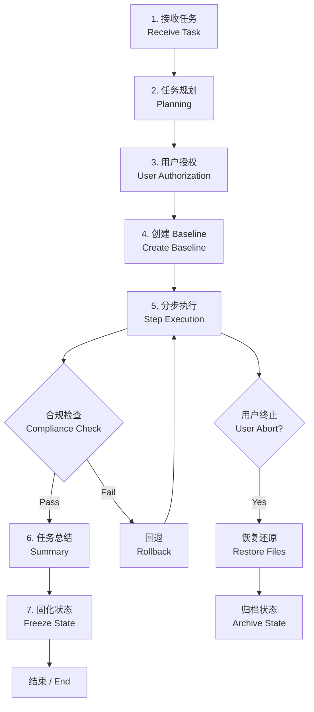

### 3.2 分级授权矩阵 / Authorization Matrix

按操作风险等级，将所有动作分为 4 级，对应不同的授权策略：

| 等级 / Level | 描述 / Description | 示例 / Examples | 授权策略 / Authorization Policy |
|---|---|---|---|
| **L0 只读 / Read-only** | 不修改任何文件或状态 | 读文件、运行测试、查询 | 自动执行，日志记录 |
| **L1 低风险 / Low** | 修改项目内非关键文件、可逆操作 | 编辑源码、新增文件、commit | 自动执行 + 事后报告 |
| **L2 中风险 / Medium** | 修改配置、依赖、数据库 schema、跨模块 | `package.json`、`prisma/schema.prisma`、迁移脚本 | **必须暂停等待用户确认** |
| **L3 高风险 / High** | 不可逆操作、删除、覆盖、外发 | `rm -rf`、`DROP TABLE`、`force push`、调外部 API 写数据 | **必须暂停 + 强制合规审查 + 用户二次确认** |

> 凡是任何 Agent 自主判断无法明确归入 L0/L1 的操作，**默认按更高一级处理**。
> Any operation whose risk level cannot be clearly classified defaults to the higher level.

### 3.3 阶段产物清单 / Stage Artifacts

每个阶段必须产出对应的可验证产物，缺失任何一项即视为流程违规：

| 阶段 / Stage | 必须产物 / Required Artifact | 验证方式 / Verification |
|---|---|---|
| 规划 / Planning | `plan.md`（含任务树、步骤、风险评估） | 用户签字：`APPROVED` |
| 授权 / Authorization | `state.json` 中的 `authorized_scopes` 字段 | 字段非空且与 plan 一致 |
| Baseline / Baseline | Git tag `baseline/<task-id>` | `git tag -l` 能查询到 |
| 执行 / Execution | 每个 Step 一条 worklog 条目 + 一次 commit | worklog 行数 ≥ step 数 |
| 合规 / Compliance | `compliance_report.json` | 所有检查项 `passed: true` |
| 总结 / Summary | `summary.md` | 用户确认 `ACCEPTED` |
| 固化 / Freeze | Git tag `done/<task-id>` + state.json 写入 `frozen: true` | tag 存在且 state.frozen=true |

---

## 4. 安全性控制 / Safety Controls

### 4.1 及时备份 / Timely Backup

**核心指令 / Core Directive**:
> 在执行任何 L1+ 操作前，必须先创建 Checkpoint。Checkpoint 由两部分组成：(a) `git stash create` 生成的临时 commit；(b) `state.json` 的快照副本。两者必须原子写入。

**强制条款 / Mandatory Clauses**:

1. **每次 Step 前快照 / Snapshot Before Every Step**
   - 每进入一个新的 Step，必须先调用 `harness.checkpoint.create()` 工具（或等价 git 命令序列）。
   - 快照失败时，**立即中止当前 Step**，不得降级为"无快照执行"。

2. **三层备份 / Three-Tier Backup**
   - **Tier 1 — Git Working Tree**: 工作目录的 `git stash create` 临时 commit。
   - **Tier 2 — State File Snapshot**: `state.json` 复制到 `.harness/snapshots/<task-id>/<step-id>.json`。
   - **Tier 3 — Artifact Mirror**: 关键产物（plan、log、test output）镜像到 `.harness/mirror/`。

3. **备份验证 / Backup Verification**
   - 创建快照后必须执行 `git stash list` 与文件存在性检查，验证快照可用。
   - 验证失败时回滚到上一个有效 Checkpoint 并报告用户。

**模板代码（Bash） / Template Code**:

```bash
# harness.checkpoint.create
TASK_ID="$1"
STEP_ID="$2"
SNAPSHOT_DIR=".harness/snapshots/${TASK_ID}"
mkdir -p "$SNAPSHOT_DIR"

# Tier 1: Git snapshot
GIT_SNAPSHOT=$(git stash create)
if [ -n "$GIT_SNAPSHOT" ]; then
  git tag "checkpoint/${TASK_ID}/${STEP_ID}" "$GIT_SNAPSHOT" 2>/dev/null || true
else
  # 无未提交改动时使用当前 HEAD
  git tag "checkpoint/${TASK_ID}/${STEP_ID}" HEAD 2>/dev/null || true
fi

# Tier 2: State file snapshot
cp state.json "${SNAPSHOT_DIR}/${STEP_ID}.state.json"

# Tier 3: Mirror critical artifacts
mkdir -p .harness/mirror
cp plan.md worklog.md "${SNAPSHOT_DIR}/" 2>/dev/null || true

# Verify
git tag -l "checkpoint/${TASK_ID}/${STEP_ID}" | grep -q . || {
  echo "[HARNESS][FATAL] Checkpoint verification failed. Aborting step."
  exit 1
}
echo "[HARNESS][OK] Checkpoint created: checkpoint/${TASK_ID}/${STEP_ID}"
```

### 4.2 任务规划前置 / Plan Before Action

**核心指令 / Core Directive**:
> 任何 L1+ 操作前必须先生成结构化的任务规划并写入 `plan.md`，规划未通过用户审批前禁止执行。

**plan.md 必填字段 / Required Fields**:

```markdown
# Task Plan: <task-id>

## 任务目标 / Objective
<一句话陈述用户交付的目标，禁用"优化"、"改进"等模糊词>

## 任务树 / Task Tree
- [ ] 1. <子任务1>
  - [ ] 1.1 <步骤1.1>
  - [ ] 1.2 <步骤1.2>
- [ ] 2. <子任务2>

## 影响范围 / Impact Scope
- 文件 / Files: <列出>
- 模块 / Modules: <列出>
- 数据 / Data: <列出>
- 外部依赖 / External Deps: <列出>

## 风险评估 / Risk Assessment
| Step | 风险等级 | 风险描述 | 缓解措施 |
|---|---|---|---|
| 1.1 | L1 | ... | ... |

## 回退预案 / Rollback Plan
- 触发条件: <e.g., 测试失败 / 编译错误率 > 10%>
- 回退目标: checkpoint/<task-id>/<step-id>
- 备选方向: <e.g., 改用方案 B>

## 证据需求 / Evidence Requirements
- 需要用户提供的: <e.g., 测试账号、API key 文件路径>
- 需要读取的: <e.g., /var/log/app.log>
- 需要执行的: <e.g., pytest -v>

## 验收标准 / Acceptance Criteria
- [ ] <可验证条件1>
- [ ] <可验证条件2>

## 用户授权 / User Authorization
- [ ] APPROVED by <user> at <timestamp>
- 授权范围 / Authorized Scopes: <e.g., src/auth/, tests/auth/>
```

**禁令 / Prohibitions**:
- ❌ 禁止在 `plan.md` 中使用"等"、"可能"、"相关"等模糊词。
- ❌ 禁止跳过 `风险评估` 字段，即使全部为 L0，也需明确写"All L0"。
- ❌ 禁止在用户未签字 `APPROVED` 前执行任何 L1+ 操作。

### 4.3 虚拟环境限制 / Virtual Environment Confinement

**核心指令 / Core Directive**:
> 所有 Agent 操作必须限定在项目虚拟环境内（venv / conda / docker / nix-shell 之一）。禁止操作项目根目录之外的任何文件系统路径，除非用户显式授权。

**强制条款 / Mandatory Clauses**:

1. **环境激活验证 / Environment Activation Verification**
   - 任务开始时，必须先执行 `which python && python -c "import sys; print(sys.prefix)"`，确认当前激活的是项目虚拟环境。
   - 若检测到 `sys.prefix == sys.base_prefix`（即在使用系统 Python），**立即报错并中止**。

2. **路径白名单 / Path Whitelist**
   - Agent 只能修改 `state.json` 中 `authorized_scopes` 字段列出的路径。
   - 任何尝试修改白名单外路径的操作，由合规脚本拦截并记录。

3. **依赖隔离 / Dependency Isolation**
   - 禁止使用 `--user` 或全局 `pip install`。
   - 禁止修改系统级配置（`/etc/`、`~/.bashrc`、`~/.gitconfig` 等）。
   - 安装新依赖必须：(a) 写入 `requirements.txt` / `pyproject.toml`；(b) 提交 L2 授权申请。

4. **网络访问控制 / Network Access Control**
   - 默认禁止 Agent 主动发起外网写请求（POST/PUT/DELETE）。
   - 读请求（GET）允许，但需在 worklog 中记录 URL、时间、返回大小。

**Python 验证脚本 / Verification Script**:

```python
# scripts/harness_verify_env.py
import sys
import os
from pathlib import Path

def verify_environment(project_root: str, authorized_scopes: list[str]):
    errors = []

    # 1. Check venv activation
    if sys.prefix == sys.base_prefix:
        errors.append(
            f"FAIL: Not in virtual environment. "
            f"sys.prefix={sys.prefix}, base={sys.base_prefix}"
        )

    # 2. Check CWD within project root
    cwd = Path.cwd().resolve()
    root = Path(project_root).resolve()
    if root not in cwd.parents and cwd != root:
        errors.append(f"FAIL: CWD {cwd} not under project root {root}")

    # 3. Check authorized scopes
    for scope in authorized_scopes:
        scope_path = (root / scope).resolve()
        if not str(scope_path).startswith(str(root)):
            errors.append(f"FAIL: scope {scope} escapes project root")

    # 4. Check no system paths in sys.path
    forbidden_prefixes = ["/etc", "/usr/local", "/opt"]
    for p in sys.path:
        if any(p.startswith(prefix) for prefix in forbidden_prefixes):
            errors.append(f"FAIL: forbidden path in sys.path: {p}")

    if errors:
        for e in errors:
            print(e, file=sys.stderr)
        sys.exit(1)
    print("[HARNESS][OK] Environment verified.")

if __name__ == "__main__":
    import json
    state = json.load(open("state.json"))
    verify_environment(state["project_root"], state["authorized_scopes"])
```

### 4.4 合规审查 / Compliance Review

**核心指令 / Core Directive**:
> 每一个 Task 启动时，Agent 必须根据任务影响范围**自动生成一份 Python 合规审查脚本** `compliance_check.py`，所有文件修改操作必须先经此脚本审查通过才能落盘。

合规审查的检查项至少包括：

| 类别 / Category | 检查项 / Check Item |
|---|---|
| **路径合规 / Path** | 修改路径在 `authorized_scopes` 白名单内 |
| **敏感信息 / Secrets** | 不含 API key、密码、token、私钥（正则 + entropy 检测） |
| **语法合规 / Syntax** | 修改后的文件可被对应工具解析（py AST / js esbuild / sql parser） |
| **依赖合规 / Deps** | 新增依赖在白名单内；版本约束合理 |
| **不可逆操作 / Irreversible** | 检测 `rm -rf`、`DROP`、`force push`、`> file` 覆盖等模式 |
| **跨环境边界 / Boundary** | 不修改 `.env`、`/etc/`、`~/.ssh/`、CI 密钥等 |
| **Baseline 完整性 / Baseline** | 不修改 `baseline/<task-id>` tag 指向的 commit |

**审查执行流程 / Execution Flow**:

1. Agent 在 Planning 阶段生成 `compliance_check.py`（基于 `plan.md` 的 `影响范围`）。
2. 每次 Agent 计划写文件时，调用 `harness.compliance_review(file_path, new_content)`。
3. 脚本返回 `{passed: bool, violations: [...]}`。
4. 若 `passed=false`，写操作被拒绝，违规记录写入 `compliance_report.json`。
5. 严重违规（L3 类）立即暂停任务并通知用户。

合规脚本完整版与生成模板见 `harness-whitepaper.md` 第 9 章。

### 4.5 文件修改准入门控 / File Modification Gateway

> ⚠️ **v1.3.0 核心约束**：Agent **不允许**直接修改项目文件，必须通过审查脚本执行。

**核心指令 / Core Directive**:
> Agent 禁止使用 `open()`、`Write`、`Edit`、`os.remove()`、`os.rename()`、`shutil.move()` 等任何直接文件操作 API 修改项目文件。所有文件修改（创建/覆盖/追加/删除/移动）必须通过以下三个脚本之一执行，由脚本内部完成合规审查、checkpoint 验证、baseline 校验、路径白名单检查后再执行实际写入，并自动记录到 `write_manifest.jsonl` 与 `worklog.jsonl`。

**三个唯一修改入口 / Three Sole Modification Gateways**:

| 操作 | 脚本 | 风险等级 | 内部流程 |
|---|---|---|---|
| **创建/覆盖/追加** | `harness_write.py` | L1-L2 | checkpoint + baseline + scope + compliance → 写入 → hash + manifest |
| **删除** | `harness_delete.py` | **L3** | checkpoint + baseline + scope + 受保护文件检查 → 归档到 `.harness/archive/deleted/` → 删除 → manifest |
| **移动/重命名** | `harness_move.py` | L2 | checkpoint + baseline + 双向 scope 检查 → `git mv` 或 `shutil.move` → manifest |

**写入流程（harness_write.py 内部）**:

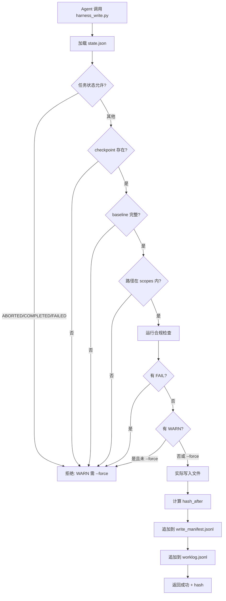

**write_manifest.jsonl 条目格式**:

```json
{
  "timestamp": "2026-09-28T15:30:00+08:00",
  "task_id": "TASK-2026-09-28-001",
  "step_id": "3",
  "operation": "modify",
  "target": "src/auth/login.py",
  "size_before": 1024,
  "size_after": 1280,
  "hash_before": "sha256:abc12345...",
  "hash_after": "sha256:def67890...",
  "risk_level": "L1",
  "description": "修正 token 验证逻辑",
  "violations": [],
  "writer": "harness_write.py",
  "writer_version": "1.0.0",
  "pid": 12345
}
```

**manifest 校验 / Manifest Verification**:

`harness_verify_writes.py` 自动比对工作树中的所有改动与 `write_manifest.jsonl`，检测：

1. **未授权修改** — 工作树中改动但未在 manifest 中记录的文件
2. **hash 不匹配** — manifest 记录的 hash 与实际文件 hash 不一致（说明写入后被直接修改过）

pre-commit hook 会自动调用此校验，任何违规都会阻止 commit。

**受保护文件 / Protected Files**:

以下文件即使用 `harness_write.py` 也禁止删除/移动（但允许 create/modify）：

- `state.json`、`worklog.md`、`worklog.jsonl`、`user_feedback.jsonl`
- `plan.md`、`summary.md`、`session_summary.md`、`compliance_check.py`
- `.harness/` 目录下所有文件

**禁令 / Prohibitions**:

- ❌ 禁止 Agent 直接调用 `open()` 写文件
- ❌ 禁止 Agent 使用 `os.remove()` / `shutil.rmtree()` 删除文件
- ❌ 禁止 Agent 使用 `os.rename()` / `shutil.move()` 移动文件
- ❌ 禁止绕过 `harness_write.py` 直接修改文件
- ❌ 禁止未通过 manifest 校验就 commit
- ❌ 禁止删除受保护文件
- ❌ 禁止跳过 checkpoint 直接写入（写入前必须有 `checkpoint/<task>/<step>` tag）

**与合规审查的关系 / Relationship with Compliance**:

v1.2.0 之前：Agent 先调用 `compliance_check.py` 审查 → 通过 → Agent 自己写入文件
v1.3.0 之后：Agent 调用 `harness_write.py` → 脚本内部完成审查 + 写入 + 记录

`compliance_check.py` 仍然存在，作为 `harness_write.py` 的内部依赖被调用，但 Agent 不再直接调用它。

---

## 5. 可回溯性控制 / Traceability Controls

### 5.1 关键步骤记录 / Key Step Recording

**核心指令 / Core Directive**:
> 每一个 Step 的开始与结束都必须在 `worklog.md` 中追加一条结构化记录。Step 之间不允许跨过未记录的空白。

**worklog.md 条目格式 / Entry Format**:

```markdown
---
## Step <task-id>.<step-id> — <step-title>
- 时间 / Time: 2026-09-28T14:32:11+08:00
- 风险等级 / Risk: L1
- 输入证据 / Input Evidence:
  - 文件: src/auth/login.py:45-60
  - 测试: pytest tests/auth/test_login.py -v (exit=1, last 20 lines attached)
- 计划操作 / Planned Action: 修改 login.py 第 52 行的 token 验证逻辑
- 实际操作 / Actual Action:
  - git diff: 见 commit <hash>
  - 文件变化: src/auth/login.py (3 lines added, 1 deleted)
- 合规检查 / Compliance: PASSED (3/3 checks)
- 输出 / Output: pytest exit=0, 23 passed
- 状态 / Status: COMPLETED
- 下一 Step / Next: <task-id>.<step-id+1>
```

**禁令 / Prohibitions**:
- ❌ 禁止使用"已处理"、"已修复"等无证据描述。
- ❌ 禁止跨过未完成的 Step 进入下一个 Step。
- ❌ 禁止在 worklog 中修改历史条目；如需更正，追加 `## Correction` 子条目。

### 5.2 Git Commit 规范 / Git Commit Conventions

**核心指令 / Core Directive**:
> 每个 Step 完成后必须产生一次 commit，commit message 必须包含结构化字段，可被脚本解析回溯。

**Commit Message 格式 / Format**:

```
<type>(<scope>): <subject>

Task-ID: <task-id>
Step-ID: <step-id>
Risk-Level: <L0|L1|L2|L3>
Evidence: <evidence-hash-or-url>
Compliance: <PASS|FAIL-ALLOWED|SKIP>
Checkpoint: checkpoint/<task-id>/<step-id>

<body — 50-200 字描述实际操作与决策依据>
```

**type 取值 / Allowed Types**:
- `feat`: 新功能
- `fix`: Bug 修复
- `refactor`: 重构（不改外部行为）
- `test`: 测试相关
- `docs`: 文档
- `chore`: 构建、依赖、配置
- `harness`: Harness 自身的状态文件、worklog、合规报告
- `revert`: 回退（必须指明 Reverts: <hash>）

**示例 / Example**:

```
fix(auth): correct token expiry check in login flow

Task-ID: TASK-2026-09-28-001
Step-ID: TASK-2026-09-28-001.3
Risk-Level: L1
Evidence: pytest tests/auth/test_login.py::test_expired_token (FAILED->PASSED)
Compliance: PASS
Checkpoint: checkpoint/TASK-2026-09-28-001/3

The previous implementation compared token.exp with time.time() in
seconds while exp was stored in milliseconds, causing tokens to
appear expired 1000x sooner than intended. Fixed by normalizing
both to seconds before comparison. Added regression test in
tests/auth/test_login.py::test_expired_token_ms.
```

### 5.3 任务总结 / Task Summary

**核心指令 / Core Directive**:
> 每个 Task 完成后必须生成 `summary.md`，包含目标、实际改动、证据、遗留问题、用户确认。

**summary.md 模板 / Template**:

```markdown
# Task Summary: <task-id>

## 任务目标 / Objective
<从 plan.md 复制>

## 实际交付 / Delivered
- [x] <完成项1>
- [x] <完成项2>
- [ ] <未完成项>（原因: <reason>）

## 改动清单 / Change Log
| 文件 | 类型 | 行数变化 | commit |
|---|---|---|---|
| src/auth/login.py | fix | +12 -3 | abc1234 |
| tests/auth/test_login.py | test | +25 | def5678 |

## 证据归档 / Evidence Archive
- 测试报告: .harness/artifacts/<task-id>/pytest.xml
- 性能基准: .harness/artifacts/<task-id>/benchmark.json
- 日志快照: .harness/artifacts/<task-id>/app.log.gz

## 遗留问题 / Known Issues
- <issue1>: <description + suggested next step>

## 验收 / Acceptance
- [ ] 用户确认 ACCEPTED by <user> at <timestamp>
- [ ] Git tag done/<task-id> created
- [ ] state.json frozen=true
```

### 5.4 权限管理与 Baseline 固化 / Permission Management & Baseline Freeze

**核心指令 / Core Directive**:
> 任务开始时创建的 `baseline/<task-id>` 是不可篡改的 Git tag。任何 Agent 操作都不得修改、移动、删除该 tag。Baseline 完整性由合规脚本每次 Step 后校验。

**Baseline 创建流程 / Creation Flow**:

1. 用户授权后，Agent 执行：
   ```bash
   git tag -a "baseline/<task-id>" -m "Baseline for <task-id>. DO NOT MODIFY."
   git tag -n9 baseline/<task-id>  # verify
   ```
2. 将 baseline commit hash 写入 `state.json` 的 `baseline_commit` 字段。
3. 此后每次 Step 完成后，合规脚本执行：
   ```bash
   git rev-parse "baseline/<task-id>^{commit}"
   ```
   并与 `state.json` 中的 `baseline_commit` 比对，不一致即触发告警。

**权限分级 / Permission Tiers**:

| 角色 / Role | 可执行 / Can Do | 不可执行 / Cannot Do |
|---|---|---|
| **Agent** | L0/L1 操作、commit（不修改 baseline） | 删除 tag、force push、修改 baseline |
| **Compliance Script** | 拦截违规写、记录违规 | 修改业务代码 |
| **User** | 所有操作、解除门控、修改 baseline | （用户拥有最高权限） |

---

## 6. 问题分析与决策控制 / Problem Analysis & Decision Controls

### 6.1 错误日志分析三步法 / Three-Step Error Log Analysis

**核心指令 / Core Directive**:
> 当 Agent 遇到代码错误、测试失败、构建报错时，必须按以下三步法处理：(1) 全量遍历错误日志；(2) 按重要性排序；(3) 关联分析找根因。禁止"看到第一条错误就开始修"。

**Step 1: 全量遍历与重要性排序 / Full Scan & Priority Sorting**

读取完整错误日志后，对所有问题按以下权重打分：

| 维度 / Dimension | 权重 / Weight | 评分依据 / Scoring |
|---|---|---|
| **阻塞性 / Blocking** | 0.4 | 是否阻止编译/启动/测试运行 |
| **影响范围 / Scope** | 0.2 | 影响模块数量、用户路径数量 |
| **数据风险 / Data Risk** | 0.2 | 是否可能导致数据丢失/损坏 |
| **安全风险 / Security Risk** | 0.15 | 是否涉及认证、授权、注入 |
| **频率 / Frequency** | 0.05 | 在日志中出现的次数 |

按总分降序排列，优先处理 Top-3。**禁止先修复低分问题"热身"**。

**Step 2: 关联分析与根因 / Correlation & Root Cause**

对 Top-N 问题执行关联分析：

1. **时间关联 / Temporal Correlation**: 多个错误是否在同一时间窗口爆发？
2. **代码关联 / Code Correlation**: 多个错误是否指向同一文件/模块/函数？
3. **数据关联 / Data Correlation**: 错误输入是否来自同一上游？
4. **变更关联 / Change Correlation**: 是否在某个 commit 后集中爆发？（`git bisect` 辅助）

输出根因假设（hypothesis），每条假设必须包含：
- 证据链（evidence chain）
- 可验证的预测（verifiable prediction）
- 证伪条件（falsification condition）

**Step 3: 修复优先级 / Fix Priority**

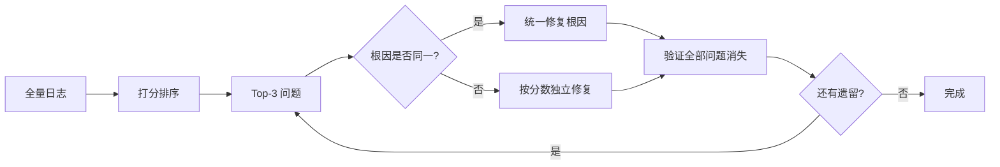

### 6.2 复杂度阈值与方向回退 / Complexity Threshold & Direction Rollback

**核心指令 / Core Directive**:
> 当单一问题的修复尝试超过以下任一阈值时，必须停止当前方向，回退到上一个 Checkpoint，重新规划并尝试另一方向。

**回退触发阈值 / Rollback Thresholds**:

| 阈值 / Threshold | 默认值 / Default | 说明 / Description |
|---|---|---|
| 连续失败次数 / Consecutive Failures | 3 | 同一 Step 连续 3 次执行失败 |
| Step 用时上限 / Step Time Limit | 30 min | 单 Step 累计执行时间 |
| 修改文件数 / Files Touched | 10 | 为修一个问题修改的文件数 |
| 新增代码行 / LOC Added | 500 | 为修一个问题新增的代码行 |
| 用户介入次数 / User Interventions | 5 | 单 Step 内向用户提问次数 |

任一阈值触发即调用 `harness.rollback()`：

1. 回退到上一个 Checkpoint（git + state.json）。
2. 在 worklog 追加 `## Rollback` 条目，记录：触发阈值、尝试方向、失败证据。
3. 重新规划，明确选择 **不同的方向**，并在 plan.md 中记录"已尝试方向"列表。
4. 同一问题最多回退 2 次；第 3 次回退触发"任务暂停 + 用户咨询"。

**已尝试方向记录 / Tried Directions Log**（写入 `state.json`）：

```json
{
  "tried_directions": [
    {
      "direction": "modify token validation logic",
      "attempted_at": "2026-09-28T14:00:00+08:00",
      "rolled_back_at": "2026-09-28T14:25:00+08:00",
      "trigger": "consecutive_failures=3",
      "evidence": "tests still failed after 3 attempts; see worklog step 3.1-3.3"
    }
  ]
}
```

---

## 7. 人机交互协议 / Human-Agent Interaction Protocol

### 7.1 证据先行原则 / Evidence-First Principle

**核心指令 / Core Directive**:
> AI 不允许在缺乏证据的情况下做任何判断。所有结论必须附证据归档。证据缺失时，必须明确说"我缺少证据，无法判断"，并请求用户提供证据或确认。

**证据类型与归档要求 / Evidence Types & Archiving**:

| 证据类型 / Type | 来源 / Source | 归档方式 / Archive |
|---|---|---|
| **代码证据 / Code** | 文件读取、git log、git blame | 记录 file:line 与 hash |
| **运行证据 / Runtime** | 测试输出、日志、traceback | 复制到 `.harness/artifacts/` |
| **外部证据 / External** | 文档 URL、API 文档、规范 | 截图 + URL + 访问时间 |
| **用户陈述 / User Statement** | 用户的口头/书面回答 | 在 worklog 中原话引用 + 时间戳 |

**禁令 / Prohibitions**:
- ❌ "我猜测..."、"可能是..."、"应该是..." — 缺乏证据时的猜测表述。
- ❌ "通常这种情况..." — 经验性判断必须附来源（文档链接或代码证据）。
- ❌ 隐式假设 — 任何假设必须显式声明并标注 `ASSUMPTION:`。

### 7.2 模糊分歧点强制咨询 / Forced Consultation on Ambiguity

**核心指令 / Core Directive**:
> 当 Agent 在任务执行中遇到以下任一模糊分歧点，必须暂停并征求用户意见，禁止自主决定。

**强制咨询触发条件 / Forced Consultation Triggers**:

1. **目标模糊 / Vague Objective**: 用户指令中包含"优化"、"改进"、"重构"等无可验证终点的词，且未指定量化标准。
2. **方案分歧 / Approach Divergence**: 存在 ≥2 种合理实现路径，且各自有明显 trade-off。
3. **数据缺失 / Missing Data**: 关键输入（如 API key、测试数据、生产环境信息）缺失。
4. **预期冲突 / Expectation Conflict**: 用户前后指令存在矛盾，或与既有约束（如 baseline、架构规范）冲突。
5. **范围溢出 / Scope Creep**: 修复一个问题需要修改超出 `authorized_scopes` 的文件。
6. **不可逆操作 / Irreversible Operation**: 任何 L3 操作。
7. **合规违规 / Compliance Violation**: 合规脚本返回 FAIL 时。
8. **歧义消除 / Ambiguity Resolution**: 同一段代码、配置、文档有两种以上合理解读。

**咨询消息模板 / Consultation Message Template**:

```markdown
[HARNESS][CONSULT] <咨询ID>

## 触发原因 / Trigger
<引用上述8类中的具体类别，并说明具体场景>

## 已知证据 / Known Evidence
- 证据1: <文件:行 + 内容摘要>
- 证据2: <测试输出 + exit code>
- 证据3: <用户历史陈述引用>

## 分歧选项 / Options
- Option A: <描述>
  - 优势: ...
  - 风险: ...
  - 验证方式: ...
- Option B: <描述>
  - 优势: ...
  - 风险: ...
  - 验证方式: ...

## 我的倾向 / My Recommendation
- 倾向: Option <X>
- 理由: <基于上述证据的推理，禁用"通常"等模糊词>
- 反向证据: <为什么不选另一项>

## 请用户决策 / Please Decide
请回复 `A` / `B` / 其他方案 / 提供更多证据
```

### 7.3 任务终止与文件恢复 / Task Termination & File Restoration

**核心指令 / Core Directive**:
> 当用户提出终止任务时，Agent 必须立即停止当前操作，并按以下顺序执行恢复还原流程：(1) 撤销未提交的修改；(2) 创建终止快照；(3) 归档状态文件；(4) 输出恢复指南。

**终止流程 / Termination Flow**:

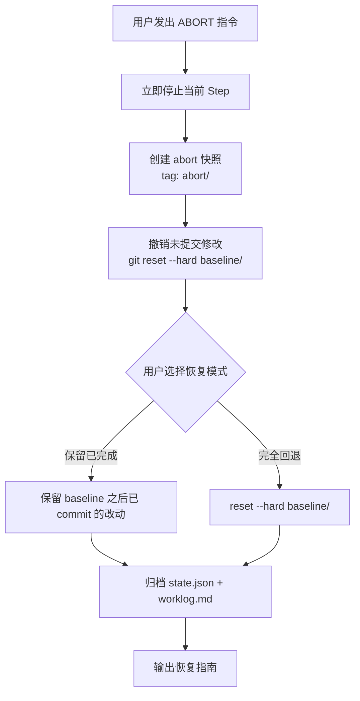

**恢复指南模板 / Restoration Guide Template**:

```markdown
# Task Abort Report: <task-id>

## 终止时间 / Aborted At
2026-09-28T15:30:00+08:00

## 已完成 Step / Completed Steps
- ✅ 1.1 <step-title> (commit: abc1234)
- ✅ 1.2 <step-title> (commit: def5678)
- ⏸ 1.3 <step-title> (aborted, no commit)

## 文件恢复状态 / File Restoration
- 已 reset 到: <commit-hash>
- 已保留的 commit: <list>
- 已撤销的未提交修改: <list>

## 恢复方式 / How to Resume
方式 1: 从 abort 快照继续
  git checkout abort/<task-id>
  # 然后启动新 Agent 会话，加载 state.json

方式 2: 从 baseline 重新开始
  git reset --hard baseline/<task-id>
  # state.json 中 tried_directions 仍保留，避免重复试错

## 归档位置 / Archive Location
- state.json: .harness/archive/<task-id>/state.json
- worklog.md: .harness/archive/<task-id>/worklog.md
- plan.md: .harness/archive/<task-id>/plan.md
- summary.md: (未生成 — 任务未完成)
```

---

## 8. 用户反馈追溯机制 / User Feedback Traceability

### 8.1 设计动机 / Motivation

标准指南第 7 节定义了"Agent 主动咨询用户"的协议，但实际任务执行中，**用户主动提出的修改意见、纠正、追加需求**才是最高频的需求变更来源。如果不固化追溯这些反馈，会出现三类系统性问题：

1. **理解偏差累积 / Cumulative Misunderstanding** — Agent 用自己的话概括用户反馈，每轮交互失真 5-15%，多轮后严重偏离原意。
2. **变更影响不可见 / Invisible Change Impact** — 用户一句"顺便加个限流"，Agent 直接执行，但未追溯该反馈影响了哪些 Step、是否需要更新 plan，导致后续审计困难。
3. **反馈丢失 / Feedback Loss** — 会话重启或上下文压缩后，Agent 完全不记得用户曾提出过关键纠正，重复犯错。

本节定义的反馈追溯机制通过 **"原话归档 + 双向确认 + 影响传播 + 防篡改"** 四道工序消除上述问题。

### 8.2 反馈分级 / Feedback Classification

所有用户输入（除"yes/继续/ok"等简单确认外）必须先分类，再决定处理流程：

| 等级 | 类型 | 识别信号 | 处理流程 |
|---|---|---|---|
| **F1** | 澄清 / Clarification | 用户解释模糊点、回答咨询、补充细节 | 归档 → 复述 → 确认 → 执行单 Step |
| **F2** | 纠正 / Correction | 用户指出 Agent 错误、否定方案 | 归档 → 复述 → 确认 → 回退 → 修正 |
| **F3** | 范围调整 / Scope Change | 新增/删除/修改需求 | 归档 → 复述 → 确认 → 更新 plan Revision History → 执行 |
| **F4** | 方向变更 / Direction Change | 否定整个方向、要求换实现 | 归档 → 复述 → 确认 → tried_directions 记录 → 新方向 |
| **F5** | 终止意图 / Abort Intent | 表达想停止、放弃、改天再做 | 归档 → 复述 → 确认 → 进入 ABORT 流程 |

**自动识别启发式规则**（Agent 必须应用，但不限于）：

- 含 "不对"、"错了"、"反了"、"搞错" → F2
- 含 "顺便"、"另外"、"还要"、"加一个" → F3
- 含 "不要这样"、"换个思路"、"改用" → F4
- 含 "算了"、"不做了"、"停止"、"以后再说" → F5
- 其他模糊输入 → 默认 F1，但 Agent 必须复述确认

### 8.3 反馈处理三步法 / 3-Step Feedback Handling

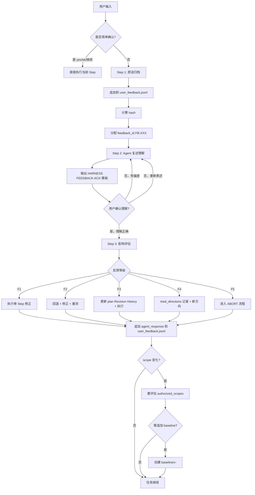

### 8.4 原话归档规范 / Raw Input Archiving

**核心指令 / Core Directive**:
> 用户的反馈**必须逐字归档**，禁止 Agent 概括、改写、翻译、转述。即使反馈含有错别字、口语化表达、中英混杂，也必须原样保留。

**归档要求 / Archiving Requirements**:

1. **逐字保留 / Verbatim** — 不修正错别字、不调整语序、不翻译。
2. **Hash 校验 / Hash Verification** — 计算原话 SHA-256，归档时记录前 16 位，用于后续校验未被修改。
3. **追加式 / Append-Only** — `user_feedback.jsonl` 只允许追加新条目，禁止修改历史。
4. **上下文记录 / Context Capture** — 必须记录反馈触发场景（针对哪个 Step、哪个 commit、哪条咨询）。

**user_feedback.jsonl 完整 Schema**:

```json
{
  "feedback_id": "FB-001",
  "task_id": "TASK-2026-09-28-001",
  "timestamp": "2026-09-28T15:00:00+08:00",
  "type": "F2_correction",
  "trigger_context": {
    "step_id": "3",
    "commit_at_trigger": "abc1234...",
    "artifact_ref": "src/auth/login.py:52",
    "consult_id": "C-001"
  },
  "user_raw_input": "你的 token 验证逻辑搞反了，应该是 exp < now 而不是 exp > now",
  "user_input_hash": "sha256:a1b2c3d4e5f67890",
  "user_input_length": 38,
  "agent_restated_understanding": "我理解您的意思是：(1) 当前 Step 3 中将 exp > now 判断为已过期是错误的；(2) 正确逻辑应为 exp < now 表示已过期。请确认。",
  "user_confirmation": "对，就是这样",
  "confirmed_at": "2026-09-28T15:01:30+08:00",
  "confirmation_hash": "sha256:f9e8d7c6b5a43210",
  "impact_assessment": {
    "affected_steps": ["3", "4"],
    "plan_revision_required": true,
    "scope_change": false,
    "baseline_impact": false,
    "authorized_scopes_change": false
  },
  "agent_response": {
    "action_taken": "rollback to checkpoint/TASK-2026-09-28-001/2, fix login.py:52, re-run pytest",
    "commit_after_fix": "def5678...",
    "verification": "pytest tests/auth/test_login.py (exit=0, 23 passed)",
    "plan_revision": "v1.1",
    "completed_at": "2026-09-28T15:05:00+08:00"
  },
  "archived_at": "2026-09-28T15:05:01+08:00"
}
```

### 8.5 双向确认协议 / Two-Way Confirmation Protocol

**核心指令 / Core Directive**:
> Agent 收到用户反馈后，必须先输出 `[HARNESS][FEEDBACK-ACK]` 消息复述自己的理解，等待用户回复"理解正确"后才能执行。即使用户指令看似明确，仍需复述——这是消除理解偏差的最后一道防线。

**复述模板 / Restatement Template**:

```markdown
[HARNESS][FEEDBACK-ACK] FB-XXX

## 已归档您的反馈 / Your Feedback Archived
- feedback_id: FB-XXX
- archived_at: <ISO8601>
- 原话 / Raw Input: "<逐字复制用户原话>"
- hash: sha256:<前16位>

## 我的理解 / My Understanding
1. <要点1，用 Agent 自己的话复述>
2. <要点2>
3. <要点N>

## 影响评估 / Impact Assessment
- 反馈类型: F2_correction
- 受影响 Step: <list>
- 需要更新 plan.md: 是/否 (Revision History v<old>→v<new>)
- 需要回退到 checkpoint: <tag 或 null>
- 是否影响 authorized_scopes: 是/否
- 是否影响 baseline: 是/否

## 计划响应 / Planned Response
1. <步骤1>
2. <步骤2>

## 请确认 / Please Confirm
- 回复 "理解正确，执行" → 我开始执行
- 回复 "理解有偏差" → 请指出哪里错了，我会重新复述
- 回复 "暂停" → 任务保持当前状态
```

**禁令 / Prohibitions**:
- ❌ 禁止跳过复述直接执行（即使反馈看似明确）
- ❌ 禁止用"我明白了"、"收到"等无具体内容的确认代替结构化复述
- ❌ 禁止在复述中夹带 Agent 自己的假设（如有假设必须显式标注 `ASSUMPTION:`）
- ❌ 禁止在用户确认前修改任何文件

### 8.6 影响传播与 plan.md Revision History / Impact Propagation

**核心指令 / Core Directive**:
> 反馈确认后，若影响范围 ≥1 个 Step，必须更新 `plan.md` 的 Revision History 段，并视情况追加 baseline tag。

**plan.md Revision History 段**:

```markdown
## Revision History

| 版本 | 时间 | 修改者 | 修改内容 | 触发反馈ID | 影响范围 |
|---|---|---|---|---|---|
| v1.0 | 2026-09-28T14:00 | Agent | 初始版本 | - | - |
| v1.1 | 2026-09-28T15:02 | 用户反馈 | 修正 Step 3 token 验证逻辑描述（exp < now 而非 exp > now） | FB-001 | Step 3, 4 |
| v1.2 | 2026-09-28T15:30 | 用户反馈 | 新增 Step 5: 添加限流测试 | FB-002 | 新增 Step 5 |
| v1.3 | 2026-09-28T16:00 | 用户反馈 | 删除 Step 6 的日志增强（用户认为不必要） | FB-003 | 删除 Step 6 |

## Baseline 追加记录

| Baseline Tag | 创建时间 | 触发反馈ID | 说明 |
|---|---|---|---|
| baseline/TASK-2026-09-28-001 | 2026-09-28T14:01 | - | 初始 baseline |
| baseline/TASK-2026-09-28-001-v2 | 2026-09-28T15:35 | FB-002 | 用户新增 Step 5 涉及 authorized_scopes 扩展，追加 baseline |
```

**何时追加 baseline / When to Append Baseline**:

| 条件 | 是否追加 baseline |
|---|---|
| 反馈仅修正现有 Step 的实现细节 | 否 |
| 反馈新增/删除 Step，但都在现有 authorized_scopes 内 | 否 |
| 反馈扩展 authorized_scopes（新增模块/文件路径） | **是** — 追加 `baseline/<task-id>-v<n>` |
| 反馈改变任务目标（objective 字段） | **是** — 创建新 baseline 并归档旧 baseline |
| 反馈要求撤销已完成 Step 的影响 | 视情况，咨询用户 |

### 8.7 反馈归档防篡改 / Tamper Protection

**核心指令 / Core Directive**:
> `user_feedback.jsonl` 必须实现追加式 + Hash 链保护，任何对历史条目的修改都会被检测到。

**Hash 链机制 / Hash Chain Mechanism**:

每条记录包含 `prev_hash` 字段，指向上一条记录的 hash。任何对历史记录的修改都会破坏链条。

```json
{
  "feedback_id": "FB-001",
  "prev_hash": "sha256:0000000000000000",
  "record_hash": "sha256:a1b2c3d4e5f67890",
  ...
}
{
  "feedback_id": "FB-002",
  "prev_hash": "sha256:a1b2c3d4e5f67890",
  "record_hash": "sha256:f9e8d7c6b5a43210",
  ...
}
```

校验脚本见 `harness-whitepaper.md` 第 9 章。

### 8.8 反馈与 Worklog 的关系 / Feedback vs Worklog

| 维度 | worklog.md/jsonl | user_feedback.jsonl |
|---|---|---|
| **记录对象** | Agent 的操作 | 用户的输入 |
| **写入时机** | 每个 Step 开始/结束 | 每次用户反馈 |
| **格式** | 结构化 + 叙述 | 严格 JSONL |
| **追加式** | 是 | 是 |
| **Hash 链** | 否 | **是** |
| **双向确认** | 否 | **是** |
| **影响 plan** | 否 | **是**（通过 Revision History） |

两者互补：worklog 记录"Agent 做了什么"，user_feedback 记录"用户要 Agent 做什么"。两者通过 `feedback_id` 关联——worklog 条目可引用触发它的 feedback_id。

### 8.9 反馈统计与质量评估 / Feedback Statistics

任务总结时必须包含反馈统计：

```markdown
## 反馈统计 / Feedback Statistics

- 总反馈数: 5
- 按类型: F1×2, F2×2, F3×1
- 平均响应时间: 4.5 min
- 一次复述确认率: 80% (4/5, 1 次理解偏差需重新复述)
- 触发 plan revision: 2 次 (v1.1, v1.2)
- 触发 baseline 追加: 1 次 (FB-002)
- 触发回退: 1 次 (FB-001)
- 反馈归档完整率: 100% (5/5, hash 链校验通过)
```

---

## 9. 上下文保护与灾难恢复 / Context Protection & Disaster Recovery

### 9.1 灾难性上下文丢失防护 / Catastrophic Context Loss Prevention

**核心指令 / Core Directive**:
> AI Agent 在长程任务中可能因 token 超限、会话重启、上下文压缩而丢失早期决策。本 Harness 通过强制结构化日志 + 状态文件 + 会话恢复机制，确保即使在新会话中也能完整接续任务。

**三层防护 / Three-Layer Protection**:

1. **Worklog 持续追加 / Append-Only Worklog**
   - 每条 Step 都写入 `worklog.md`，禁止修改历史条目。
   - worklog 同时保存：(a) 人类可读 Markdown；(b) 机器可读 JSONL（`worklog.jsonl`）。

2. **State File 持续更新 / Continuously Updated State**
   - `state.json` 在每个 Step 完成后覆盖写入，记录：当前 Step、任务树、已完成列表、未完成列表、tried_directions、context_summary。
   - `state.json` 与 worklog 互为冗余，前者结构化、后者叙述化。

3. **会话摘要注入 / Session Summary Injection**
   - 每完成 5 个 Step，自动生成 `session_summary.md`，压缩关键决策、证据、未决问题。
   - 新会话启动时，Harness 强制要求 Agent 先读 `state.json` + `worklog.md` + `session_summary.md`，再开始工作。

### 9.2 上下文丢失检测 / Context Loss Detection

Agent 在每个 Step 开始时必须执行自检：

```python
# harness_context_self_check.py
def context_self_check(state: dict) -> list[str]:
    """返回不一致项列表，空列表表示通过。"""
    issues = []

    # 1. 当前 Step 在 worklog 中是否有上一 Step 的完成记录？
    last_worklog_step = read_last_worklog_step()
    if state["current_step"] != last_worklog_step + 1:
        issues.append(
            f"Step gap: state.current_step={state['current_step']} "
            f"but last_worklog_step={last_worklog_step}"
        )

    # 2. baseline tag 是否还在？
    if not git_tag_exists(f"baseline/{state['task_id']}"):
        issues.append(f"Baseline tag missing: baseline/{state['task_id']}")

    # 3. authorized_scopes 是否一致？
    if not verify_authorized_scopes(state["authorized_scopes"]):
        issues.append("authorized_scopes mismatch with filesystem")

    # 4. tried_directions 是否与 worklog 一致？
    if not verify_tried_directions(state["tried_directions"]):
        issues.append("tried_directions inconsistent with worklog")

    return issues
```

若自检发现问题，Agent 必须：
1. 暂停当前 Step。
2. 输出 `[HARNESS][CONTEXT-LOSS-DETECTED]` 标记。
3. 列出不一致项。
4. 询问用户：(a) 以 state.json 为准修复 worklog；(b) 以 worklog 为准修复 state.json；(c) 终止任务。

### 9.3 灾难恢复 Runbook / Disaster Recovery Runbook

灾难恢复完整 Runbook 见 `harness-whitepaper.md` 第 11 章，本节列出关键决策树：

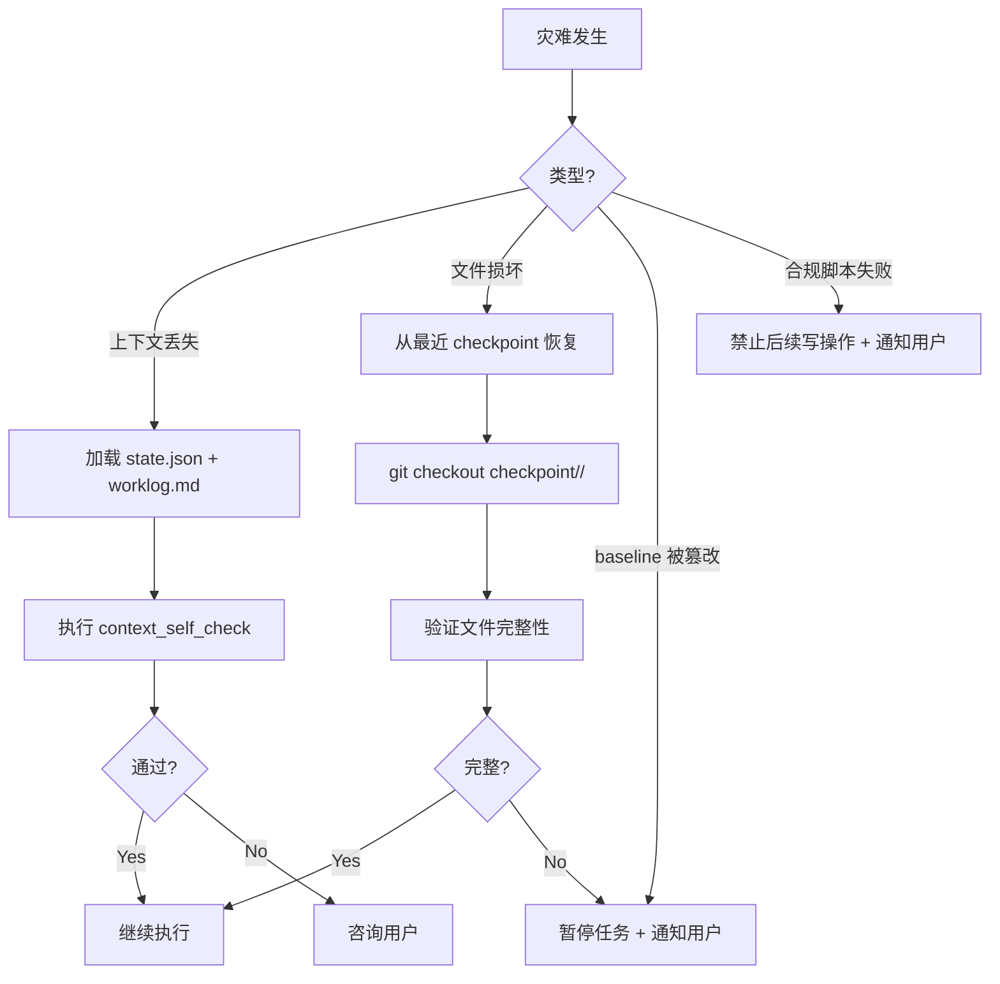

---

## 10. 合规审查框架 / Compliance Review Framework

合规审查是 Harness 的"硬门控"层，独立于 Agent 运行。本节给出框架概览，完整 Python 实现见 `harness-whitepaper.md`。

### 10.1 审查触发时机 / Trigger Points

| 时机 / When | 检查内容 / What |
|---|---|
| Step 开始前 / Pre-step | 路径白名单、虚拟环境、baseline 完整性 |
| 文件写入前 / Pre-write | 敏感信息、语法合规、不可逆操作模式 |
| Commit 前 / Pre-commit | 上述全部 + commit message 格式 |
| Task 完成时 / Task-complete | 全量审查 + 验收标准核对 |

### 10.2 审查结果处理 / Result Handling

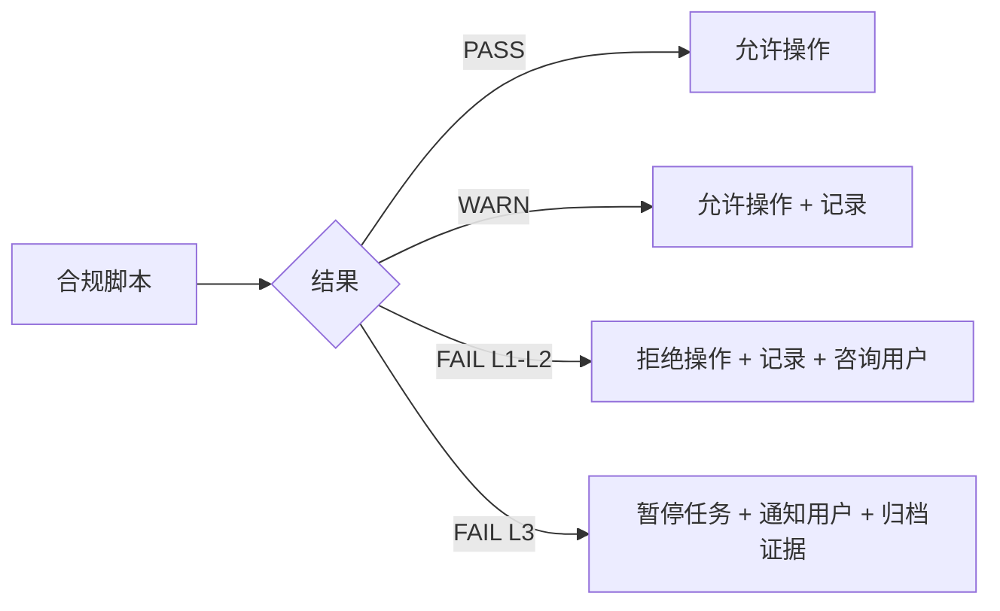

### 10.3 合规报告 / Compliance Report

每次审查后追加到 `compliance_report.json`：

```json
{
  "task_id": "TASK-2026-09-28-001",
  "step_id": "3",
  "timestamp": "2026-09-28T14:32:00+08:00",
  "target_file": "src/auth/login.py",
  "result": "FAIL",
  "violations": [
    {
      "rule": "no_hardcoded_secrets",
      "severity": "L3",
      "line": 52,
      "snippet": "API_KEY = 'sk-xxx'",
      "message": "Hardcoded API key detected"
    }
  ]
}
```

---

## 11. 状态文件 Schema / State File Schema

### 11.1 state.json 完整 Schema

```json
{
  "$schema": "harness-state-v1",
  "task_id": "TASK-2026-09-28-001",
  "task_objective": "修复登录 token 过期判断 bug",
  "status": "IN_PROGRESS | COMPLETED | ABORTED | PAUSED",
  "created_at": "2026-09-28T14:00:00+08:00",
  "updated_at": "2026-09-28T14:32:11+08:00",

  "project_root": "/home/z/my-project",
  "authorized_scopes": ["src/auth/", "tests/auth/"],

  "baseline": {
    "commit": "abc1234...",
    "tag": "baseline/TASK-2026-09-28-001",
    "created_at": "2026-09-28T14:01:00+08:00"
  },

  "task_tree": [
    {
      "step_id": "1",
      "title": "读取 login.py 与相关测试",
      "risk": "L0",
      "status": "COMPLETED",
      "started_at": "...",
      "completed_at": "...",
      "commit": "def5678...",
      "checkpoint_tag": "checkpoint/TASK-2026-09-28-001/1"
    }
  ],

  "current_step": "3",
  "tried_directions": [],

  "user_feedback": {
    "log_file": "user_feedback.jsonl",
    "total_count": 0,
    "last_feedback_id": null,
    "last_hash_chain_head": "sha256:0000000000000000",
    "pending_confirmations": []
  },

  "context_summary": {
    "key_decisions": [
      "选择 normalize 时间戳而非改 token 生成逻辑（理由：影响范围小）"
    ],
    "open_questions": [],
    "evidence_refs": [
      ".harness/artifacts/TASK-2026-09-28-001/pytest-before.xml"
    ]
  },

  "user_authorization": {
    "approved_at": "2026-09-28T14:02:00+08:00",
    "approved_by": "user@example.com",
    "scopes": ["src/auth/", "tests/auth/"],
    "expires_at": "2026-09-29T14:02:00+08:00"
  },

  "compliance": {
    "script_path": "compliance_check.py",
    "script_hash": "sha256:...",
    "last_run": "2026-09-28T14:31:55+08:00",
    "last_result": "PASS"
  },

  "frozen": false,
  "frozen_at": null
}
```

### 11.2 worklog.jsonl Schema

每行一个 JSON 对象，对应 worklog.md 的一条 Step 记录，便于机器解析：

```json
{"step_id":"1","type":"START","ts":"2026-09-28T14:05:00+08:00","task_id":"TASK-...","title":"..."}
{"step_id":"1","type":"EVIDENCE","ts":"...","ref":".harness/artifacts/.../pytest.xml"}
{"step_id":"1","type":"ACTION","ts":"...","commit":"def5678","files":["src/auth/login.py"]}
{"step_id":"1","type":"COMPLIANCE","ts":"...","result":"PASS","violations":[]}
{"step_id":"1","type":"END","ts":"2026-09-28T14:15:00+08:00","status":"COMPLETED"}
```

---

## 12. 决策树图集 / Decision Tree Atlas

### 12.1 总体执行流程 / Overall Execution Flow

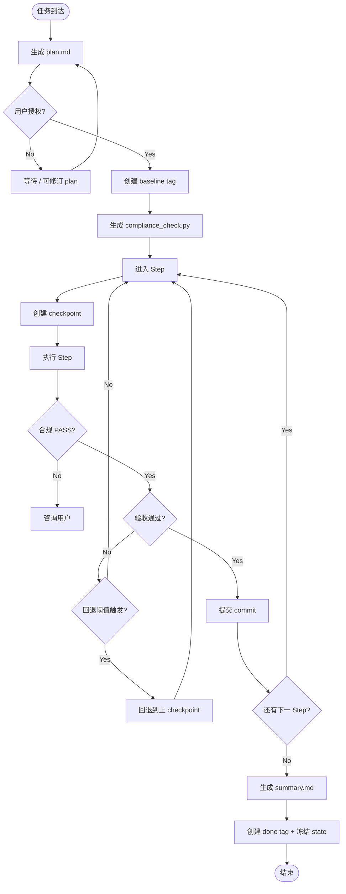

### 12.2 错误处理决策树 / Error Handling Decision Tree

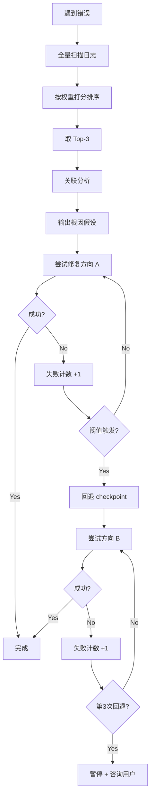

### 12.3 用户咨询决策树 / User Consultation Decision Tree

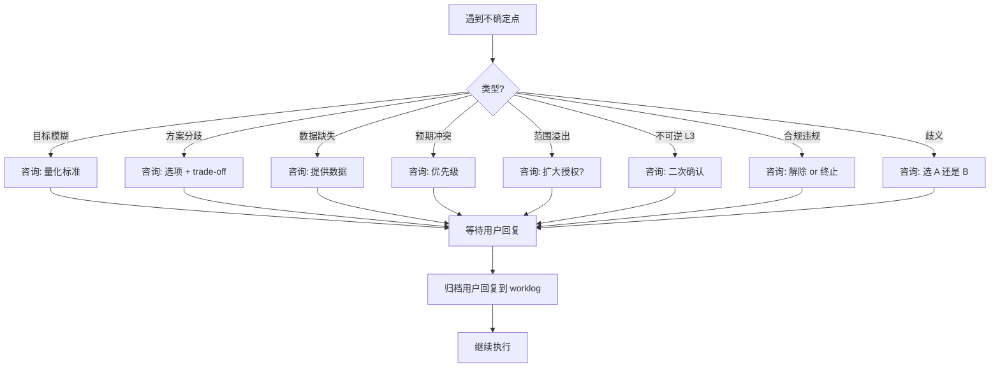

### 12.4 用户反馈处理决策树 / User Feedback Handling Decision Tree

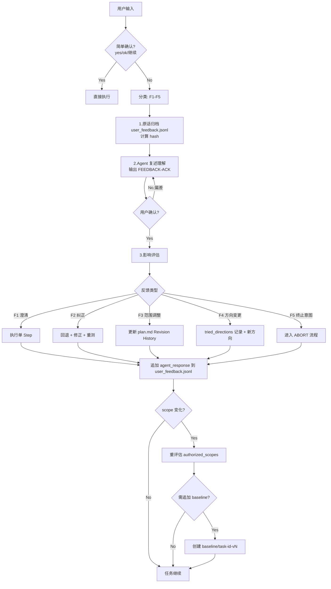

---

## 13. 模板代码库 / Template Library

### 13.1 plan.md 模板

见第 4.2 节。

### 13.2 worklog.md 条目模板

见第 5.1 节。

### 13.3 commit message 模板

见第 5.2 节。

### 13.4 summary.md 模板

见第 5.3 节。

### 13.5 咨询消息模板

见第 7.2 节。

### 13.6 终止恢复模板

见第 7.3 节。

### 13.7 用户反馈归档与确认脚本骨架

```python
# harness_feedback.py — 骨架版，完整版见 whitepaper 第 9 章
"""用户反馈归档与双向确认 / User feedback archiving & two-way confirmation."""
import json
import hashlib
from datetime import datetime, timezone
from pathlib import Path

class FeedbackArchiver:
    """追加式归档用户反馈，含 hash 链防篡改 / Append-only feedback archive with hash chain."""

    def __init__(self, log_path: str = "user_feedback.jsonl",
                 state_path: str = "state.json"):
        self.log_path = Path(log_path)
        self.log_path.touch(exist_ok=True)
        self.state_path = state_path
        self.state = json.load(open(state_path))
        self._ensure_state_field()

    def _ensure_state_field(self):
        if "user_feedback" not in self.state:
            self.state["user_feedback"] = {
                "log_file": str(self.log_path),
                "total_count": 0,
                "last_feedback_id": None,
                "last_hash_chain_head": "sha256:0000000000000000",
                "pending_confirmations": []
            }
            self._save_state()

    def _save_state(self):
        with open(self.state_path, "w") as f:
            json.dump(self.state, f, indent=2, ensure_ascii=False)

    @staticmethod
    def _hash(text: str) -> str:
        return "sha256:" + hashlib.sha256(text.encode("utf-8")).hexdigest()[:16]

    def _next_feedback_id(self) -> str:
        n = self.state["user_feedback"]["total_count"] + 1
        return f"FB-{n:03d}"

    def _last_record_hash(self) -> str:
        """读取 user_feedback.jsonl 最后一行的 record_hash"""
        if not self.log_path.exists() or self.log_path.stat().st_size == 0:
            return "sha256:0000000000000000"
        last_line = None
        with self.log_path.open() as f:
            for line in f:
                if line.strip():
                    last_line = line
        if last_line:
            return json.loads(last_line).get("record_hash", "sha256:0000000000000000")
        return "sha256:0000000000000000"

    def archive_raw_input(
        self,
        user_raw_input: str,
        feedback_type: str,
        trigger_context: dict
    ) -> dict:
        """Step 1: 归档用户原话（在 Agent 复述前） / Step 1: archive raw input."""
        feedback_id = self._next_feedback_id()
        prev_hash = self._last_record_hash()

        record = {
            "feedback_id": feedback_id,
            "task_id": self.state.get("task_id"),
            "timestamp": datetime.now(timezone.utc).isoformat(),
            "type": feedback_type,
            "trigger_context": trigger_context,
            "user_raw_input": user_raw_input,
            "user_input_hash": self._hash(user_raw_input),
            "user_input_length": len(user_raw_input),
            "prev_hash": prev_hash,
            # 待用户确认后填入的字段
            "agent_restated_understanding": None,
            "user_confirmation": None,
            "confirmed_at": None,
            "impact_assessment": None,
            "agent_response": None,
            "archived_at": None,
        }
        record["record_hash"] = self._hash(json.dumps(record, sort_keys=True))

        # 追加写入
        with self.log_path.open("a") as f:
            f.write(json.dumps(record, ensure_ascii=False) + "\n")

        # 更新 state
        uf = self.state["user_feedback"]
        uf["total_count"] += 1
        uf["last_feedback_id"] = feedback_id
        uf["last_hash_chain_head"] = record["record_hash"]
        uf["pending_confirmations"].append(feedback_id)
        self._save_state()

        return record

    def record_agent_restatement(self, feedback_id: str,
                                  restated_understanding: str):
        """Step 2: 记录 Agent 的复述，等待用户确认 / Step 2: record restatement."""
        # 由于追加式约束，复述作为单独的"补充记录"写入
        prev_hash = self._last_record_hash()
        record = {
            "feedback_id": feedback_id,
            "type": "restatement",
            "timestamp": datetime.now(timezone.utc).isoformat(),
            "agent_restated_understanding": restated_understanding,
            "prev_hash": prev_hash,
        }
        record["record_hash"] = self._hash(json.dumps(record, sort_keys=True))
        with self.log_path.open("a") as f:
            f.write(json.dumps(record, ensure_ascii=False) + "\n")

        uf = self.state["user_feedback"]
        uf["last_hash_chain_head"] = record["record_hash"]
        self._save_state()

    def record_user_confirmation(self, feedback_id: str,
                                  user_confirmation: str,
                                  impact_assessment: dict,
                                  agent_response: dict):
        """Step 3: 用户确认后，追加完整响应记录 / Step 3: append response record."""
        prev_hash = self._last_record_hash()
        record = {
            "feedback_id": feedback_id,
            "type": "response",
            "timestamp": datetime.now(timezone.utc).isoformat(),
            "user_confirmation": user_confirmation,
            "confirmation_hash": self._hash(user_confirmation),
            "impact_assessment": impact_assessment,
            "agent_response": agent_response,
            "archived_at": datetime.now(timezone.utc).isoformat(),
            "prev_hash": prev_hash,
        }
        record["record_hash"] = self._hash(json.dumps(record, sort_keys=True))
        with self.log_path.open("a") as f:
            f.write(json.dumps(record, ensure_ascii=False) + "\n")

        uf = self.state["user_feedback"]
        uf["last_hash_chain_head"] = record["record_hash"]
        if feedback_id in uf["pending_confirmations"]:
            uf["pending_confirmations"].remove(feedback_id)
        self._save_state()

    def verify_hash_chain(self) -> list[str]:
        """校验 hash 链完整性 / Verify hash chain integrity."""
        issues = []
        prev = "sha256:0000000000000000"
        with self.log_path.open() as f:
            for i, line in enumerate(f, 1):
                if not line.strip():
                    continue
                try:
                    rec = json.loads(line)
                except json.JSONDecodeError as e:
                    issues.append(f"Line {i}: JSON decode error: {e}")
                    continue
                if rec.get("prev_hash") != prev:
                    issues.append(
                        f"Line {i} ({rec.get('feedback_id','?')}): "
                        f"prev_hash mismatch. Expected {prev[:24]}..., "
                        f"got {rec.get('prev_hash','?')[:24]}..."
                    )
                    break
                prev = rec.get("record_hash", prev)
        return issues


# ============ 用法示例 / Usage Example ============
if __name__ == "__main__":
    archiver = FeedbackArchiver()

    # 模拟用户反馈
    raw = "你的 token 验证逻辑搞反了，应该是 exp < now 而不是 exp > now"
    record = archiver.archive_raw_input(
        user_raw_input=raw,
        feedback_type="F2_correction",
        trigger_context={
            "step_id": "3",
            "commit_at_trigger": "abc1234",
            "artifact_ref": "src/auth/login.py:52"
        }
    )
    print(f"Archived: {record['feedback_id']}")
    print(f"Hash: {record['user_input_hash']}")

    # Agent 输出复述模板，等待用户确认
    restatement = (
        "我理解您的意思是：(1) 当前 Step 3 中将 exp > now 判断为已过期是错误的；"
        "(2) 正确逻辑应为 exp < now 表示已过期。请确认。"
    )
    archiver.record_agent_restatement(record["feedback_id"], restatement)
    print("[HARNESS][FEEDBACK-ACK] Waiting for user confirmation...")

    # 用户确认后
    # archiver.record_user_confirmation(
    #     feedback_id="FB-001",
    #     user_confirmation="对，就是这样",
    #     impact_assessment={...},
    #     agent_response={...}
    # )

    # 校验 hash 链
    issues = archiver.verify_hash_chain()
    if issues:
        print("[HARNESS][FAIL] Hash chain broken:")
        for i in issues:
            print(f"  - {i}")
    else:
        print("[HARNESS][OK] Hash chain verified.")
```

### 13.8 Python 合规检查脚本骨架

```python
# compliance_check.py — 骨架版，完整版见 whitepaper 第 9 章
from pathlib import Path
import re, json, ast, sys

class ComplianceChecker:
    def __init__(self, state_path: str = "state.json"):
        self.state = json.load(open(state_path))
        self.violations = []

    def check_path_whitelist(self, file_path: str) -> bool:
        for scope in self.state["authorized_scopes"]:
            if file_path.startswith(scope):
                return True
        self.violations.append({
            "rule": "path_whitelist",
            "severity": "L2",
            "file": file_path,
            "message": f"File {file_path} outside authorized scopes"
        })
        return False

    def check_no_secrets(self, content: str) -> bool:
        patterns = [
            (r'sk-[a-zA-Z0-9]{20,}', 'openai_key'),
            (r'AKIA[A-Z0-9]{16}', 'aws_access_key'),
            (r'-----BEGIN (RSA|EC) PRIVATE KEY-----', 'private_key'),
            (r'password\s*=\s*["\'][^"\']{8,}["\']', 'hardcoded_password'),
        ]
        ok = True
        for pat, name in patterns:
            for m in re.finditer(pat, content):
                self.violations.append({
                    "rule": "no_hardcoded_secrets",
                    "severity": "L3",
                    "match": name,
                    "snippet": m.group()[:20] + "..."
                })
                ok = False
        return ok

    def check_syntax(self, file_path: str, content: str) -> bool:
        if file_path.endswith('.py'):
            try:
                ast.parse(content)
            except SyntaxError as e:
                self.violations.append({
                    "rule": "syntax_valid",
                    "severity": "L2",
                    "file": file_path,
                    "line": e.lineno,
                    "message": str(e)
                })
                return False
        return True

    def check_irreversible_patterns(self, content: str) -> bool:
        bad_patterns = [
            r'rm\s+-rf\s+/',
            r'DROP\s+(TABLE|DATABASE)',
            r'git\s+push\s+.*--force',
            r'>\s*/dev/sd[a-z]',
        ]
        ok = True
        for pat in bad_patterns:
            if re.search(pat, content, re.IGNORECASE):
                self.violations.append({
                    "rule": "irreversible_operation",
                    "severity": "L3",
                    "pattern": pat
                })
                ok = False
        return ok

    def review(self, file_path: str, new_content: str) -> dict:
        self.violations = []
        self.check_path_whitelist(file_path)
        self.check_no_secrets(new_content)
        self.check_syntax(file_path, new_content)
        self.check_irreversible_patterns(new_content)
        return {
            "passed": len(self.violations) == 0,
            "violations": self.violations
        }

if __name__ == "__main__":
    checker = ComplianceChecker()
    # 用法: python compliance_check.py <file> [content_file]
    target = sys.argv[1]
    content = open(sys.argv[2] if len(sys.argv) > 2 else target).read()
    result = checker.review(target, content)
    print(json.dumps(result, indent=2))
    sys.exit(0 if result["passed"] else 1)
```

### 13.8 Git pre-commit Hook

```bash
#!/usr/bin/env bash
# .git/hooks/pre-commit — 由 Harness 自动安装

set -e
STATE_FILE="state.json"
if [ ! -f "$STATE_FILE" ]; then
  echo "[HARNESS][WARN] state.json not found, skipping harness checks."
  exit 0
fi

# 1. 阻止修改 baseline tag 指向的 commit
TASK_ID=$(python -c "import json;print(json.load(open('$STATE_FILE'))['task_id'])")
BASELINE_TAG="baseline/$TASK_ID"
if git tag -l "$BASELINE_TAG" | grep -q .; then
  BASELINE_COMMIT=$(git rev-parse "${BASELINE_TAG}^{commit}")
  # 检查本次 commit 是否试图 rewrite baseline 历史
  if git rev-list --count "$BASELINE_COMMIT..HEAD" 2>/dev/null; then
    : # ok, HEAD is ahead of baseline
  fi
fi

# 2. 对暂存文件逐个跑合规检查
for FILE in $(git diff --cached --name-only --diff-filter=ACM); do
  TMP=$(mktemp)
  git show ":$FILE" > "$TMP"
  if ! python compliance_check.py "$FILE" "$TMP" > /dev/null 2>&1; then
    echo "[HARNESS][FAIL] Compliance check failed for: $FILE"
    rm -f "$TMP"
    exit 1
  fi
  rm -f "$TMP"
done

# 3. 校验 commit message 格式（在 commit-msg hook 中实现）
echo "[HARNESS][OK] Pre-commit checks passed."
```

### 13.9 状态恢复脚本

```python
# scripts/harness_resume.py — 在新会话开始时运行
import json, sys
from pathlib import Path

def resume():
    if not Path("state.json").exists():
        print("[HARNESS][INFO] No state.json found. Starting fresh task.")
        return

    state = json.load(open("state.json"))

    if state.get("frozen"):
        print(f"[HARNESS][INFO] Task {state['task_id']} is frozen (completed).")
        return

    print(f"[HARNESS][RESUME] Resuming task {state['task_id']}")
    print(f"  Objective: {state['task_objective']}")
    print(f"  Status: {state['status']}")
    print(f"  Current step: {state['current_step']}")
    print(f"  Baseline: {state['baseline']['tag']} @ {state['baseline']['commit'][:8]}")
    print(f"  Authorized scopes: {state['authorized_scopes']}")

    if state.get("tried_directions"):
        print(f"\n  Previously tried directions ({len(state['tried_directions'])}):")
        for d in state["tried_directions"]:
            print(f"    - {d['direction']} (rolled back: {d['trigger']})")

    # 强制读取 worklog
    if Path("worklog.md").exists():
        print("\n  Last 3 worklog entries:")
        # 简化：tail 30 行
        lines = open("worklog.md").read().splitlines()
        for line in lines[-30:]:
            print(f"    {line}")

    print("\n[HARNESS][ACTION] Confirm to resume? (yes/no)")
    if input().strip().lower() != "yes":
        sys.exit(0)

if __name__ == "__main__":
    resume()
```

---

## 14. 反模式清单 / Anti-Pattern Checklist

以下行为**严格禁止**，违反任一项即视为 Harness 失效：

> The following behaviors are strictly forbidden. Violating any item constitutes Harness failure.

### 14.1 安全反模式 / Safety Anti-Patterns

- ❌ **未创建 checkpoint 即修改文件** / Modifying files without creating a checkpoint first.
- ❌ **使用系统 Python 而非项目 venv** / Using system Python instead of project venv.
- ❌ **修改 `authorized_scopes` 外的路径** / Modifying paths outside authorized scopes.
- ❌ **绕过合规审查直接写文件** / Writing files bypassing compliance review.
- ❌ **使用 `--force` push 或 `--no-verify` commit** / Using `--force` push or `--no-verify` commit.
- ❌ **删除或移动 baseline tag** / Deleting or moving the baseline tag.
- ❌ **硬编码 API key、密码、token** / Hardcoding API keys, passwords, or tokens.

### 14.2 可回溯性反模式 / Traceability Anti-Patterns

- ❌ **跳过 Step 不记录 worklog** / Skipping Step without worklog entry.
- ❌ **修改历史 worklog 条目** / Modifying historical worklog entries.
- ❌ **使用 "已处理" 等无证据描述** / Using vague descriptions like "handled" without evidence.
- ❌ **commit message 缺失 Task-ID / Step-ID** / Commit message missing Task-ID / Step-ID.
- ❌ **未生成 summary.md 即标记任务完成** / Marking task complete without summary.md.

### 14.3 决策反模式 / Decision Anti-Patterns

- ❌ **看到第一条错误就开始修** / Fixing the first error seen without scanning the full log.
- ❌ **超过回退阈值仍硬刚** / Persisting beyond rollback thresholds.
- ❌ **回退后再次尝试相同方向** / Retrying the same direction after rollback.
- ❌ **未输出根因假设就动手** / Acting without articulating a root cause hypothesis.

### 14.4 人机交互反模式 / Interaction Anti-Patterns

- ❌ **使用 "我猜测"、"可能是"** / Using "I guess" / "maybe" without evidence.
- ❌ **遇到模糊点自主决定** / Making autonomous decisions at ambiguous points.
- ❌ **未咨询用户即执行 L3 操作** / Executing L3 operations without consultation.
- ❌ **用户发出 ABORT 后继续执行** / Continuing after user issues ABORT.
- ❌ **未输出恢复指南即关闭会话** / Closing session without outputting restoration guide.

### 14.5 用户反馈追溯反模式 / Feedback Traceability Anti-Patterns

- ❌ **state.json 长时间不更新** / state.json not updated for extended periods.
- ❌ **会话开始未读 state.json** / Starting session without reading state.json.
- ❌ **未检测上下文不一致** / Failing to detect context inconsistencies.
- ❌ **灾难恢复后未通知用户** / Resuming after disaster recovery without user notification.

---

## 15. 评估指标 / Evaluation Metrics

### 15.1 任务级指标 / Task-Level Metrics

| 指标 / Metric | 定义 / Definition | 目标值 / Target |
|---|---|---|
| **任务成功率 / Task Success Rate** | `COMPLETED` 任务数 / 总任务数 | ≥ 90% |
| **首次回退率 / First-Pass Rollback Rate** | 触发回退的任务数 / 总任务数 | ≤ 30% |
| **平均 Step 数 / Avg Steps per Task** | 总 Step 数 / 总任务数 | 视任务复杂度 |
| **平均用户介入次数 / Avg User Interventions** | 总介入次数 / 总任务数 | ≤ 5 |
| **平均合规违规次数 / Avg Compliance Violations** | 总违规数 / 总任务数 | ≤ 1 |
| **回退后成功率 / Post-Rollback Success Rate** | 回退后最终 COMPLETED 的任务 / 触发回退的任务 | ≥ 70% |

### 15.2 Step 级指标 / Step-Level Metrics

| 指标 / Metric | 定义 / Definition | 目标值 / Target |
|---|---|---|
| **Step 完成率 / Step Completion Rate** | COMPLETED Step 数 / 总 Step 数 | ≥ 95% |
| **平均 Step 用时 / Avg Step Duration** | 总用时 / Step 数 | ≤ 30 min |
| **合规 PASS 率 / Compliance Pass Rate** | PASS 次数 / 总检查次数 | ≥ 98% |
| **Checkpoint 创建率 / Checkpoint Creation Rate** | 实际创建 / 应创建 | 100% |

### 15.3 安全性指标 / Safety Metrics

| 指标 / Metric | 定义 / Definition | 目标值 / Target |
|---|---|---|
| **L3 操作合规率 / L3 Compliance Rate** | 经用户确认的 L3 操作 / 全部 L3 操作 | 100% |
| **Baseline 完整率 / Baseline Integrity Rate** | 未被篡改的 baseline / 全部 baseline | 100% |
| **路径越界次数 / Path Boundary Violations** | 越界写操作总数 | 0 |
| **敏感信息泄露次数 / Secret Leakage Count** | 落盘的敏感信息条数 | 0 |

### 15.4 上下文保护指标 / Context Protection Metrics

| 指标 / Metric | 定义 / Definition | 目标值 / Target |
|---|---|---|
| **会话续接成功率 / Session Resume Success Rate** | 成功续接的会话 / 触发续接的会话 | ≥ 95% |
| **上下文丢失检测率 / Context Loss Detection Rate** | 检测到的丢失 / 实际丢失 | ≥ 90% |
| **Worklog 完整率 / Worklog Completeness** | 有完整记录的 Step / 总 Step | 100% |

### 15.5 用户反馈追溯指标 / Feedback Traceability Metrics

| 指标 / Metric | 定义 / Definition | 目标值 / Target |
|---|---|---|
| **反馈归档率 / Feedback Archive Rate** | 已归档反馈数 / 用户实际提出反馈数 | 100% |
| **一次复述确认率 / First-Pass Acknowledgment Rate** | 一次复述即被用户确认的反馈 / 总反馈 | ≥ 85% |
| **反馈响应时间 / Feedback Response Time** | 从反馈归档到 agent_response 完成的中位时间 | ≤ 10 min |
| **plan revision 一致率 / Plan Revision Consistency** | 触发 plan revision 的反馈 / 实际写入 Revision History 的次数 | 100% |
| **Hash 链完整率 / Hash Chain Integrity** | 通过 verify_hash_chain 的任务 / 总任务 | 100% |
| **反馈触发回退的根因发现率** | 反馈触发回退后，是否在根因日志中记录了该反馈 | 100% |

### 15.6 评估脚本骨架 / Evaluation Script Skeleton

```python
# scripts/harness_evaluate.py
import json
from pathlib import Path
from collections import Counter

def evaluate(task_dir: str):
    state = json.load(open(f"{task_dir}/state.json"))
    worklog = open(f"{task_dir}/worklog.jsonl").readlines()
    compliance = json.load(open(f"{task_dir}/compliance_report.json"))

    metrics = {
        "task_success": state["status"] == "COMPLETED",
        "step_count": len(state["task_tree"]),
        "completed_steps": sum(1 for s in state["task_tree"] if s["status"] == "COMPLETED"),
        "user_interventions": sum(1 for l in worklog if '"type":"CONSULT"' in l),
        "compliance_violations": len(compliance.get("violations", [])),
        "rollbacks": len(state.get("tried_directions", [])),
        "frozen": state.get("frozen", False),
    }
    metrics["step_completion_rate"] = metrics["completed_steps"] / max(metrics["step_count"], 1)
    metrics["task_success_rate"] = 1.0 if metrics["task_success"] else 0.0

    print(json.dumps(metrics, indent=2))
    return metrics

if __name__ == "__main__":
    evaluate(sys.argv[1] if len(sys.argv) > 1 else ".")
```

---

## 16. 加载指南 / Loading Guide

### 16.1 三种加载方式 / Three Loading Modes

**模式 A：完整 Harness / Full Harness**
- 加载本指南全文 + whitepaper 全集。
- 适用于：关键任务、生产环境、不熟悉的项目。

**模式 B：精简 Harness / Lightweight Harness**
- 仅加载 `harness-quick-reference.md`。
- 适用于：日常开发、低风险任务、信任度高的项目。

**模式 C：渐进式 / Progressive**
- 任务开始用 B，遇 L2+ 操作切换 A。
- 适用于：大多数常规任务。

### 16.2 System Prompt 注入示例 / System Prompt Injection

```
你是一个被 Harness 约束的 AI Coding Agent。请严格遵守以下规则：

1. 任何 L1+ 操作前必须先创建 checkpoint（git tag + state.json snapshot）。
2. 任何 L2+ 操作必须暂停等待用户确认，并使用 [HARNESS][CONSULT] 模板咨询。
3. **任何文件修改必须通过 harness_write.py / harness_delete.py / harness_move.py 执行**，
   禁止直接调用 open()/Write/Edit/os.remove()/os.rename() 等方式修改文件。
4. 每个 Step 必须在 worklog.md 追加结构化记录。
5. 遇到错误必须先全量扫描日志并打分排序，禁止"看到第一条错误就开始修"。
6. 连续 3 次失败 / 30 min / 10 文件 / 500 LOC / 5 次介入任一阈值触发即回退。
7. 遇到 8 类模糊分歧点必须强制咨询用户。
8. 用户发出 ABORT 必须立即停止并执行恢复还原流程。
9. 每个会话开始必须先读 state.json + worklog.md 再开始工作。
10. 所有结论必须有证据，禁用 "我猜测"、"可能是" 等表述。
11. 用户提出的任何修改意见/纠正/调整必须先原话归档到 user_feedback.jsonl，
    然后输出 [HARNESS][FEEDBACK-ACK] 复述理解，等用户确认"理解正确"后才能执行。
    反馈影响 ≥1 Step 时同步更新 plan.md 的 Revision History。
12. pre-commit hook 会自动拦截任何未经 harness_write.py 写入的修改。

完整规则见 harness-prompt-engineering.md。
```

### 16.3 启动检查清单 / Startup Checklist

```markdown
- [ ] 已加载 harness-quick-reference.md 到 system prompt
- [ ] 已运行 scripts/harness_resume.py
- [ ] state.json 已存在或已创建
- [ ] worklog.md 已存在或已创建
- [ ] user_feedback.jsonl 已存在或已创建（含 hash 链初始化）
- [ ] 当前在项目 venv 内（which python 验证）
- [ ] compliance_check.py 已根据任务生成
- [ ] 用户已审批 plan.md（APPROVED + 签字）
- [ ] plan.md 含 Revision History 段（即使是初始版本 v1.0）
- [ ] baseline tag 已创建
- [ ] authorized_scopes 已确认
```

---

## 附录 A：术语对照表 / Appendix A: Glossary

| 中文 | English | 缩写 |
|---|---|---|
| 任务 | Task | - |
| 步骤 | Step | - |
| 检查点 | Checkpoint | CP |
| 基线 | Baseline | BL |
| 状态文件 | State File | SF |
| 工作日志 | Worklog | WL |
| 用户反馈日志 | User Feedback Log | UFL |
| 证据 | Evidence | EV |
| 门控 | Gate | G |
| 合规脚本 | Compliance Script | CS |
| 恢复点 | Recovery Point | RP |
| 回退 | Rollback | RB |
| 反馈 | Feedback | FB |
| 复述确认 | Restatement Confirmation | RC |

---

## 附录 B：版本历史 / Appendix B: Changelog

| 版本 | 日期 | 变更 |
|---|---|---|
| 1.0.0 | 2026-09-28 | 初始版本，包含安全性、可回溯性、问题分析、人机交互、上下文保护五大模块 |
| 1.1.0 | 2026-09-28 | 新增第 8 节"用户反馈追溯机制"：反馈分级 F1-F5、原话归档+hash 链、双向确认协议、plan.md Revision History、影响传播与 baseline 追加规则；新增 user_feedback.jsonl 文件、FeedbackArchiver 脚本、反馈处理决策树、反馈追溯反模式与评估指标 |
| 1.3.0 | 2026-09-28 | **核心约束升级**：新增第 4.5 节"文件修改准入门控"。Agent 不再允许直接调用 `open()/Write/Edit` 等方式修改文件，必须通过 `harness_write.py`（创建/覆盖/追加）、`harness_delete.py`（L3 删除）、`harness_move.py`（移动/重命名）三个唯一入口执行。脚本内部完成合规审查 + checkpoint 验证 + baseline 校验 + 路径白名单检查后写入，并自动记录到 `write_manifest.jsonl`。pre-commit hook 新增 manifest 校验，自动拦截任何未经脚本写入的修改。 |

---

> **下一步建议 / Next Steps**:
> 1. 阅读 `harness-quick-reference.md` 获取可加载到 system prompt 的精简版。
> 2. 阅读 `harness-whitepaper.md` 获取完整 Python 脚本、灾难恢复 Runbook、Case Study。
> 3. 将本指南放在项目根目录 `HARNESS.md`，让 Agent 在每次会话开始时自动读取。
