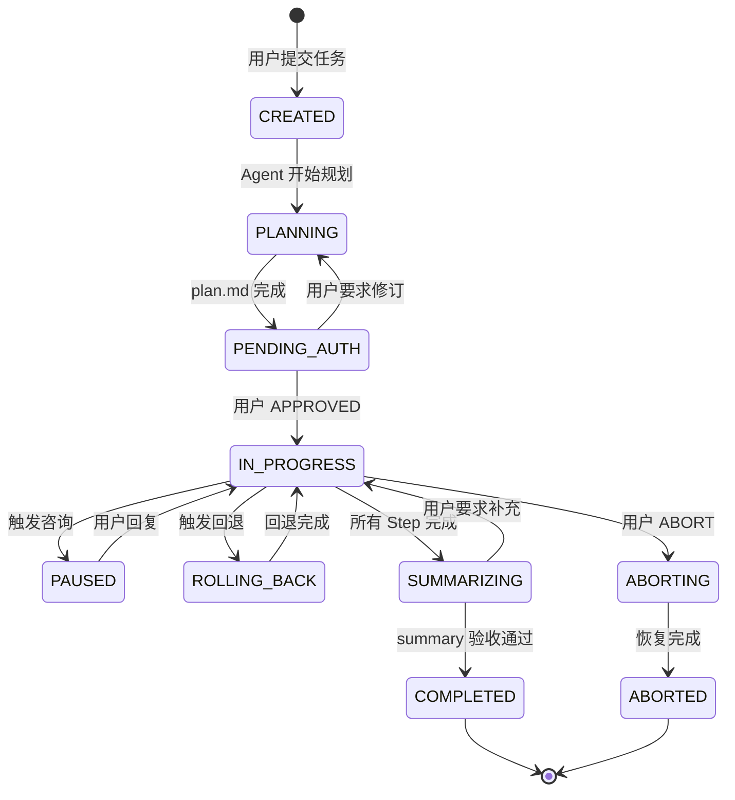
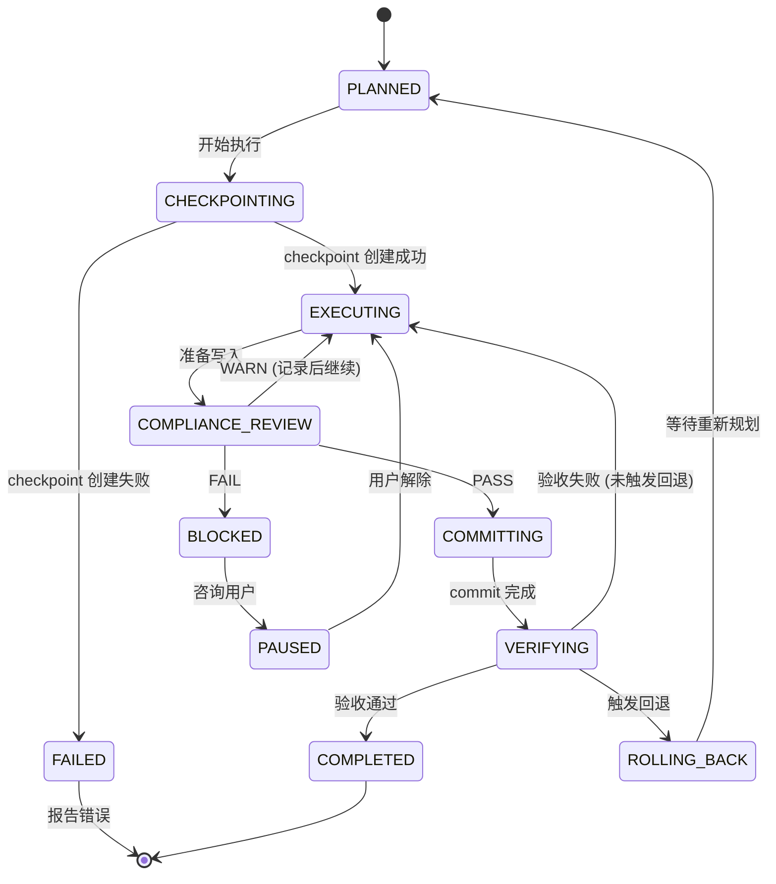
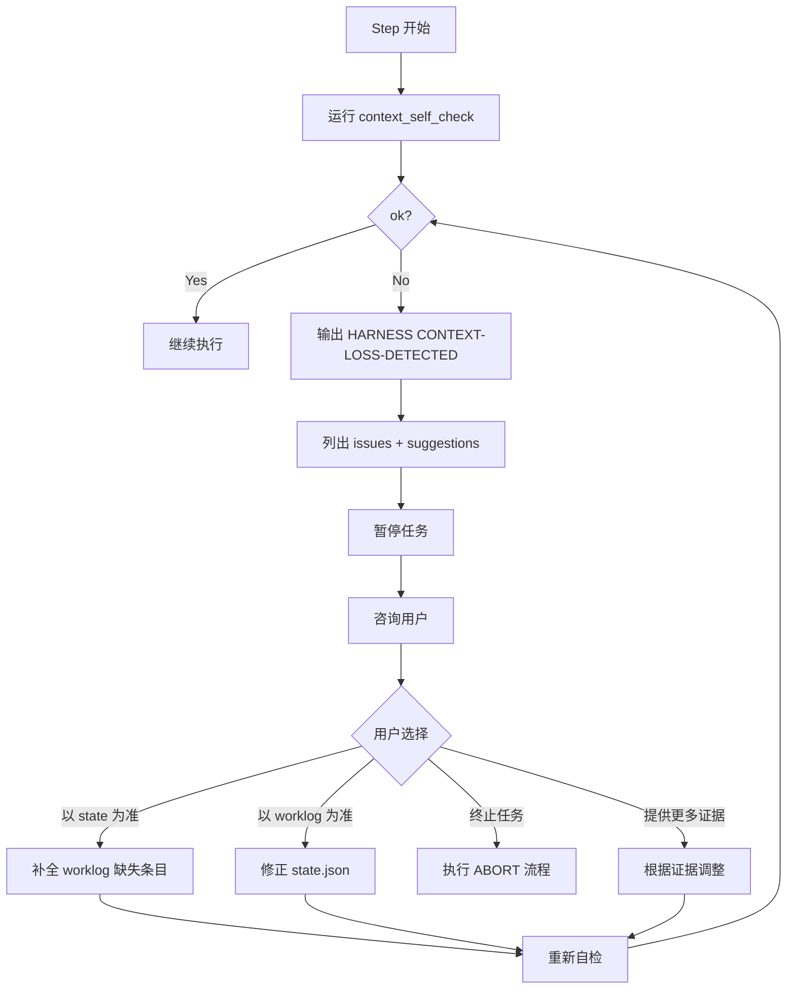
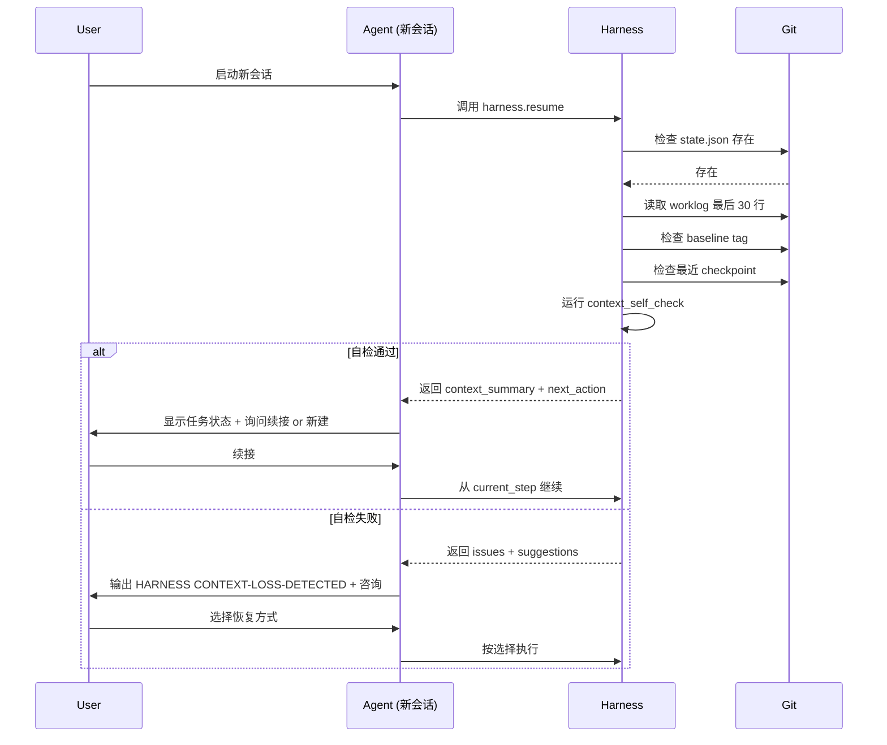

# AI Coding Harness — 深度白皮书
# AI Coding Harness — In-Depth Whitepaper

> **版本 / Version**: 2.0.0
> **状态 / Status**: Reference Implementation
> **定位 / Scope**: 提供完整协议规范、Python 合规脚本全集、灾难恢复 Runbook、Case Study
> **配套 / Companion**:
> - 标准指南 / Standard Guide: `harness-prompt-engineering.md`
> - 精简参考卡 / Quick Reference: `harness-quick-reference.md`
>
> **阅读顺序 / Reading Order**:
> 1. 先读 `harness-quick-reference.md`（速查）
> 2. 再读 `harness-prompt-engineering.md`（标准指南）
> 3. 实施时参考本白皮书（深度实现）

---

## 目录 / Table of Contents

1. [白皮书定位与范围 / Scope](#1-白皮书定位与范围--scope)
2. [Harness 完整协议规范 / Full Protocol Spec](#2-harness-完整协议规范--full-protocol-spec)
3. [工具协议 Schema / Tool Protocol Schema](#3-工具协议-schema--tool-protocol-schema)
4. [合规脚本全集 / Complete Compliance Scripts](#4-合规脚本全集--complete-compliance-scripts)
5. [Checkpoint 与 Git 集成 / Checkpoint & Git Integration](#5-checkpoint-与-git-集成--checkpoint--git-integration)
6. [状态机实现 / State Machine Implementation](#6-状态机实现--state-machine-implementation)
7. [上下文保护机制详解 / Context Protection Deep Dive](#7-上下文保护机制详解--context-protection-deep-dive)
8. [灾难恢复 Runbook / Disaster Recovery Runbook](#8-灾难恢复-runbook--disaster-recovery-runbook)
9. [完整 Python 合规审查脚本 / Full Compliance Checker](#9-完整-python-合规审查脚本--full-compliance-checker)
10. [用户反馈追溯完整实现 / User Feedback Traceability Full Implementation](#10-用户反馈追溯完整实现--user-feedback-traceability-full-implementation)
11. [会话续接协议 / Session Resume Protocol](#11-会话续接协议--session-resume-protocol)
12. [评估与监控 / Evaluation & Monitoring](#12-评估与监控--evaluation--monitoring)
13. [Case Study 1: 全栈开发任务](#13-case-study-1-全栈开发任务)
14. [Case Study 2: Bug 修复任务](#14-case-study-2-bug-修复任务)
15. [Case Study 3: 重构迁移任务](#15-case-study-3-重构迁移任务)
16. [Case Study 4: 灾难恢复场景](#16-case-study-4-灾难恢复场景)
17. [Case Study 5: 用户反馈追溯场景](#17-case-study-5-用户反馈追溯场景)
18. [与现有 Agent 框架集成 / Integration with Existing Agents](#18-与现有-agent-框架集成--integration-with-existing-agents)
19. [已知限制与未来工作 / Known Limitations & Future Work](#19-已知限制与未来工作--known-limitations--future-work)
20. [通用 Python 脚本集 / Utility Python Scripts](#20-通用-python-脚本集--utility-python-scripts)
21. [附录：完整文件树 / Appendix: Full File Tree](#21-附录完整文件树--appendix-full-file-tree)

---

## 1. 白皮书定位与范围 / Scope

### 1.1 与标准指南的关系 / Relationship with Standard Guide

`harness-prompt-engineering.md`（标准指南）回答"做什么、不做什么"。本白皮书回答"如何做、为什么这么做"。

| 维度 | 标准指南 / Standard Guide | 深度白皮书 / Whitepaper |
|---|---|---|
| 目标读者 | Agent + 用户 | 实施工程师 + Agent 框架开发者 |
| 内容深度 | 规则、模板、流程图 | 协议规范、完整脚本、Runbook |
| 代码量 | 骨架 + 模板 | 生产可用完整实现 |
| Case Study | 无 | 4 个完整案例 |
| 灾难恢复 | 决策树 | 完整 Runbook + 脚本 |

### 1.2 适用场景 / Applicable Scenarios

本白皮书适用于：

- **生产环境部署 / Production deployment** — 需要完整可执行的合规脚本与监控。
- **Agent 框架开发 / Agent framework development** — 需要参考工具协议、状态机实现。
- **审计与合规 / Audit & compliance** — 需要查阅完整规则集与证据链设计。
- **灾难演练 / Disaster drill** — 需要按 Runbook 演练恢复流程。

### 1.3 不适用场景 / Out of Scope

- 单次小型脚本任务（用精简参考卡即可）
- 个人玩具项目（不需要完整 Harness）
- 沙箱实验环境（无生产数据风险）

---

## 2. Harness 完整协议规范 / Full Protocol Spec

### 2.1 协议层次 / Protocol Layers

Harness 协议分为 5 层，每层有明确的输入输出与故障语义：

```
┌─────────────────────────────────────────────────┐
│  L5: 用户交互层 / User Interaction Layer         │  人类可读
│  ─────────────────────────────────────────       │  模板化咨询消息
├─────────────────────────────────────────────────┤
│  L4: 决策层 / Decision Layer                    │  根因分析
│  ─────────────────────────────────────────       │  回退决策
├─────────────────────────────────────────────────┤
│  L3: 工具协议层 / Tool Protocol Layer           │  harness.checkpoint
│  ─────────────────────────────────────────       │  harness.compliance_review
├─────────────────────────────────────────────────┤
│  L2: 状态机层 / State Machine Layer             │  state.json
│  ─────────────────────────────────────────       │  worklog.md/jsonl
├─────────────────────────────────────────────────┤
│  L1: 基础设施层 / Infrastructure Layer           │  Git
│  ─────────────────────────────────────────       │  venv / docker
└─────────────────────────────────────────────────┘
```

### 2.2 任务状态机 / Task State Machine

任务（Task）级别状态机：



### 2.3 Step 状态机 / Step State Machine

步骤（Step）级别状态机：



### 2.4 消息协议 / Message Protocol

所有 Harness 消息使用前缀 `[HARNESS][<TYPE>]` 标识，便于解析与过滤：

| 类型 | 含义 | 触发动作 |
|---|---|---|
| `[HARNESS][OK]` | 操作成功 | 继续下一步 |
| `[HARNESS][INFO]` | 信息性提示 | 无 |
| `[HARNESS][WARN]` | 警告（可继续） | 记录到 worklog |
| `[HARNESS][FAIL]` | 操作失败 | 暂停当前 Step |
| `[HARNESS][FATAL]` | 致命错误 | 暂停整个任务 |
| `[HARNESS][CONSULT]` | 咨询用户 | 暂停 + 等待回复 |
| `[HARNESS][ROLLBACK]` | 触发回退 | 回退到 checkpoint |
| `[HARNESS][CHECKPOINT]` | Checkpoint 操作 | 记录 tag |
| `[HARNESS][COMPLIANCE]` | 合规检查结果 | 根据 PASS/FAIL 处理 |
| `[HARNESS][CONTEXT-LOSS-DETECTED]` | 上下文丢失 | 触发恢复流程 |
| `[HARNESS][ABORT]` | 用户终止 | 执行恢复还原 |
| `[HARNESS][RESUME]` | 会话续接 | 加载 state |
| `[HARNESS][FEEDBACK-ARCHIVED]` | 用户反馈已归档 | 触发 Agent 复述流程 |
| `[HARNESS][FEEDBACK-ACK]` | Agent 复述等待确认 | 等待用户回复 |
| `[HARNESS][FEEDBACK-CONFIRMED]` | 用户已确认 Agent 理解 | Agent 开始执行响应 |
| `[HARNESS][FEEDBACK-RESTATE-FAIL]` | Agent 复述被用户否定 | 重新复述，不能执行 |
| `[HARNESS][FEEDBACK-CHAIN-BROKEN]` | user_feedback.jsonl hash 链断裂 | 暂停任务 + 通知用户 |

---

## 3. 工具协议 Schema / Tool Protocol Schema

### 3.1 harness.checkpoint.create

**用途**: 在 Step 开始前创建 checkpoint。

**输入 Schema**:
```json
{
  "type": "object",
  "properties": {
    "task_id": {"type": "string", "pattern": "^TASK-[0-9-]+$"},
    "step_id": {"type": "string", "pattern": "^[0-9]+(\\.[0-9]+)*$"},
    "description": {"type": "string", "maxLength": 200}
  },
  "required": ["task_id", "step_id"]
}
```

**输出 Schema**:
```json
{
  "type": "object",
  "properties": {
    "ok": {"type": "boolean"},
    "checkpoint_tag": {"type": "string"},
    "git_commit": {"type": "string"},
    "state_snapshot_path": {"type": "string"},
    "verification_passed": {"type": "boolean"},
    "error": {"type": "string"}
  }
}
```

**故障语义**:
- `ok=false` 时，调用方必须**立即停止当前 Step**，不得降级执行。
- `verification_passed=false` 时，调用方必须执行 `harness.disaster.recover`。

### 3.2 harness.compliance_review

**用途**: 在写文件前进行合规审查。

**输入 Schema**:
```json
{
  "type": "object",
  "properties": {
    "file_path": {"type": "string"},
    "new_content": {"type": "string"},
    "operation": {"type": "string", "enum": ["create", "modify", "delete"]},
    "task_id": {"type": "string"},
    "step_id": {"type": "string"}
  },
  "required": ["file_path", "new_content", "operation"]
}
```

**输出 Schema**:
```json
{
  "type": "object",
  "properties": {
    "passed": {"type": "boolean"},
    "severity": {"type": "string", "enum": ["PASS", "WARN", "FAIL_L1", "FAIL_L2", "FAIL_L3"]},
    "violations": {
      "type": "array",
      "items": {
        "type": "object",
        "properties": {
          "rule": {"type": "string"},
          "severity": {"type": "string", "enum": ["L1", "L2", "L3"]},
          "file": {"type": "string"},
          "line": {"type": "integer"},
          "snippet": {"type": "string", "maxLength": 100},
          "message": {"type": "string"}
        }
      }
    },
    "report_path": {"type": "string"}
  }
}
```

### 3.3 harness.rollback

**用途**: 回退到指定 checkpoint。

**输入 Schema**:
```json
{
  "type": "object",
  "properties": {
    "task_id": {"type": "string"},
    "target_step_id": {"type": "string"},
    "reason": {"type": "string"},
    "trigger_threshold": {
      "type": "string",
      "enum": ["consecutive_failures", "step_timeout", "files_touched", "loc_added", "user_interventions"]
    },
    "evidence": {"type": "string"}
  },
  "required": ["task_id", "target_step_id", "reason"]
}
```

**输出 Schema**:
```json
{
  "type": "object",
  "properties": {
    "ok": {"type": "boolean"},
    "rolled_back_to": {"type": "string"},
    "direction_recorded": {"type": "boolean"},
    "new_plan_required": {"type": "boolean"}
  }
}
```

### 3.4 harness.consult

**用途**: 向用户发起咨询。

**输入 Schema**:
```json
{
  "type": "object",
  "properties": {
    "consult_id": {"type": "string"},
    "trigger_type": {
      "type": "string",
      "enum": ["vague_objective", "approach_divergence", "missing_data",
               "expectation_conflict", "scope_creep", "irreversible_L3",
               "compliance_violation", "ambiguity"]
    },
    "evidence": {"type": "array", "items": {"type": "object"}},
    "options": {
      "type": "array",
      "items": {
        "type": "object",
        "properties": {
          "id": {"type": "string"},
          "description": {"type": "string"},
          "pros": {"type": "array", "items": {"type": "string"}},
          "cons": {"type": "array", "items": {"type": "string"}},
          "verification": {"type": "string"}
        }
      }
    },
    "recommendation": {"type": "string"},
    "recommendation_reasoning": {"type": "string"}
  }
}
```

### 3.5 harness.abort

**用途**: 用户终止任务后的恢复还原。

**输入 Schema**:
```json
{
  "type": "object",
  "properties": {
    "task_id": {"type": "string"},
    "mode": {
      "type": "string",
      "enum": ["keep_committed", "full_rollback"]
    },
    "reason": {"type": "string"}
  },
  "required": ["task_id", "mode"]
}
```

### 3.6 harness.resume

**用途**: 新会话续接已有任务。

**输入 Schema**:
```json
{
  "type": "object",
  "properties": {
    "task_id": {"type": "string"},
    "force_fresh": {"type": "boolean", "default": false}
  }
}
```

**输出 Schema**:
```json
{
  "type": "object",
  "properties": {
    "resumed": {"type": "boolean"},
    "context_summary": {"type": "string"},
    "warnings": {"type": "array", "items": {"type": "string"}},
    "next_action": {"type": "string"}
  }
}
```

### 3.7 harness.feedback.archive

**用途**: 用户提出反馈后，Agent 必须先调用此工具归档原话，再输出复述模板等待确认。

**输入 Schema**:
```json
{
  "type": "object",
  "properties": {
    "user_raw_input": {
      "type": "string",
      "description": "用户原话，逐字保留，禁止概括"
    },
    "feedback_type": {
      "type": "string",
      "enum": ["F1_clarification", "F2_correction", "F3_scope_change",
               "F4_direction_change", "F5_abort_intent"]
    },
    "trigger_context": {
      "type": "object",
      "properties": {
        "step_id": {"type": "string"},
        "commit_at_trigger": {"type": "string"},
        "artifact_ref": {"type": "string"},
        "consult_id": {"type": "string"}
      }
    }
  },
  "required": ["user_raw_input", "feedback_type"]
}
```

**输出 Schema**:
```json
{
  "type": "object",
  "properties": {
    "feedback_id": {"type": "string", "pattern": "^FB-[0-9]{3}$"},
    "user_input_hash": {"type": "string"},
    "prev_hash": {"type": "string"},
    "record_hash": {"type": "string"},
    "archived_at": {"type": "string", "format": "date-time"},
    "pending_confirmation": {"type": "boolean", "default": true}
  }
}
```

**故障语义**:
- 调用此工具后，Agent **必须立即输出** `[HARNESS][FEEDBACK-ACK]` 复述模板，禁止在归档前直接执行任何操作。

### 3.8 harness.feedback.restate

**用途**: Agent 归档用户原话后，调用此工具记录自己的复述，等待用户确认。

**输入 Schema**:
```json
{
  "type": "object",
  "properties": {
    "feedback_id": {"type": "string"},
    "restated_understanding": {"type": "string"},
    "assumptions": {
      "type": "array",
      "items": {"type": "string"},
      "description": "Agent 在复述中识别到的隐式假设，必须显式标注"
    },
    "impact_assessment": {
      "type": "object",
      "properties": {
        "affected_steps": {"type": "array", "items": {"type": "string"}},
        "plan_revision_required": {"type": "boolean"},
        "scope_change": {"type": "boolean"},
        "baseline_impact": {"type": "boolean"},
        "authorized_scopes_change": {"type": "boolean"}
      }
    },
    "planned_response": {
      "type": "array",
      "items": {"type": "string"},
      "description": "Agent 计划执行的步骤列表"
    }
  },
  "required": ["feedback_id", "restated_understanding", "impact_assessment"]
}
```

**输出 Schema**:
```json
{
  "type": "object",
  "properties": {
    "ok": {"type": "boolean"},
    "message_template": {"type": "string", "description": "供 Agent 输出给用户的 FEEDBACK-ACK 模板"},
    "waiting_for_user_confirmation": {"type": "boolean", "default": true}
  }
}
```

### 3.9 harness.feedback.confirm

**用途**: 用户确认 Agent 的复述后，调用此工具记录确认与计划响应的执行结果。

**输入 Schema**:
```json
{
  "type": "object",
  "properties": {
    "feedback_id": {"type": "string"},
    "user_confirmation": {"type": "string"},
    "confirmation_outcome": {
      "type": "string",
      "enum": ["understood_correct", "understood_partial", "misunderstood"]
    },
    "agent_response": {
      "type": "object",
      "properties": {
        "action_taken": {"type": "string"},
        "commit_after_fix": {"type": "string"},
        "verification": {"type": "string"},
        "plan_revision": {"type": "string", "description": "如 v1.1"},
        "completed_at": {"type": "string", "format": "date-time"}
      }
    }
  },
  "required": ["feedback_id", "user_confirmation", "confirmation_outcome"]
}
```

**输出 Schema**:
```json
{
  "type": "object",
  "properties": {
    "ok": {"type": "boolean"},
    "record_hash": {"type": "string"},
    "feedback_closed": {"type": "boolean", "default": true},
    "next_action": {"type": "string"}
  }
}
```

### 3.10 harness.feedback.verify_chain

**用途**: 校验 user_feedback.jsonl 的 hash 链完整性。

**输入 Schema**:
```json
{
  "type": "object",
  "properties": {
    "log_path": {"type": "string", "default": "user_feedback.jsonl"},
    "fix_broken": {"type": "boolean", "default": false, "description": "若 true，发现断裂时自动重建（仅 last_hash_chain_head）"}
  }
}
```

**输出 Schema**:
```json
{
  "type": "object",
  "properties": {
    "ok": {"type": "boolean"},
    "total_records": {"type": "integer"},
    "issues": {"type": "array", "items": {"type": "string"}},
    "head_hash": {"type": "string"}
  }
}
```

### 3.11 harness.write (v1.3.0+)

**用途**: 唯一文件写入入口。Agent 不允许直接调用 `open()/Write`，必须通过此工具。

**输入 Schema**:
```json
{
  "type": "object",
  "properties": {
    "target_path": {"type": "string", "description": "目标文件路径（相对项目根）"},
    "content": {"type": "string", "description": "文件内容"},
    "operation": {
      "type": "string",
      "enum": ["create", "modify", "append"],
      "default": "modify"
    },
    "task_id": {"type": "string"},
    "step_id": {"type": "string"},
    "risk_level": {"type": "string", "enum": ["L0", "L1", "L2", "L3"]},
    "description": {"type": "string"},
    "force": {"type": "boolean", "default": false, "description": "覆盖 WARN 级违规"},
    "dry_run": {"type": "boolean", "default": false}
  },
  "required": ["target_path", "content"]
}
```

**输出 Schema**:
```json
{
  "type": "object",
  "properties": {
    "ok": {"type": "boolean"},
    "target": {"type": "string"},
    "operation": {"type": "string"},
    "hash_before": {"type": "string"},
    "hash_after": {"type": "string"},
    "size_before": {"type": "integer"},
    "size_after": {"type": "integer"},
    "violations": {"type": "array"},
    "manifest_entry": {"type": "object"},
    "error": {"type": "string"}
  }
}
```

**故障语义**:
- `ok=false` 时，文件未被修改，Agent 不得自行重试直接写入。
- 任何 FAIL 级违规都会阻止写入；WARN 级违规需 `force=true` 才能写入。

### 3.12 harness.delete (v1.3.0+)

**用途**: 唯一文件删除入口。L3 高风险操作，删除前自动归档到 `.harness/archive/deleted/`。

**输入 Schema**:
```json
{
  "type": "object",
  "properties": {
    "target_path": {"type": "string"},
    "task_id": {"type": "string"},
    "step_id": {"type": "string"},
    "description": {"type": "string", "description": "删除原因（必填）"},
    "dry_run": {"type": "boolean", "default": false}
  },
  "required": ["target_path", "description"]
}
```

**输出 Schema**:
```json
{
  "type": "object",
  "properties": {
    "ok": {"type": "boolean"},
    "target": {"type": "string"},
    "archived_to": {"type": "string"},
    "hash_before": {"type": "string"},
    "size_before": {"type": "integer"},
    "manifest_entry": {"type": "object"}
  }
}
```

### 3.13 harness.move (v1.3.0+)

**用途**: 唯一文件移动/重命名入口。优先使用 `git mv`。

**输入 Schema**:
```json
{
  "type": "object",
  "properties": {
    "src_path": {"type": "string"},
    "dst_path": {"type": "string"},
    "task_id": {"type": "string"},
    "step_id": {"type": "string"},
    "description": {"type": "string"},
    "dry_run": {"type": "boolean", "default": false}
  },
  "required": ["src_path", "dst_path"]
}
```

### 3.14 harness.verify_writes (v1.3.0+)

**用途**: 校验所有文件修改均通过 harness_write/delete/move 脚本执行。

**输入 Schema**:
```json
{
  "type": "object",
  "properties": {
    "strict": {"type": "boolean", "default": false}
  }
}
```

**输出 Schema**:
```json
{
  "type": "object",
  "properties": {
    "ok": {"type": "boolean"},
    "issues": {"type": "array", "items": {"type": "string"}},
    "unauthorized_files": {"type": "array", "items": {"type": "string"}},
    "hash_mismatches": {"type": "array"},
    "total_manifest_entries": {"type": "integer"},
    "total_modified_files": {"type": "integer"}
  }
}
```

---

## 4. 合规脚本全集 / Complete Compliance Scripts

### 4.1 脚本架构 / Script Architecture

```
.harness/
├── compliance/
│   ├── __init__.py
│   ├── checker.py              # 主检查器
│   ├── rules/
│   │   ├── path_whitelist.py
│   │   ├── secrets.py
│   │   ├── syntax.py
│   │   ├── dependencies.py
│   │   ├── irreversible.py
│   │   ├── boundary.py
│   │   └── baseline_integrity.py
│   ├── generators/
│   │   └── plan_based_generator.py  # 基于 plan.md 自动生成
│   └── reporters/
│       └── json_reporter.py
├── scripts/
│   ├── harness_checkpoint.sh
│   ├── harness_resume.py
│   ├── harness_evaluate.py
│   └── harness_disaster_recover.py
└── state.json
```

### 4.2 主检查器 / Main Checker

```python
# .harness/compliance/checker.py
"""Harness 合规检查主入口 / Harness compliance checker main entry."""

from __future__ import annotations
import json
import hashlib
import sys
from pathlib import Path
from typing import Any

from .rules.path_whitelist import PathWhitelistRule
from .rules.secrets import SecretsRule
from .rules.syntax import SyntaxRule
from .rules.dependencies import DependenciesRule
from .rules.irreversible import IrreversibleRule
from .rules.boundary import BoundaryRule
from .rules.baseline_integrity import BaselineIntegrityRule
from .reporters.json_reporter import JSONReporter


class ComplianceChecker:
    """主检查器：协调所有规则的执行 / Main checker: orchestrates rule execution."""

    def __init__(self, state_path: str = "state.json"):
        self.state = self._load_state(state_path)
        self.reporter = JSONReporter(
            report_path=".harness/compliance_report.json"
        )
        # 按依赖顺序注册规则
        self.rules = [
            BaselineIntegrityRule(self.state),
            PathWhitelistRule(self.state),
            BoundaryRule(self.state),
            SecretsRule(self.state),
            SyntaxRule(self.state),
            IrreversibleRule(self.state),
            DependenciesRule(self.state),
        ]

    @staticmethod
    def _load_state(state_path: str) -> dict[str, Any]:
        path = Path(state_path)
        if not path.exists():
            raise FileNotFoundError(
                f"state.json not found at {path.absolute()}. "
                "Run harness init first."
            )
        with path.open() as f:
            return json.load(f)

    def review_file(
        self,
        file_path: str,
        new_content: str,
        operation: str = "modify"
    ) -> dict[str, Any]:
        """对单个文件执行全部规则审查 / Run all rules on a single file."""
        violations = []
        for rule in self.rules:
            if not rule.applies_to(file_path, operation):
                continue
            violations.extend(rule.check(file_path, new_content, operation))

        severity = self._compute_severity(violations)
        result = {
            "passed": len(violations) == 0,
            "severity": severity,
            "violations": violations,
            "file": file_path,
            "operation": operation,
            "task_id": self.state.get("task_id"),
            "step_id": self.state.get("current_step"),
            "timestamp": self._now_iso(),
        }
        self.reporter.append(result)
        return result

    def review_batch(
        self,
        changes: list[dict[str, str]]
    ) -> dict[str, Any]:
        """批量审查 / Batch review.
        changes: [{"file_path": ..., "new_content": ..., "operation": ...}]
        """
        results = [self.review_file(**c) for c in changes]
        any_fail = any(not r["passed"] for r in results)
        any_l3 = any(r["severity"] == "FAIL_L3" for r in results)
        return {
            "passed": not any_fail,
            "severity": "FAIL_L3" if any_l3 else (
                "FAIL_L2" if any_fail else "PASS"
            ),
            "results": results,
        }

    @staticmethod
    def _compute_severity(violations: list[dict]) -> str:
        if not violations:
            return "PASS"
        if any(v["severity"] == "L3" for v in violations):
            return "FAIL_L3"
        if any(v["severity"] == "L2" for v in violations):
            return "FAIL_L2"
        return "WARN"

    @staticmethod
    def _now_iso() -> str:
        from datetime import datetime, timezone
        return datetime.now(timezone.utc).isoformat()


if __name__ == "__main__":
    # CLI: python checker.py <file_path> [content_file]
    if len(sys.argv) < 2:
        print("Usage: python checker.py <file_path> [content_file]")
        sys.exit(2)

    target = sys.argv[1]
    if len(sys.argv) > 2:
        content = open(sys.argv[2]).read()
    else:
        content = open(target).read()

    checker = ComplianceChecker()
    result = checker.review_file(target, content)
    print(json.dumps(result, indent=2, ensure_ascii=False))
    sys.exit(0 if result["passed"] else 1)
```

### 4.3 路径白名单规则 / Path Whitelist Rule

```python
# .harness/compliance/rules/path_whitelist.py
"""路径白名单规则 / Path whitelist rule."""

from pathlib import Path
from typing import Any


class PathWhitelistRule:
    """确保所有修改都在 authorized_scopes 内 / Ensure changes are within scopes."""

    def __init__(self, state: dict[str, Any]):
        self.state = state
        self.scopes = state.get("authorized_scopes", [])
        self.project_root = Path(state.get("project_root", ".")).resolve()

    def applies_to(self, file_path: str, operation: str) -> bool:
        # 跳过 harness 自身管理的文件
        if file_path.startswith(".harness/"):
            return False
        if file_path in ("state.json", "worklog.md", "worklog.jsonl",
                         "plan.md", "summary.md"):
            return False
        return True

    def check(
        self, file_path: str, new_content: str, operation: str
    ) -> list[dict]:
        if operation == "delete" and not self.scopes:
            return [{
                "rule": "path_whitelist_delete_no_scope",
                "severity": "L2",
                "file": file_path,
                "message": "Delete operation requires explicit scope"
            }]

        target = (self.project_root / file_path).resolve()
        try:
            target.relative_to(self.project_root)
        except ValueError:
            return [{
                "rule": "path_whitelist_escape",
                "severity": "L3",
                "file": file_path,
                "message": f"Path {file_path} escapes project root"
            }]

        if not self.scopes:
            return [{
                "rule": "path_whitelist_empty",
                "severity": "L2",
                "file": file_path,
                "message": "No authorized_scopes defined"
            }]

        rel = str(target.relative_to(self.project_root))
        for scope in self.scopes:
            if rel.startswith(scope) or rel == scope.rstrip("/"):
                return []
        return [{
            "rule": "path_whitelist_violation",
            "severity": "L2",
            "file": file_path,
            "message": f"File {rel} outside authorized_scopes {self.scopes}"
        }]
```

### 4.4 敏感信息规则 / Secrets Rule

```python
# .harness/compliance/rules/secrets.py
"""敏感信息检测规则 / Secret detection rule."""

import re
import math
from typing import Any


class SecretsRule:
    """检测硬编码的密钥、密码、token / Detect hardcoded secrets."""

    # 高置信度模式 / High-confidence patterns
    HIGH_CONFIDENCE_PATTERNS = [
        (r'sk-[a-zA-Z0-9]{20,}', 'openai_api_key'),
        (r'AKIA[A-Z0-9]{16}', 'aws_access_key_id'),
        (r'aws_secret_access_key\s*=\s*["\'][A-Za-z0-9/+=]{40}["\']', 'aws_secret'),
        (r'-----BEGIN (RSA|EC|OPENSSH|PGP) PRIVATE KEY-----', 'private_key'),
        (r'gh[pousr]_[A-Za-z0-9]{36,}', 'github_token'),
        (r'xox[baprs]-[A-Za-z0-9-]+', 'slack_token'),
        (r'AIza[A-Za-z0-9_-]{35}', 'google_api_key'),
        (r'eyJ[A-Za-z0-9_-]+\.eyJ[A-Za-z0-9_-]+\.[A-Za-z0-9_-]+', 'jwt_token'),
    ]

    # 低置信度模式 / Low-confidence patterns
    LOW_CONFIDENCE_PATTERNS = [
        (r'password\s*[:=]\s*["\'][^"\']{8,}["\']', 'password_assignment'),
        (r'api[_-]?key\s*[:=]\s*["\'][^"\']{16,}["\']', 'api_key_assignment'),
        (r'secret\s*[:=]\s*["\'][^"\']{16,}["\']', 'secret_assignment'),
    ]

    # 文件名敏感模式 / Sensitive file names
    SENSITIVE_FILE_PATTERNS = [
        (r'\.env$', 'dotenv_file'),
        (r'\.env\.', 'dotenv_variant'),
        (r'^id_rsa', 'ssh_private_key'),
        (r'^id_dsa', 'ssh_private_key'),
        (r'^id_ecdsa', 'ssh_private_key'),
        (r'^id_ed25519', 'ssh_private_key'),
        (r'\.pem$', 'pem_certificate'),
        (r'\.key$', 'private_key_file'),
        (r'\.p12$', 'pkcs12_keystore'),
        (r'credentials\.json$', 'gcp_credentials'),
        (r'service-account.*\.json$', 'gcp_service_account'),
    ]

    def __init__(self, state: dict[str, Any]):
        self.state = state

    def applies_to(self, file_path: str, operation: str) -> bool:
        return True

    def check(
        self, file_path: str, new_content: str, operation: str
    ) -> list[dict]:
        violations = []

        # 1. 文件名敏感
        import re as re_mod
        for pattern, name in self.SENSITIVE_FILE_PATTERNS:
            if re_mod.search(pattern, file_path):
                violations.append({
                    "rule": "secrets_sensitive_file",
                    "severity": "L3",
                    "file": file_path,
                    "match": name,
                    "message": f"Sensitive file detected: {name}"
                })

        # 2. 高置信度密钥模式
        for pattern, name in self.HIGH_CONFIDENCE_PATTERNS:
            for m in re.finditer(pattern, new_content):
                violations.append({
                    "rule": "secrets_hardcoded",
                    "severity": "L3",
                    "file": file_path,
                    "line": new_content[:m.start()].count('\n') + 1,
                    "match": name,
                    "snippet": self._mask(m.group()),
                    "message": f"Hardcoded {name} detected"
                })

        # 3. 低置信度 + entropy 验证
        for pattern, name in self.LOW_CONFIDENCE_PATTERNS:
            for m in re.finditer(pattern, new_content, re.IGNORECASE):
                # 提取值部分
                value_match = re.search(r'["\']([^"\']+)["\']', m.group())
                if value_match:
                    value = value_match.group(1)
                    entropy = self._shannon_entropy(value)
                    # 高熵值（接近 log2(alphabet_size)）才告警
                    if entropy > 3.0:
                        violations.append({
                            "rule": "secrets_low_confidence",
                            "severity": "L2",
                            "file": file_path,
                            "line": new_content[:m.start()].count('\n') + 1,
                            "match": name,
                            "snippet": self._mask(m.group()),
                            "message": (
                                f"Possible hardcoded {name} "
                                f"(entropy={entropy:.2f})"
                            )
                        })

        return violations

    @staticmethod
    def _shannon_entropy(s: str) -> float:
        if not s:
            return 0.0
        from collections import Counter
        counts = Counter(s)
        total = len(s)
        entropy = 0.0
        for c in counts.values():
            p = c / total
            entropy -= p * math.log2(p)
        return entropy

    @staticmethod
    def _mask(s: str, keep: int = 4) -> str:
        if len(s) <= keep * 2:
            return s[0] + "***" + s[-1]
        return s[:keep] + "..." + s[-keep:]
```

### 4.5 语法合规规则 / Syntax Rule

```python
# .harness/compliance/rules/syntax.py
"""语法合规规则 / Syntax validation rule."""

import ast
import json
import subprocess
import tempfile
from pathlib import Path
from typing import Any


class SyntaxRule:
    """确保文件语法正确 / Ensure file syntax is valid."""

    def __init__(self, state: dict[str, Any]):
        self.state = state

    def applies_to(self, file_path: str, operation: str) -> bool:
        if operation == "delete":
            return False
        return any(
            file_path.endswith(ext)
            for ext in (".py", ".js", ".ts", ".json", ".yaml", ".yml", ".sql")
        )

    def check(
        self, file_path: str, new_content: str, operation: str
    ) -> list[dict]:
        ext = Path(file_path).suffix
        try:
            if ext == ".py":
                ast.parse(new_content)
            elif ext == ".json":
                json.loads(new_content)
            elif ext in (".yaml", ".yml"):
                import yaml
                yaml.safe_load(new_content)
            elif ext == ".sql":
                # 简单检查：用 sqlparse 验证
                try:
                    import sqlparse
                    parsed = sqlparse.parse(new_content)
                    if not parsed:
                        raise ValueError("Empty SQL")
                except ImportError:
                    # sqlparse 不可用时跳过 SQL 检查
                    pass
            elif ext in (".js", ".ts"):
                # 使用 node --check
                with tempfile.NamedTemporaryFile(
                    suffix=ext, mode="w", delete=False
                ) as f:
                    f.write(new_content)
                    f.flush()
                    result = subprocess.run(
                        ["node", "--check", f.name],
                        capture_output=True, text=True, timeout=10
                    )
                    if result.returncode != 0:
                        raise SyntaxError(result.stderr)
        except SyntaxError as e:
            return [{
                "rule": "syntax_invalid",
                "severity": "L2",
                "file": file_path,
                "line": getattr(e, "lineno", None),
                "message": f"Syntax error: {e}"
            }]
        except json.JSONDecodeError as e:
            return [{
                "rule": "syntax_invalid_json",
                "severity": "L2",
                "file": file_path,
                "line": e.lineno,
                "message": f"JSON parse error: {e.msg}"
            }]
        except Exception as e:
            return [{
                "rule": "syntax_check_failed",
                "severity": "L2",
                "file": file_path,
                "message": f"Syntax check failed: {type(e).__name__}: {e}"
            }]
        return []
```

### 4.6 依赖合规规则 / Dependencies Rule

```python
# .harness/compliance/rules/dependencies.py
"""依赖合规规则 / Dependency compliance rule."""

import re
import json
from pathlib import Path
from typing import Any


class DependenciesRule:
    """检查新增依赖是否在白名单内 / Verify new deps are whitelisted."""

    # 依赖清单文件
    DEP_FILES = {
        "requirements.txt": "python",
        "pyproject.toml": "python",
        "package.json": "node",
        "go.mod": "go",
        "Cargo.toml": "rust",
    }

    # 依赖白名单（默认允许常用安全包）
    DEFAULT_WHITELIST = {
        "python": {
            "fastapi", "flask", "django", "pydantic", "sqlalchemy",
            "pytest", "requests", "httpx", "aiohttp", "numpy", "pandas",
            "pyyaml", "toml", "click", "rich", "typer", "loguru",
        },
        "node": {
            "express", "fastify", "next", "react", "vue", "lodash",
            "axios", "zod", "yup", "jest", "vitest", "typescript",
        },
    }

    # 已知危险包
    DANGEROUS_PACKAGES = {
        "python": {"eval", "exec", "pickle-tools-eval"},  # 示例
        "node": {"npm-exec-sync", "child-process-exec"},
    }

    def __init__(self, state: dict[str, Any]):
        self.state = state
        # 用户可在 state 中自定义白名单
        self.whitelist = {
            **self.DEFAULT_WHITELIST,
            **state.get("dependency_whitelist", {})
        }

    def applies_to(self, file_path: str, operation: str) -> bool:
        return file_path in self.DEP_FILES and operation != "delete"

    def check(
        self, file_path: str, new_content: str, operation: str
    ) -> list[dict]:
        lang = self.DEP_FILES[file_path]
        violations = []

        if file_path == "requirements.txt":
            new_deps = self._parse_requirements(new_content)
        elif file_path == "package.json":
            new_deps = self._parse_package_json(new_content)
        elif file_path == "pyproject.toml":
            new_deps = self._parse_pyproject(new_content)
        else:
            new_deps = []

        whitelist = self.whitelist.get(lang, set())
        dangerous = self.DANGEROUS_PACKAGES.get(lang, set())

        for dep in new_deps:
            name = dep["name"].lower().replace("-", "_")
            if name in dangerous:
                violations.append({
                    "rule": "dependency_dangerous",
                    "severity": "L3",
                    "file": file_path,
                    "match": dep["name"],
                    "message": f"Dangerous package: {dep['name']}"
                })
            elif name not in whitelist and whitelist:
                violations.append({
                    "rule": "dependency_not_whitelisted",
                    "severity": "L2",
                    "file": file_path,
                    "match": dep["name"],
                    "message": (
                        f"Package {dep['name']} not in whitelist. "
                        "Add to state.dependency_whitelist if intended."
                    )
                })

            # 版本约束检查
            if dep.get("version"):
                v = dep["version"]
                # 禁止使用 * 或 latest
                if v in ("*", "latest"):
                    violations.append({
                        "rule": "dependency_unpinned",
                        "severity": "L2",
                        "file": file_path,
                        "match": dep["name"],
                        "message": f"Unpinned version for {dep['name']}: {v}"
                    })

        return violations

    @staticmethod
    def _parse_requirements(content: str) -> list[dict]:
        deps = []
        for line in content.splitlines():
            line = line.split("#")[0].strip()
            if not line:
                continue
            # 简单解析 name[extra]==version
            m = re.match(r'^([a-zA-Z0-9_-]+)(?:\[.+\])?\s*([<>=!~].+)?', line)
            if m:
                deps.append({
                    "name": m.group(1),
                    "version": m.group(2).strip() if m.group(2) else None
                })
        return deps

    @staticmethod
    def _parse_package_json(content: str) -> list[dict]:
        try:
            data = json.loads(content)
        except json.JSONDecodeError:
            return []
        deps = []
        for section in ("dependencies", "devDependencies", "optionalDependencies"):
            for name, version in data.get(section, {}).items():
                deps.append({"name": name, "version": version})
        return deps

    @staticmethod
    def _parse_pyproject(content: str) -> list[dict]:
        # 简化：仅识别 [project.dependencies] 段
        deps = []
        in_deps = False
        for line in content.splitlines():
            if line.strip() == "[project.dependencies]":
                in_deps = True
                continue
            if line.startswith("[") and in_deps:
                break
            if in_deps:
                m = re.match(r'^([a-zA-Z0-9_-]+)\s*=\s*"(.+)"', line.strip())
                if m:
                    deps.append({"name": m.group(1), "version": m.group(2)})
        return deps
```

### 4.7 不可逆操作规则 / Irreversible Rule

```python
# .harness/compliance/rules/irreversible.py
"""不可逆操作检测 / Irreversible operation detection."""

import re
from typing import Any


class IrreversibleRule:
    """检测危险/不可逆操作模式 / Detect dangerous/irreversible operations."""

    # 通用不可逆模式
    PATTERNS = [
        # Shell 命令
        (r'rm\s+-rf?\s+/', "shell_rm_root", "L3", "rm -rf on root"),
        (r'rm\s+-rf?\s+~', "shell_rm_home", "L3", "rm -rf on home"),
        (r'rm\s+-rf?\s+\*\s*$', "shell_rm_all", "L3", "rm -rf *"),
        (r'mkfs\.[a-z0-9]+\s+/dev/', "shell_mkfs", "L3", "Format disk"),
        (r'dd\s+.*of=/dev/[sh]d', "shell_dd_disk", "L3", "dd to disk device"),
        (r'>\s*/dev/sd[a-z]', "shell_overwrite_disk", "L3", "Overwrite disk"),

        # Git
        (r'git\s+push\s+.*--force', "git_force_push", "L3", "git push --force"),
        (r'git\s+push\s+-f\b', "git_force_push", "L3", "git push -f"),
        (r'git\s+reset\s+--hard\s+[0-9a-f]{40}', "git_reset_hard", "L2",
         "git reset --hard to specific commit"),
        (r'git\s+clean\s+-[fxd]+\s*', "git_clean", "L2", "git clean"),
        (r'git\s+tag\s+-d\s+baseline/', "git_delete_baseline", "L3",
         "Delete baseline tag"),
        (r'git\s+commit\s+.*--no-verify', "git_no_verify", "L2",
         "Bypass pre-commit hooks"),

        # SQL
        (r'\bDROP\s+(DATABASE|SCHEMA)\b', "sql_drop_db", "L3",
         "DROP DATABASE/SCHEMA"),
        (r'\bDROP\s+TABLE\b', "sql_drop_table", "L2", "DROP TABLE"),
        (r'\bTRUNCATE\s+TABLE\b', "sql_truncate", "L2", "TRUNCATE TABLE"),
        (r'\bDELETE\s+FROM\s+\w+\s*;', "sql_delete_all", "L3",
         "DELETE FROM without WHERE"),
        (r'\bUPDATE\s+\w+\s+SET\s+.*(?!\bWHERE\b)', "sql_update_all",
         "L2", "UPDATE without WHERE"),

        # Python
        (r'\beval\s*\(', "py_eval", "L2", "eval() usage"),
        (r'\bexec\s*\(', "py_exec", "L2", "exec() usage"),
        (r'__import__\s*\(\s*["\']', "py_dunder_import", "L2",
         "__import__ usage"),
        (r'\bos\.system\s*\(', "py_os_system", "L2", "os.system() usage"),
        (r'\bsubprocess\.call\s*\(\s*["\'].*shell\s*=', "py_shell_inject",
         "L3", "Possible shell injection"),
        (r'\bpickle\.loads?\s*\(', "py_pickle", "L2",
         "pickle deserialization (RCE risk)"),
        (r'\bshutil\.rmtree\s*\(\s*["\']/', "py_rmtree_root", "L3",
         "rmtree on root"),

        # Node.js
        (r'\beval\s*\(', "node_eval", "L2", "eval() usage"),
        (r'child_process\.exec\s*\(\s*`', "node_exec_template", "L3",
         "child_process.exec with template literal"),

        # 文件操作
        (r'open\s*\(\s*["\'][^"\']+["\']\s*,\s*["\']w["\']\s*\)\s*\.truncate',
         "file_truncate", "L2", "File truncate"),
    ]

    def __init__(self, state: dict[str, Any]):
        self.state = state

    def applies_to(self, file_path: str, operation: str) -> bool:
        # 应用到所有可能包含代码或命令的文件
        return any(
            file_path.endswith(ext)
            for ext in (".py", ".js", ".ts", ".sh", ".sql", ".md", ".yaml", ".yml", "")
        )

    def check(
        self, file_path: str, new_content: str, operation: str
    ) -> list[dict]:
        violations = []
        for pattern, name, severity, message in self.PATTERNS:
            for m in re.finditer(pattern, new_content, re.IGNORECASE):
                violations.append({
                    "rule": "irreversible_operation",
                    "severity": severity,
                    "file": file_path,
                    "line": new_content[:m.start()].count('\n') + 1,
                    "match": name,
                    "snippet": self._snippet(new_content, m.start()),
                    "message": message
                })
        return violations

    @staticmethod
    def _snippet(content: str, pos: int, radius: int = 30) -> str:
        start = max(0, pos - radius)
        end = min(len(content), pos + radius)
        snippet = content[start:end].replace("\n", "\\n")
        return f"...{snippet}..."
```

### 4.8 边界规则 / Boundary Rule

```python
# .harness/compliance/rules/boundary.py
"""环境边界规则 / Environment boundary rule."""

import re
from pathlib import Path
from typing import Any


class BoundaryRule:
    """禁止修改系统/环境文件 / Forbid modifying system/env files."""

    # 受保护路径模式
    PROTECTED_PATTERNS = [
        (r'^/etc/', "system_config", "L3"),
        (r'^/usr/', "system_binary", "L3"),
        (r'^/var/', "system_var", "L3"),
        (r'^/sys/', "kernel_sysfs", "L3"),
        (r'^/proc/', "kernel_procfs", "L3"),
        (r'^/boot/', "boot_loader", "L3"),
        (r'^/dev/', "device_files", "L3"),

        # 用户级敏感路径
        (r'^~?/\.ssh/', "ssh_dir", "L3"),
        (r'^~?/\.aws/', "aws_dir", "L3"),
        (r'^~?/\.gnupg/', "gpg_dir", "L3"),
        (r'^~?/\.docker/', "docker_dir", "L3"),
        (r'^~?/\.kube/', "kube_dir", "L3"),
        (r'^~?/\.config/git/config', "git_config", "L2"),
        (r'^~?/\.bashrc', "shell_rc", "L2"),
        (r'^~?/\.zshrc', "shell_rc", "L2"),
        (r'^~?/\.profile', "shell_profile", "L2"),

        # CI/CD 配置
        (r'^\.github/workflows/', "ci_workflow", "L2"),
        (r'^\.gitlab-ci\.yml', "gitlab_ci", "L2"),
        (r'^\.circleci/', "circleci", "L2"),
        (r'^Jenkinsfile', "jenkins", "L2"),
    ]

    def __init__(self, state: dict[str, Any]):
        self.state = state
        self.project_root = Path(state.get("project_root", ".")).resolve()

    def applies_to(self, file_path: str, operation: str) -> bool:
        return True

    def check(
        self, file_path: str, new_content: str, operation: str
    ) -> list[dict]:
        violations = []

        # 1. 绝对路径检查
        if file_path.startswith("/"):
            for pattern, name, severity in self.PROTECTED_PATTERNS:
                if re.match(pattern, file_path):
                    violations.append({
                        "rule": "boundary_protected_path",
                        "severity": severity,
                        "file": file_path,
                        "match": name,
                        "message": f"Protected path accessed: {name}"
                    })

        # 2. 相对路径但指向受保护目录（如 ../../etc/passwd）
        if ".." in file_path:
            target = (self.project_root / file_path).resolve()
            try:
                target.relative_to(self.project_root)
            except ValueError:
                violations.append({
                    "rule": "boundary_path_escape",
                    "severity": "L3",
                    "file": file_path,
                    "message": f"Path escapes project root: {file_path}"
                })

        # 3. .env 文件保护（除非在 authorized_scopes 内）
        if file_path.endswith(".env") and not self._in_scopes(file_path):
            violations.append({
                "rule": "boundary_dotenv",
                "severity": "L2",
                "file": file_path,
                "message": "Dotenv file modification requires explicit authorization"
            })

        # 4. CI 配置保护
        for pattern, name, severity in self.PROTECTED_PATTERNS:
            if re.match(pattern, file_path):
                violations.append({
                    "rule": "boundary_ci_config",
                    "severity": severity,
                    "file": file_path,
                    "match": name,
                    "message": f"CI/CD config modification: {name}"
                })

        return violations

    def _in_scopes(self, file_path: str) -> bool:
        for scope in self.state.get("authorized_scopes", []):
            if file_path.startswith(scope):
                return True
        return False
```

### 4.9 Baseline 完整性规则 / Baseline Integrity Rule

```python
# .harness/compliance/rules/baseline_integrity.py
"""Baseline 完整性规则 / Baseline integrity rule."""

import subprocess
import json
from typing import Any


class BaselineIntegrityRule:
    """校验 baseline tag 未被篡改 / Verify baseline tag integrity."""

    def __init__(self, state: dict[str, Any]):
        self.state = state

    def applies_to(self, file_path: str, operation: str) -> bool:
        # 此规则不针对单个文件，而是全局检查
        # 在批量审查开始时执行
        return False  # 由 checker 显式调用 verify_baseline

    def check(
        self, file_path: str, new_content: str, operation: str
    ) -> list[dict]:
        return []

    def verify_baseline(self) -> list[dict]:
        """显式调用 / Called explicitly by checker."""
        violations = []
        baseline = self.state.get("baseline")
        if not baseline:
            return [{
                "rule": "baseline_missing",
                "severity": "L2",
                "message": "No baseline defined in state.json"
            }]

        expected_commit = baseline.get("commit")
        tag_name = baseline.get("tag")
        if not tag_name:
            return violations

        # 1. tag 是否还存在
        result = subprocess.run(
            ["git", "tag", "-l", tag_name],
            capture_output=True, text=True
        )
        if tag_name not in result.stdout:
            violations.append({
                "rule": "baseline_tag_missing",
                "severity": "L3",
                "match": tag_name,
                "message": f"Baseline tag {tag_name} has been deleted"
            })
            return violations

        # 2. tag 指向的 commit 是否变化
        result = subprocess.run(
            ["git", "rev-parse", f"{tag_name}^{{commit}}"],
            capture_output=True, text=True
        )
        actual_commit = result.stdout.strip()
        if expected_commit and actual_commit != expected_commit:
            violations.append({
                "rule": "baseline_commit_mismatch",
                "severity": "L3",
                "expected": expected_commit,
                "actual": actual_commit,
                "message": (
                    f"Baseline tag moved: expected {expected_commit[:8]}, "
                    f"actual {actual_commit[:8]}"
                )
            })

        # 3. baseline 是否在当前历史的祖先中（即未被 rebase 掉）
        result = subprocess.run(
            ["git", "merge-base", "--is-ancestor", actual_commit, "HEAD"],
            capture_output=True
        )
        if result.returncode != 0:
            violations.append({
                "rule": "baseline_not_ancestor",
                "severity": "L3",
                "message": (
                    "Baseline commit is not an ancestor of HEAD; "
                    "history may have been rewritten"
                )
            })

        return violations
```

### 4.10 JSON 报告器 / JSON Reporter

```python
# .harness/compliance/reporters/json_reporter.py
"""合规报告 JSON 输出器 / JSON reporter for compliance reports."""

import json
from pathlib import Path
from datetime import datetime, timezone


class JSONReporter:
    """追加式 JSON 报告器 / Append-only JSON reporter."""

    def __init__(self, report_path: str = ".harness/compliance_report.json"):
        self.report_path = Path(report_path)
        self.report_path.parent.mkdir(parents=True, exist_ok=True)
        if not self.report_path.exists():
            self._init_report()

    def _init_report(self):
        with self.report_path.open("w") as f:
            json.dump({
                "$schema": "harness-compliance-report-v1",
                "created_at": datetime.now(timezone.utc).isoformat(),
                "entries": []
            }, f, indent=2, ensure_ascii=False)

    def append(self, entry: dict):
        with self.report_path.open("r+") as f:
            data = json.load(f)
            data["entries"].append(entry)
            data["updated_at"] = datetime.now(timezone.utc).isoformat()
            f.seek(0)
            json.dump(data, f, indent=2, ensure_ascii=False)

    def summary(self) -> dict:
        with self.report_path.open() as f:
            data = json.load(f)
        entries = data["entries"]
        return {
            "total": len(entries),
            "passed": sum(1 for e in entries if e["passed"]),
            "failed": sum(1 for e in entries if not e["passed"]),
            "l3_violations": sum(
                1 for e in entries if e["severity"] == "FAIL_L3"
            ),
            "l2_violations": sum(
                1 for e in entries if e["severity"] == "FAIL_L2"
            ),
        }
```

### 4.11 基于 plan 自动生成合规脚本 / Plan-Based Generator

```python
# .harness/compliance/generators/plan_based_generator.py
"""基于 plan.md 自动生成定制化合规脚本 / Generate custom compliance from plan."""

import re
import json
from pathlib import Path
from typing import Any


class PlanBasedGenerator:
    """解析 plan.md 的影响范围，生成定制规则 / Parse plan.md impact and generate rules."""

    def __init__(self, plan_path: str = "plan.md", state_path: str = "state.json"):
        self.plan_path = plan_path
        self.state_path = state_path

    def generate(self) -> dict[str, Any]:
        """生成定制规则配置 / Generate custom rule configuration."""
        plan_text = Path(self.plan_path).read_text() if Path(self.plan_path).exists() else ""

        impact = self._parse_impact_section(plan_text)
        risks = self._parse_risk_assessment(plan_text)

        config = {
            "files_to_check": impact.get("files", []),
            "modules_to_check": impact.get("modules", []),
            "data_assets": impact.get("data", []),
            "external_deps": impact.get("external_deps", []),
            "risk_overrides": {},
            "additional_patterns": [],
        }

        # 根据 risk assessment 调整规则
        for risk in risks:
            step_id = risk.get("step")
            level = risk.get("level")
            if level == "L3":
                config["risk_overrides"][step_id] = {
                    "require_user_confirm": True,
                    "require_compliance_pass": True,
                    "require_dual_review": True,
                }
            elif level == "L2":
                config["risk_overrides"][step_id] = {
                    "require_user_confirm": True,
                    "require_compliance_pass": True,
                }

        # 如果影响数据库，添加 SQL 规则
        if impact.get("data"):
            config["additional_patterns"].extend([
                {
                    "name": "sql_unsafe_migration",
                    "pattern": r"\bALTER\s+TABLE\s+\w+\s+DROP\s+COLUMN",
                    "severity": "L2",
                    "message": "ALTER TABLE DROP COLUMN may lose data"
                },
                {
                    "name": "sql_unsafe_index",
                    "pattern": r"\bCREATE\s+INDEX\s+.*\bON\s+\w+\s*\(",
                    "severity": "L1",
                    "message": "Creating index — verify performance impact"
                }
            ])

        # 如果影响外部 API，添加网络规则
        if impact.get("external_deps"):
            config["additional_patterns"].extend([
                {
                    "name": "external_api_write",
                    "pattern": r'requests\.(post|put|delete|patch)\s*\(',
                    "severity": "L2",
                    "message": "External API write — requires L2 authorization"
                },
                {
                    "name": "external_api_no_retry",
                    "pattern": r'requests\.(post|put|delete|patch)\s*\([^)]*\)\s*$',
                    "severity": "L1",
                    "message": "External API call without retry/backoff"
                }
            ])

        # 写入 state.json
        self._update_state(config)
        return config

    def _parse_impact_section(self, plan_text: str) -> dict:
        impact = {"files": [], "modules": [], "data": [], "external_deps": []}
        section_match = re.search(
            r'##\s*影响范围.*?(?=\n##\s|\Z)',
            plan_text, re.DOTALL
        )
        if not section_match:
            return impact
        section = section_match.group()
        for line in section.splitlines():
            if line.startswith("- 文件"):
                impact["files"] = re.findall(r'`([^`]+)`', line)
            elif line.startswith("- 模块"):
                impact["modules"] = re.findall(r'`([^`]+)`', line)
            elif line.startswith("- 数据"):
                impact["data"] = re.findall(r'`([^`]+)`', line)
            elif line.startswith("- 外部依赖"):
                impact["external_deps"] = re.findall(r'`([^`]+)`', line)
        return impact

    def _parse_risk_assessment(self, plan_text: str) -> list[dict]:
        risks = []
        section_match = re.search(
            r'##\s*风险评估.*?(?=\n##\s|\Z)',
            plan_text, re.DOTALL
        )
        if not section_match:
            return risks
        section = section_match.group()
        for line in section.splitlines():
            m = re.match(
                r'\|\s*([^|]+)\s*\|\s*(L[0-3])\s*\|', line.strip()
            )
            if m:
                risks.append({"step": m.group(1).strip(), "level": m.group(2)})
        return risks

    def _update_state(self, config: dict):
        if not Path(self.state_path).exists():
            return
        with Path(self.state_path).open("r+") as f:
            state = json.load(f)
            state["compliance_config"] = config
            f.seek(0)
            json.dump(state, f, indent=2, ensure_ascii=False)
            f.truncate()


if __name__ == "__main__":
    gen = PlanBasedGenerator()
    config = gen.generate()
    print(json.dumps(config, indent=2, ensure_ascii=False))
```

---

## 5. Checkpoint 与 Git 集成 / Checkpoint & Git Integration

### 5.1 完整 Checkpoint 脚本 / Full Checkpoint Script

```bash
#!/usr/bin/env bash
# .harness/scripts/harness_checkpoint.sh
# 用法 / Usage: harness_checkpoint.sh <task_id> <step_id> [description]
set -euo pipefail

TASK_ID="${1:?Missing TASK_ID}"
STEP_ID="${2:?Missing STEP_ID}"
DESCRIPTION="${3:-}"

if [ ! -f "state.json" ]; then
  echo "[HARNESS][FATAL] state.json not found. Run harness init first." >&2
  exit 1
fi

SNAPSHOT_DIR=".harness/snapshots/${TASK_ID}"
MIRROR_DIR=".harness/mirror/${TASK_ID}"
mkdir -p "$SNAPSHOT_DIR" "$MIRROR_DIR"

# ============ Tier 1: Git Snapshot ============
# 用 git stash create 生成临时 commit（不影响 working tree）
GIT_SNAPSHOT=$(git stash create 2>/dev/null || true)
if [ -z "$GIT_SNAPSHOT" ]; then
  # 无未提交改动时使用当前 HEAD
  GIT_SNAPSHOT=$(git rev-parse HEAD)
  echo "[HARNESS][INFO] No uncommitted changes, using HEAD: ${GIT_SNAPSHOT:0:8}"
else
  echo "[HARNESS][INFO] Stash created: ${GIT_SNAPSHOT:0:8}"
fi

# 创建带注释的 tag
TAG_NAME="checkpoint/${TASK_ID}/${STEP_ID}"
if git tag -l "$TAG_NAME" | grep -q .; then
  echo "[HARNESS][WARN] Tag ${TAG_NAME} already exists, overwriting..."
  git tag -d "$TAG_NAME" >/dev/null
fi

ANNOTATION="Harness Checkpoint
Task: ${TASK_ID}
Step: ${STEP_ID}
Time: $(date -u +%Y-%m-%dT%H:%M:%SZ)
Description: ${DESCRIPTION}"

git tag -a "$TAG_NAME" "$GIT_SNAPSHOT" -m "$ANNOTATION"

# 验证 tag 创建
if ! git tag -l "$TAG_NAME" | grep -q .; then
  echo "[HARNESS][FATAL] Failed to create tag ${TAG_NAME}" >&2
  exit 1
fi

# ============ Tier 2: State Snapshot ============
STATE_SNAPSHOT="${SNAPSHOT_DIR}/${STEP_ID}.state.json"
cp state.json "$STATE_SNAPSHOT"

# ============ Tier 3: Artifact Mirror ============
for ARTIFACT in plan.md worklog.md worklog.jsonl compliance_report.json; do
  [ -f "$ARTIFACT" ] && cp "$ARTIFACT" "${SNAPSHOT_DIR}/" 2>/dev/null || true
done

# 镜像关键源文件（按需，避免占用过多空间）
# 可通过 state.json 的 authorized_scopes 配置
SCOPES=$(python -c "import json;print(' '.join(json.load(open('state.json')).get('authorized_scopes', [])))" 2>/dev/null || echo "")
if [ -n "$SCOPES" ]; then
  for SCOPE in $SCOPES; do
    if [ -d "$SCOPE" ]; then
      rsync -a --delete "$SCOPE" "${MIRROR_DIR}/${STEP_ID}/" 2>/dev/null || true
    fi
  done
fi

# ============ Verification ============
VERIFY_OK=true
# 1. Tag 存在且指向预期 commit
ACTUAL_COMMIT=$(git rev-parse "${TAG_NAME}^{commit}" 2>/dev/null || echo "")
if [ "$ACTUAL_COMMIT" != "$GIT_SNAPSHOT" ]; then
  echo "[HARNESS][FAIL] Tag verification failed: expected ${GIT_SNAPSHOT:0:8}, got ${ACTUAL_COMMIT:0:8}" >&2
  VERIFY_OK=false
fi

# 2. State snapshot 存在且可解析
if [ ! -f "$STATE_SNAPSHOT" ]; then
  echo "[HARNESS][FAIL] State snapshot missing: $STATE_SNAPSHOT" >&2
  VERIFY_OK=false
elif ! python -c "import json; json.load(open('$STATE_SNAPSHOT'))" 2>/dev/null; then
  echo "[HARNESS][FAIL] State snapshot corrupted: $STATE_SNAPSHOT" >&2
  VERIFY_OK=false
fi

# 3. Baseline 完整性
BASELINE_TAG=$(python -c "import json;print(json.load(open('state.json')).get('baseline',{}).get('tag',''))" 2>/dev/null || echo "")
if [ -n "$BASELINE_TAG" ]; then
  if ! git tag -l "$BASELINE_TAG" | grep -q .; then
    echo "[HARNESS][FATAL] Baseline tag ${BASELINE_TAG} is MISSING!" >&2
    VERIFY_OK=false
    exit 2
  fi
  BASELINE_COMMIT=$(python -c "import json;print(json.load(open('state.json')).get('baseline',{}).get('commit',''))" 2>/dev/null || echo "")
  ACTUAL_BASELINE=$(git rev-parse "${BASELINE_TAG}^{commit}" 2>/dev/null || echo "")
  if [ -n "$BASELINE_COMMIT" ] && [ "$ACTUAL_BASELINE" != "$BASELINE_COMMIT" ]; then
    echo "[HARNESS][FATAL] Baseline tag moved: expected ${BASELINE_COMMIT:0:8}, actual ${ACTUAL_BASELINE:0:8}" >&2
    VERIFY_OK=false
    exit 2
  fi
fi

if [ "$VERIFY_OK" = "true" ]; then
  echo "[HARNESS][OK] Checkpoint created: ${TAG_NAME}"
  echo "  Git commit: ${GIT_SNAPSHOT:0:8}"
  echo "  State snapshot: ${STATE_SNAPSHOT}"
  echo "  Mirror: ${MIRROR_DIR}/${STEP_ID}/"
  exit 0
else
  echo "[HARNESS][FAIL] Checkpoint verification failed." >&2
  exit 1
fi
```

### 5.2 Git Hook 集成 / Git Hook Integration

#### 5.2.1 pre-commit hook

```bash
#!/usr/bin/env bash
# .git/hooks/pre-commit
# 自动安装: cp .harness/scripts/git_hooks/pre-commit .git/hooks/pre-commit && chmod +x .git/hooks/pre-commit
set -e

if [ ! -f "state.json" ]; then
  exit 0  # 非 harness 项目，跳过
fi

echo "[HARNESS][INFO] Running pre-commit compliance check..."

# 1. 阻止 baseline tag 被删除/移动
TASK_ID=$(python -c "import json;print(json.load(open('state.json'))['task_id'])" 2>/dev/null || echo "")
BASELINE_TAG="baseline/${TASK_ID}"
if git tag -l "$BASELINE_TAG" | grep -q .; then
  # 检查是否在尝试删除 baseline（reflog 中 -d 操作）
  if git reflog show --pretty=format:'%gs' 2>/dev/null | grep -q "tag: ${BASELINE_TAG}.*deleted"; then
    echo "[HARNESS][FATAL] Attempt to delete baseline tag ${BASELINE_TAG}!" >&2
    exit 1
  fi
fi

# 2. 对暂存文件逐个跑合规检查
HAS_VIOLATION=0
for FILE in $(git diff --cached --name-only --diff-filter=ACM); do
  TMP=$(mktemp)
  git show ":$FILE" > "$TMP" 2>/dev/null || continue
  if python -m compliance.checker "$FILE" "$TMP" 2>&1 | tee /dev/stderr | grep -q '"passed": false'; then
    HAS_VIOLATION=1
    echo "[HARNESS][FAIL] Compliance check failed for: $FILE" >&2
  fi
  rm -f "$TMP"
done

if [ "$HAS_VIOLATION" = "1" ]; then
  echo "[HARNESS][FAIL] Commit blocked due to compliance violations." >&2
  exit 1
fi

echo "[HARNESS][OK] Pre-commit checks passed."
```

#### 5.2.2 commit-msg hook

```bash
#!/usr/bin/env bash
# .git/hooks/commit-msg
set -e

if [ ! -f "state.json" ]; then
  exit 0
fi

MSG_FILE="$1"
MSG=$(cat "$MSG_FILE")

# 必填字段检查
REQUIRED_FIELDS=("Task-ID:" "Step-ID:" "Risk-Level:" "Evidence:" "Compliance:")
for FIELD in "${REQUIRED_FIELDS[@]}"; do
  if ! grep -q "^${FIELD}" <<< "$MSG"; then
    echo "[HARNESS][FAIL] Commit message missing required field: ${FIELD}" >&2
    echo "Required format:" >&2
    cat <<EOF >&2
<type>(<scope>): <subject>

Task-ID: <task-id>
Step-ID: <step-id>
Risk-Level: <L0|L1|L2|L3>
Evidence: <evidence>
Compliance: <PASS|FAIL|SKIP>
Checkpoint: checkpoint/<task-id>/<step-id>

<body>
EOF
    exit 1
  fi
done

# Risk-Level 合法值
RISK=$(grep "^Risk-Level:" <<< "$MSG" | awk '{print $2}')
if ! [[ "$RISK" =~ ^L[0-3]$ ]]; then
  echo "[HARNESS][FAIL] Invalid Risk-Level: $RISK (must be L0-L3)" >&2
  exit 1
fi

# L3 操作必须 Compliance: PASS
if [ "$RISK" = "L3" ]; then
  COMP=$(grep "^Compliance:" <<< "$MSG" | awk '{print $2}')
  if [ "$COMP" != "PASS" ]; then
    echo "[HARNESS][FAIL] L3 operation requires Compliance: PASS" >&2
    exit 1
  fi
fi

echo "[HARNESS][OK] Commit message validated."
```

#### 5.2.3 pre-push hook

```bash
#!/usr/bin/env bash
# .git/hooks/pre-push
set -e

if [ ! -f "state.json" ]; then
  exit 0
fi

# 阻止 force push
while read LOCAL_REF LOCAL_OID REMOTE_REF REMOTE_OID; do
  if [ "$LOCAL_REF" = "+refs/heads/*" ]; then
    echo "[HARNESS][FAIL] Force push detected and blocked." >&2
    exit 1
  fi
done

# 阻止 push 到受保护分支（baseline tag）
while read LOCAL_REF LOCAL_OID REMOTE_REF REMOTE_OID; do
  if [[ "$REMOTE_REF" == *baseline/* ]]; then
    echo "[HARNESS][FAIL] Attempt to push baseline tag: $REMOTE_REF" >&2
    exit 1
  fi
done

echo "[HARNESS][OK] Pre-push checks passed."
```

### 5.3 Git Bisect 自动化 / Automated Git Bisect

当错误日志显示"在某 commit 后集中爆发"时，自动运行 bisect：

```python
# .harness/scripts/harness_bisect.py
"""自动 git bisect 找到引入 bug 的 commit / Automated git bisect."""
import subprocess
import sys
from pathlib import Path


def run_bisect(
    bad_commit: str,
    good_commit: str,
    test_command: str,
    task_id: str
) -> dict:
    """运行 git bisect 并返回结果 / Run git bisect and return result."""

    # 创建 bisect log
    log_path = Path(f".harness/artifacts/{task_id}/bisect.log")
    log_path.parent.mkdir(parents=True, exist_ok=True)

    steps = [
        ("git", "bisect", "start"),
        ("git", "bisect", "bad", bad_commit),
        ("git", "bisect", "good", good_commit),
    ]

    for cmd in steps:
        result = subprocess.run(cmd, capture_output=True, text=True)
        with log_path.open("a") as f:
            f.write(f"$ {' '.join(cmd)}\n{result.stdout}\n{result.stderr}\n")

    # 自动 bisect run
    cmd = ("git", "bisect", "run", "bash", "-c", test_command)
    result = subprocess.run(cmd, capture_output=True, text=True)
    with log_path.open("a") as f:
        f.write(f"$ {' '.join(cmd)}\n{result.stdout}\n{result.stderr}\n")

    # 解析结果
    # 输出形如: "abc1234 is the first bad commit"
    output = result.stdout
    import re
    m = re.search(r'([0-9a-f]{40}) is the first bad commit', output)
    if m:
        bad_commit_found = m.group(1)
        # 获取 commit 详情
        show = subprocess.run(
            ["git", "show", "--stat", "--format=%H%n%an%n%ad%n%s%n%b",
             bad_commit_found],
            capture_output=True, text=True
        )
        return {
            "ok": True,
            "bad_commit": bad_commit_found,
            "details": show.stdout,
            "log_path": str(log_path)
        }

    # 结束 bisect
    subprocess.run(["git", "bisect", "reset"], capture_output=True)
    return {
        "ok": False,
        "error": "Could not identify bad commit",
        "log_path": str(log_path),
        "output": output
    }


if __name__ == "__main__":
    if len(sys.argv) < 5:
        print("Usage: python harness_bisect.py <bad> <good> <test_cmd> <task_id>")
        sys.exit(1)
    result = run_bisect(sys.argv[1], sys.argv[2], sys.argv[3], sys.argv[4])
    import json
    print(json.dumps(result, indent=2, ensure_ascii=False))
```

---

## 6. 状态机实现 / State Machine Implementation

### 6.1 Python 状态机 / Python State Machine

```python
# .harness/state_machine.py
"""Harness 任务状态机 / Harness task state machine."""

from __future__ import annotations
import json
import sys
from datetime import datetime, timezone
from enum import Enum
from pathlib import Path
from typing import Any
import subprocess


class TaskStatus(str, Enum):
    CREATED = "CREATED"
    PLANNING = "PLANNING"
    PENDING_AUTH = "PENDING_AUTH"
    IN_PROGRESS = "IN_PROGRESS"
    PAUSED = "PAUSED"
    ROLLING_BACK = "ROLLING_BACK"
    ABORTING = "ABORTING"
    ABORTED = "ABORTED"
    SUMMARIZING = "SUMMARIZING"
    COMPLETED = "COMPLETED"
    FAILED = "FAILED"


# 合法状态转换 / Allowed transitions
ALLOWED_TRANSITIONS: dict[TaskStatus, set[TaskStatus]] = {
    TaskStatus.CREATED: {TaskStatus.PLANNING, TaskStatus.ABORTING},
    TaskStatus.PLANNING: {TaskStatus.PENDING_AUTH, TaskStatus.ABORTING},
    TaskStatus.PENDING_AUTH: {TaskStatus.PLANNING, TaskStatus.IN_PROGRESS,
                              TaskStatus.ABORTING},
    TaskStatus.IN_PROGRESS: {TaskStatus.PAUSED, TaskStatus.ROLLING_BACK,
                             TaskStatus.ABORTING, TaskStatus.SUMMARIZING,
                             TaskStatus.FAILED},
    TaskStatus.PAUSED: {TaskStatus.IN_PROGRESS, TaskStatus.ABORTING},
    TaskStatus.ROLLING_BACK: {TaskStatus.IN_PROGRESS, TaskStatus.FAILED,
                             TaskStatus.ABORTING},
    TaskStatus.ABORTING: {TaskStatus.ABORTED},
    TaskStatus.SUMMARIZING: {TaskStatus.IN_PROGRESS, TaskStatus.COMPLETED,
                             TaskStatus.ABORTING},
    TaskStatus.ABORTED: set(),
    TaskStatus.COMPLETED: set(),
    TaskStatus.FAILED: set(),
}


class StateMachine:
    """任务状态机 / Task state machine."""

    def __init__(self, state_path: str = "state.json"):
        self.state_path = Path(state_path)
        self.state: dict[str, Any] = self._load_or_init()

    def _load_or_init(self) -> dict[str, Any]:
        if self.state_path.exists():
            return json.load(self.state_path.open())
        return {
            "$schema": "harness-state-v1",
            "task_id": None,
            "task_objective": None,
            "status": TaskStatus.CREATED.value,
            "created_at": self._now_iso(),
            "updated_at": self._now_iso(),
            "project_root": str(Path.cwd()),
            "authorized_scopes": [],
            "baseline": {},
            "task_tree": [],
            "current_step": None,
            "tried_directions": [],
            "context_summary": {},
            "user_authorization": {},
            "compliance": {},
            "frozen": False,
            "frozen_at": None,
        }

    def transition(self, new_status: TaskStatus, **context):
        """执行状态转换 / Execute state transition."""
        current = TaskStatus(self.state["status"])
        if new_status not in ALLOWED_TRANSITIONS.get(current, set()):
            raise ValueError(
                f"Illegal transition: {current.value} -> {new_status.value}. "
                f"Allowed: {[s.value for s in ALLOWED_TRANSITIONS[current]]}"
            )

        old_status = current.value
        self.state["status"] = new_status.value
        self.state["updated_at"] = self._now_iso()
        self.state.setdefault("transitions", []).append({
            "from": old_status,
            "to": new_status.value,
            "at": self._now_iso(),
            "context": context
        })
        self._save()
        self._log_transition(old_status, new_status.value, context)

    def _save(self):
        with self.state_path.open("w") as f:
            json.dump(self.state, f, indent=2, ensure_ascii=False)

    def _log_transition(self, frm: str, to: str, context: dict):
        log_path = Path("worklog.md")
        with log_path.open("a") as f:
            f.write(f"\n---\n## State Transition\n")
            f.write(f"- {frm} -> {to}\n")
            f.write(f"- Time: {self._now_iso()}\n")
            if context:
                for k, v in context.items():
                    f.write(f"- {k}: {v}\n")

    @staticmethod
    def _now_iso() -> str:
        return datetime.now(timezone.utc).isoformat()


# ============ Step 级状态机 ============

class StepStatus(str, Enum):
    PLANNED = "PLANNED"
    CHECKPOINTING = "CHECKPOINTING"
    EXECUTING = "EXECUTING"
    COMPLIANCE_REVIEW = "COMPLIANCE_REVIEW"
    COMMITTING = "COMMITTING"
    VERIFYING = "VERIFYING"
    COMPLETED = "COMPLETED"
    FAILED = "FAILED"
    BLOCKED = "BLOCKED"
    PAUSED = "PAUSED"
    ROLLING_BACK = "ROLLING_BACK"


STEP_TRANSITIONS: dict[StepStatus, set[StepStatus]] = {
    StepStatus.PLANNED: {StepStatus.CHECKPOINTING, StepStatus.FAILED},
    StepStatus.CHECKPOINTING: {StepStatus.EXECUTING, StepStatus.FAILED},
    StepStatus.EXECUTING: {StepStatus.COMPLIANCE_REVIEW, StepStatus.FAILED,
                           StepStatus.PAUSED, StepStatus.ROLLING_BACK},
    StepStatus.COMPLIANCE_REVIEW: {StepStatus.EXECUTING, StepStatus.COMMITTING,
                                   StepStatus.BLOCKED},
    StepStatus.COMMITTING: {StepStatus.VERIFYING, StepStatus.FAILED},
    StepStatus.VERIFYING: {StepStatus.COMPLETED, StepStatus.EXECUTING,
                           StepStatus.ROLLING_BACK, StepStatus.FAILED},
    StepStatus.BLOCKED: {StepStatus.PAUSED, StepStatus.EXECUTING},
    StepStatus.PAUSED: {StepStatus.EXECUTING, StepStatus.ROLLING_BACK,
                       StepStatus.FAILED},
    StepStatus.ROLLING_BACK: {StepStatus.PLANNED, StepStatus.FAILED},
    StepStatus.COMPLETED: set(),
    StepStatus.FAILED: set(),
}


class StepStateMachine:
    """Step 级状态机 / Step-level state machine."""

    def __init__(self, task_sm: StateMachine, step_id: str):
        self.task_sm = task_sm
        self.step_id = step_id

    def transition(self, new_status: StepStatus, **context):
        # 类似 task，但记录到 step 内部
        step = self._find_step()
        if not step:
            raise ValueError(f"Step {self.step_id} not found in task_tree")
        current = StepStatus(step["status"])
        if new_status not in STEP_TRANSITIONS.get(current, set()):
            raise ValueError(
                f"Illegal step transition: {current.value} -> {new_status.value}"
            )
        step["status"] = new_status.value
        step.setdefault("transitions", []).append({
            "from": current.value,
            "to": new_status.value,
            "at": StateMachine._now_iso(),
            "context": context
        })
        self.task_sm._save()

    def _find_step(self) -> dict | None:
        for step in self.task_sm.state["task_tree"]:
            if step["step_id"] == self.step_id:
                return step
        return None
```

### 6.2 状态机验证脚本 / State Machine Validation

```python
# .harness/scripts/harness_validate_state.py
"""验证 state.json 的一致性 / Validate state.json consistency."""

import json
import sys
from pathlib import Path


def validate(state_path: str = "state.json") -> list[str]:
    """返回问题列表，空列表表示通过 / Return issues list."""
    state = json.load(open(state_path))
    issues = []

    # 1. 必填字段
    required = ["task_id", "status", "project_root", "authorized_scopes",
                "baseline", "task_tree", "current_step"]
    for field in required:
        if field not in state or state[field] is None:
            issues.append(f"Missing required field: {field}")

    # 2. status 合法值
    valid_statuses = {"CREATED", "PLANNING", "PENDING_AUTH", "IN_PROGRESS",
                      "PAUSED", "ROLLING_BACK", "ABORTING", "ABORTED",
                      "SUMMARIZING", "COMPLETED", "FAILED"}
    if state.get("status") not in valid_statuses:
        issues.append(f"Invalid status: {state.get('status')}")

    # 3. current_step 必须在 task_tree 中
    if state.get("current_step"):
        step_ids = [s["step_id"] for s in state.get("task_tree", [])]
        if state["current_step"] not in step_ids:
            issues.append(
                f"current_step {state['current_step']} not in task_tree"
            )

    # 4. baseline 完整性
    baseline = state.get("baseline", {})
    if baseline:
        if not baseline.get("commit"):
            issues.append("baseline.commit missing")
        if not baseline.get("tag"):
            issues.append("baseline.tag missing")

    # 5. authorized_scopes 必须以 / 结尾或明确文件
    for scope in state.get("authorized_scopes", []):
        if not scope.endswith("/") and "." not in scope:
            issues.append(
                f"Ambiguous scope: {scope} "
                "(should end with / or contain file extension)"
            )

    # 6. tried_directions 格式
    for d in state.get("tried_directions", []):
        for field in ("direction", "attempted_at", "rolled_back_at",
                      "trigger", "evidence"):
            if field not in d:
                issues.append(f"tried_directions entry missing {field}: {d}")

    # 7. user_authorization
    auth = state.get("user_authorization", {})
    if state.get("status") == "IN_PROGRESS":
        if not auth.get("approved_at"):
            issues.append("IN_PROGRESS without user_authorization.approved_at")
        if not auth.get("approved_by"):
            issues.append("IN_PROGRESS without user_authorization.approved_by")

    # 8. frozen 一致性
    if state.get("frozen") and state.get("status") != "COMPLETED":
        issues.append(f"frozen=true but status={state.get('status')}")

    return issues


if __name__ == "__main__":
    issues = validate(sys.argv[1] if len(sys.argv) > 1 else "state.json")
    if issues:
        print("[HARNESS][FAIL] State validation failed:")
        for i in issues:
            print(f"  - {i}")
        sys.exit(1)
    print("[HARNESS][OK] State validation passed.")
```

---

## 7. 上下文保护机制详解 / Context Protection Deep Dive

### 7.1 上下文丢失的根因 / Root Causes of Context Loss

AI Coding Agent 在长程任务中丢失上下文的常见原因：

| 根因 | 描述 | 典型表现 |
|---|---|---|
| **Token 溢出 / Token Overflow** | 历史消息累积超过模型上下文窗口 | Agent "忘记"早期约束、重复提问 |
| **上下文压缩 / Context Compression** | 模型或框架自动截断早期消息 | 决策依据丢失、矛盾修改 |
| **会话重启 / Session Restart** | 进程崩溃、用户关闭、超时 | 完全丢失任务上下文 |
| **任务切换 / Task Switching** | Agent 同时处理多任务导致注意力分散 | 不同任务的约束混淆 |
| **隐式假设累积 / Implicit Assumption Accumulation** | Agent 在多步推理中隐式假设但未显式记录 | 后续步骤基于错误前提 |
| **工具调用失败漂移 / Tool Failure Drift** | 工具调用失败后 Agent 自行"猜"结果 | 错误状态传播 |

### 7.2 防护机制分层 / Layered Protection

#### 7.2.1 持久化层 / Persistence Layer

所有关键状态必须**双写到磁盘**：

| 持久化对象 | 文件格式 | 用途 |
|---|---|---|
| 任务状态 | `state.json` | 结构化、机器可读 |
| 工作日志 | `worklog.md` + `worklog.jsonl` | 人类可读 + 机器可读双格式 |
| 上下文摘要 | `session_summary.md` | 每 5 Step 压缩关键决策 |
| 证据归档 | `.harness/artifacts/<task-id>/` | 测试输出、日志、截图 |

#### 7.2.2 校验层 / Verification Layer

每个 Step 开始时执行 `context_self_check`：

```python
# .harness/scripts/harness_context_self_check.py
"""上下文一致性自检 / Context consistency self-check."""

import json
import subprocess
import sys
from pathlib import Path
from datetime import datetime, timezone


def context_self_check(state_path: str = "state.json") -> dict:
    """返回不一致项与建议 / Return inconsistencies and suggestions."""
    issues = []
    suggestions = []

    state = json.load(open(state_path))

    # 1. worklog 最后一条 Step 是否与 state.current_step 一致
    last_step = _get_last_worklog_step()
    expected_current = state.get("current_step")
    if last_step and expected_current:
        if not _is_next_step(last_step, expected_current):
            issues.append(
                f"step_gap: last_worklog_step={last_step}, "
                f"state.current_step={expected_current}"
            )
            suggestions.append(
                "worklog 与 state 不一致。可能选项：\n"
                "  (a) 以 state 为准，补全 worklog\n"
                "  (b) 以 worklog 为准，修正 state\n"
                "  (c) 咨询用户决定"
            )

    # 2. baseline tag 完整性
    baseline = state.get("baseline", {})
    if baseline:
        tag = baseline.get("tag")
        if tag:
            result = subprocess.run(
                ["git", "tag", "-l", tag],
                capture_output=True, text=True
            )
            if tag not in result.stdout:
                issues.append(f"baseline_tag_missing: {tag}")
                suggestions.append("baseline tag 丢失，可能被误删。立即创建或咨询用户。")

            actual_commit = subprocess.run(
                ["git", "rev-parse", f"{tag}^{{commit}}"],
                capture_output=True, text=True
            ).stdout.strip()
            expected_commit = baseline.get("commit")
            if expected_commit and actual_commit != expected_commit:
                issues.append(
                    f"baseline_commit_mismatch: "
                    f"expected={expected_commit[:8]}, "
                    f"actual={actual_commit[:8]}"
                )
                suggestions.append("baseline tag 被移动，立即暂停任务并通知用户。")

    # 3. authorized_scopes 文件系统一致性
    for scope in state.get("authorized_scopes", []):
        scope_path = Path(scope)
        if scope_path.is_dir():
            continue  # ok
        elif scope_path.is_file():
            continue  # ok
        else:
            # 不存在，可能是路径错误
            issues.append(f"scope_not_exist: {scope}")
            suggestions.append(f"Scope {scope} 不存在，请确认路径或更新 authorized_scopes")

    # 4. tried_directions 与 worklog 一致
    tried = state.get("tried_directions", [])
    worklog_rollbacks = _count_worklog_rollbacks()
    if len(tried) != worklog_rollbacks:
        issues.append(
            f"tried_directions_mismatch: state={len(tried)}, "
            f"worklog={worklog_rollbacks}"
        )
        suggestions.append("tried_directions 与 worklog 不一致，需人工核对。")

    # 5. session_summary 是否过期
    summary_path = Path("session_summary.md")
    if summary_path.exists():
        mtime = datetime.fromtimestamp(summary_path.stat().st_mtime, timezone.utc)
        age_hours = (datetime.now(timezone.utc) - mtime).total_seconds() / 3600
        completed_steps = sum(
            1 for s in state.get("task_tree", [])
            if s.get("status") == "COMPLETED"
        )
        if completed_steps > 0 and completed_steps % 5 == 0 and age_hours > 1:
            issues.append(
                f"session_summary_stale: last updated {age_hours:.1f}h ago, "
                f"{completed_steps} steps completed"
            )
            suggestions.append("生成新的 session_summary.md。")

    return {
        "ok": len(issues) == 0,
        "issues": issues,
        "suggestions": suggestions,
        "checked_at": datetime.now(timezone.utc).isoformat()
    }


def _get_last_worklog_step() -> str | None:
    if not Path("worklog.jsonl").exists():
        return None
    last = None
    for line in open("worklog.jsonl"):
        try:
            entry = json.loads(line)
            if entry.get("type") == "END" and entry.get("step_id"):
                last = entry["step_id"]
        except json.JSONDecodeError:
            continue
    return last


def _count_worklog_rollbacks() -> int:
    if not Path("worklog.jsonl").exists():
        return 0
    count = 0
    for line in open("worklog.jsonl"):
        try:
            entry = json.loads(line)
            if entry.get("type") == "ROLLBACK":
                count += 1
        except json.JSONDecodeError:
            continue
    return count


def _is_next_step(last: str, current: str) -> bool:
    """检查 current 是否是 last 的下一个 Step."""
    def parse(s): return [int(x) for x in s.split(".")]
    try:
        last_parts = parse(last)
        curr_parts = parse(current)
    except ValueError:
        return False

    # 简化：只检查数字递增
    if len(last_parts) == len(curr_parts):
        # 同级：last + 1 = current
        return curr_parts[-1] == last_parts[-1] + 1 and curr_parts[:-1] == last_parts[:-1]
    elif len(curr_parts) == len(last_parts) + 1:
        # 进入子步骤：last.x
        return curr_parts[:-1] == last_parts and curr_parts[-1] == 1
    return False


if __name__ == "__main__":
    result = context_self_check()
    print(json.dumps(result, indent=2, ensure_ascii=False))
    sys.exit(0 if result["ok"] else 1)
```

#### 7.2.3 摘要生成层 / Summary Generation Layer

每完成 N 个 Step 自动生成会话摘要：

```python
# .harness/scripts/harness_summarize_session.py
"""生成会话摘要 / Generate session summary."""

import json
from pathlib import Path
from datetime import datetime, timezone


def summarize(state_path: str = "state.json",
              worklog_path: str = "worklog.jsonl",
              output_path: str = "session_summary.md",
              last_n_steps: int = 5) -> str:
    state = json.load(open(state_path))

    # 读取最近 N 个完成的 Step
    completed_steps = [
        s for s in state.get("task_tree", [])
        if s.get("status") == "COMPLETED"
    ]
    recent = completed_steps[-last_n_steps:]

    # 提取关键决策（从 worklog 的 CONSULT 与决策记录）
    key_decisions = []
    if Path(worklog_path).exists():
        for line in open(worklog_path):
            try:
                entry = json.loads(line)
                if entry.get("type") == "DECISION":
                    key_decisions.append(entry)
            except json.JSONDecodeError:
                continue

    # 生成摘要
    lines = [
        f"# Session Summary: {state.get('task_id')}",
        f"\nGenerated at: {datetime.now(timezone.utc).isoformat()}",
        f"\n## Task Objective\n{state.get('task_objective', 'N/A')}",
        f"\n## Current Status\n- status: {state.get('status')}",
        f"- current_step: {state.get('current_step')}",
        f"- completed_steps: {len(completed_steps)}",
        f"- total_steps: {len(state.get('task_tree', []))}",
        f"\n## Recent {len(recent)} Steps",
    ]

    for step in recent:
        lines.append(f"\n### Step {step['step_id']}: {step.get('title', 'N/A')}")
        lines.append(f"- Risk: {step.get('risk', 'N/A')}")
        lines.append(f"- Commit: `{step.get('commit', 'N/A')[:8]}`")
        if step.get("evidence_refs"):
            lines.append(f"- Evidence: {step['evidence_refs']}")

    lines.append(f"\n## Key Decisions ({len(key_decisions)})")
    for d in key_decisions[-10:]:  # 最近 10 条
        lines.append(f"- Step {d.get('step_id')}: {d.get('decision', 'N/A')}")

    # 未决问题
    open_qs = state.get("context_summary", {}).get("open_questions", [])
    lines.append(f"\n## Open Questions ({len(open_qs)})")
    for q in open_qs:
        lines.append(f"- {q}")

    # Tried directions
    tried = state.get("tried_directions", [])
    if tried:
        lines.append(f"\n## Tried Directions ({len(tried)})")
        for d in tried:
            lines.append(f"- {d['direction']} (trigger: {d['trigger']})")

    # 下一步建议
    lines.append("\n## Next Steps")
    next_step = state.get("current_step")
    if next_step:
        lines.append(f"- Continue from step {next_step}")
        lines.append("- Run: python scripts/harness_resume.py")

    content = "\n".join(lines)
    Path(output_path).write_text(content)
    return content


if __name__ == "__main__":
    print(summarize())
```

### 7.3 上下文丢失检测后的恢复流程 / Recovery Flow After Detection



---

## 8. 灾难恢复 Runbook / Disaster Recovery Runbook

### 8.1 灾难分类与响应级别 / Disaster Classification

| 级别 | 灾难类型 | 响应时间 | 处置原则 |
|---|---|---|---|
| **P0** | 数据丢失 / 生产环境破坏 | 立即 | 停止一切写操作，通知用户 |
| **P1** | Baseline 篡改 / 合规脚本被绕过 | 5 min 内 | 暂停任务，启动调查 |
| **P2** | 上下文丢失 / 文件损坏 | 15 min 内 | 从 checkpoint 恢复 |
| **P3** | 依赖冲突 / 测试失败 | 30 min 内 | 回退 + 重新规划 |

### 8.2 Runbook 1: 上下文完全丢失 / Complete Context Loss

**症状**: Agent 启动新会话后，似乎完全不记得之前的任务。

**诊断步骤**:

1. **检查 state.json 是否存在**
   ```bash
   ls -la state.json
   cat state.json | python -m json.tool
   ```

2. **检查 worklog.md 最后一条记录**
   ```bash
   tail -50 worklog.md
   ```

3. **检查 git tag**
   ```bash
   git tag -l "checkpoint/*"
   git tag -l "baseline/*"
   ```

4. **运行自检**
   ```bash
   python .harness/scripts/harness_context_self_check.py
   ```

**恢复步骤**:

```bash
# 1. 验证 baseline 完整
BASELINE_TAG=$(python -c "import json;print(json.load(open('state.json'))['baseline']['tag'])")
git rev-parse "${BASELINE_TAG}^{commit}"

# 2. 验证最近 checkpoint
LAST_CP=$(git tag -l "checkpoint/*" | sort -V | tail -1)
git rev-parse "${LAST_CP}^{commit}"

# 3. 加载 session_summary
cat session_summary.md

# 4. 启动新会话，强制读 state
python .harness/scripts/harness_resume.py

# 5. 用户确认后，从 current_step 继续
```

**验证恢复成功**:

```bash
python .harness/scripts/harness_validate_state.py
python .harness/scripts/harness_context_self_check.py
# 两者都应输出 OK
```

### 8.3 Runbook 2: 文件损坏 / File Corruption

**症状**: 文件无法解析、git status 显示异常、测试突然大量失败。

**诊断步骤**:

1. **识别损坏文件**
   ```bash
   # 找出最近修改的文件
   find . -name "*.py" -newer state.json -type f -not -path "./.harness/*" -not -path "./.git/*"
   ```

2. **校验文件 hash 与 checkpoint 中的镜像**
   ```bash
   # 比较当前文件与最近 checkpoint 的镜像
   TASK_ID=$(python -c "import json;print(json.load(open('state.json'))['task_id'])")
   LAST_STEP=$(python -c "import json;print(json.load(open('state.json'))['current_step'])")
   diff -r src/ .harness/mirror/${TASK_ID}/${LAST_STEP}/ 2>&1 | head -50
   ```

3. **git fsck 检查仓库完整性**
   ```bash
   git fsck --full
   ```

**恢复步骤**:

```bash
# 1. 创建损坏快照（保留证据）
cp -r src/ .harness/disaster/corrupted_$(date +%s)/

# 2. 从最近 checkpoint 恢复
LAST_CP=$(git tag -l "checkpoint/*" | sort -V | tail -1)
git checkout "${LAST_CP}" -- .
# 或更精确地：只恢复 authorized_scopes 内的文件
SCOPES=$(python -c "import json;print(' '.join(json.load(open('state.json'))['authorized_scopes']))")
for SCOPE in $SCOPES; do
  git checkout "${LAST_CP}" -- "$SCOPE"
done

# 3. 验证恢复
python -c "import ast; [ast.parse(open(f).read()) for f in ['$(find src -name '*.py' -not -path './.harness/*')']]"

# 4. 运行测试
pytest -x --tb=short

# 5. 通知用户
echo "[HARNESS][RECOVERED] Files restored from ${LAST_CP}"
```

### 8.4 Runbook 3: Baseline 篡改 / Baseline Tampering

**症状**: `harness_context_self_check` 报告 `baseline_commit_mismatch` 或 `baseline_tag_missing`。

**响应级别**: P1，立即暂停任务。

**诊断步骤**:

```bash
# 1. 检查 tag 是否还存在
git tag -l "baseline/*"

# 2. 检查 reflog 是否有 tag 操作记录
git reflog --all | grep -i "tag:"

# 3. 检查 baseline tag 指向的 commit
TASK_ID=$(python -c "import json;print(json.load(open('state.json'))['task_id'])")
git rev-parse "baseline/${TASK_ID}^{commit}"

# 4. 比对 state.json 中记录的 commit
python -c "import json;s=json.load(open('state.json'));print('expected:', s['baseline']['commit'])"
```

**恢复步骤**:

```bash
# 1. 立即暂停任务
python -c "
import json
with open('state.json', 'r+') as f:
    s = json.load(f)
    s['status'] = 'PAUSED'
    f.seek(0); json.dump(s, f, indent=2); f.truncate()
"

# 2. 通知用户
echo "[HARNESS][FATAL] Baseline tag tampering detected!"
echo "Expected: $(python -c "import json;print(json.load(open('state.json'))['baseline']['commit'])")"
echo "Actual:   $(git rev-parse baseline/$(python -c "import json;print(json.load(open('state.json'))['task_id'])")^{commit})"

# 3. 找回原 baseline commit（如果在 reflog 中）
git reflog --all | grep -B1 -A1 "baseline" | head -20

# 4. 如果能找回，重建 tag
EXPECTED_COMMIT=$(python -c "import json;print(json.load(open('state.json'))['baseline']['commit'])")
TASK_ID=$(python -c "import json;print(json.load(open('state.json'))['task_id'])")
git tag -d "baseline/${TASK_ID}"  # 删除被篡改的
git tag -a "baseline/${TASK_ID}" "$EXPECTED_COMMIT" -m "Restored baseline"

# 5. 如果找不回，咨询用户是否接受当前 commit 作为新 baseline
# 这需要用户明确确认
```

### 8.5 Runbook 4: 合规脚本被绕过 / Compliance Bypass

**症状**: 发现未经合规审查的文件修改。

**诊断步骤**:

```bash
# 1. 检查 compliance_report.json 与实际 commit 的差异
python -c "
import json
report = json.load(open('.harness/compliance_report.json'))
reviewed_files = {e['file'] for e in report['entries']}
print('Reviewed files:', reviewed_files)
"

# 2. 找出未审查的修改
git log --name-only --since="1 day ago" | sort -u > /tmp/recent_files.txt
# 与合规报告比对

# 3. 检查 git hooks 是否还在
ls -la .git/hooks/
```

**恢复步骤**:

```bash
# 1. 立即重新安装 hooks
cp .harness/scripts/git_hooks/pre-commit .git/hooks/
cp .harness/scripts/git_hooks/commit-msg .git/hooks/
cp .harness/scripts/git_hooks/pre-push .git/hooks/
chmod +x .git/hooks/*

# 2. 对所有最近修改的文件重新跑合规检查
for FILE in $(git diff --name-only HEAD~5 HEAD); do
  python -m compliance.checker "$FILE" 2>&1 | tee -a .harness/compliance_recheck.log
done

# 3. 如发现 L3 违规，立即暂停
python -c "
import json
report = json.load(open('.harness/compliance_report.json'))
l3 = [e for e in report['entries'] if e['severity'] == 'FAIL_L3']
if l3:
    print('L3 violations detected:', len(l3))
    # 暂停任务
    with open('state.json', 'r+') as f:
        s = json.load(f); s['status'] = 'PAUSED'
        f.seek(0); json.dump(s, f, indent=2); f.truncate()
"

# 4. 通知用户
```

### 8.6 Runbook 5: 用户 ABORT 后恢复 / Recovery After User Abort

**症状**: 用户发出 ABORT 指令。

**执行流程**:

```python
# .harness/scripts/harness_abort.py
"""用户 ABORT 后的恢复还原 / Restore after user abort."""

import json
import subprocess
import sys
from datetime import datetime, timezone
from pathlib import Path


def abort(task_id: str, mode: str = "keep_committed", reason: str = ""):
    """执行 ABORT 流程 / Execute abort flow."""

    # 1. 加载 state
    state = json.load(open("state.json"))

    # 2. 创建 abort 快照
    subprocess.run(["git", "stash", "create"], capture_output=True)
    abort_tag = f"abort/{task_id}"
    subprocess.run(
        ["git", "tag", "-a", abort_tag, "HEAD",
         "-m", f"Abort point for {task_id}. Reason: {reason}"],
        check=True
    )

    # 3. 根据模式恢复
    if mode == "full_rollback":
        # 完全回退到 baseline
        baseline_tag = state["baseline"]["tag"]
        subprocess.run(["git", "reset", "--hard", baseline_tag], check=True)
        rolled_back_to = baseline_tag
    elif mode == "keep_committed":
        # 保留已 commit 的改动，撤销未提交的
        subprocess.run(["git", "reset", "--hard", "HEAD"], check=True)
        rolled_back_to = "HEAD (committed changes kept)"
    else:
        raise ValueError(f"Unknown mode: {mode}")

    # 4. 归档状态
    archive_dir = Path(f".harness/archive/{task_id}")
    archive_dir.mkdir(parents=True, exist_ok=True)
    for f in ("state.json", "worklog.md", "worklog.jsonl", "plan.md"):
        if Path(f).exists():
            import shutil
            shutil.copy(f, archive_dir / f)

    # 5. 更新 state
    state["status"] = "ABORTED"
    state["frozen"] = True
    state["frozen_at"] = datetime.now(timezone.utc).isoformat()
    state["abort_info"] = {
        "mode": mode,
        "reason": reason,
        "rolled_back_to": rolled_back_to,
        "abort_tag": abort_tag,
        "archived_at": str(archive_dir),
    }
    with open("state.json", "w") as f:
        json.dump(state, f, indent=2, ensure_ascii=False)

    # 6. 输出恢复指南
    print(f"""
[HARNESS][ABORT] Task {task_id} aborted.

## Rollback
- Mode: {mode}
- Rolled back to: {rolled_back_to}
- Abort tag: {abort_tag}

## Archive
- State: {archive_dir}/state.json
- Worklog: {archive_dir}/worklog.md
- Plan: {archive_dir}/plan.md

## How to Resume Later
方式 1: 从 abort 点续接
  git checkout {abort_tag}
  python scripts/harness_resume.py

方式 2: 从 baseline 重新开始
  git reset --hard {state['baseline']['tag']}
  # state.tried_directions 保留以避免重复试错

## Completed Steps (before abort)
""")
    for step in state.get("task_tree", []):
        if step.get("status") == "COMPLETED":
            print(f"  - {step['step_id']}: {step.get('title', 'N/A')} ({step.get('commit', 'N/A')[:8]})")


if __name__ == "__main__":
    if len(sys.argv) < 2:
        print("Usage: python harness_abort.py <task_id> [mode] [reason]")
        sys.exit(1)
    task_id = sys.argv[1]
    mode = sys.argv[2] if len(sys.argv) > 2 else "keep_committed"
    reason = sys.argv[3] if len(sys.argv) > 3 else "user_requested"
    abort(task_id, mode, reason)
```

### 8.7 Runbook 6: 依赖冲突 / Dependency Conflict

**症状**: `pip install` / `npm install` 失败、import 报错、版本冲突。

**诊断步骤**:

```bash
# 1. 检查 lockfile 是否被修改
git diff HEAD~3 -- requirements.txt pyproject.toml package-lock.json

# 2. 检查最近安装的包
pip list --not-required --format=freeze | sort

# 3. 找出冲突
pip check 2>&1 | head -30
```

**恢复步骤**:

```bash
# 1. 从最近 checkpoint 恢复 lockfile
LAST_CP=$(git tag -l "checkpoint/*" | sort -V | tail -1)
git checkout "${LAST_CP}" -- requirements.txt package-lock.json pyproject.toml

# 2. 重建虚拟环境
deactivate 2>/dev/null || true
rm -rf .venv
python -m venv .venv
source .venv/bin/activate
pip install -r requirements.txt

# 3. 验证
python -c "import <关键模块>"
pytest -x --tb=short
```

---

## 9. 完整 Python 合规审查脚本 / Full Compliance Checker

> 见第 4 节"合规脚本全集"。

完整脚本包含 7 个规则模块 + 主检查器 + 报告器 + 生成器，总计约 1200 行 Python 代码，全部已在本白皮书第 4 节给出。

---

## 10. 用户反馈追溯完整实现 / User Feedback Traceability Full Implementation

### 10.1 模块架构 / Module Architecture

```
.harness/feedback/
├── __init__.py
├── archiver.py              # FeedbackArchiver 主类
├── classifier.py            # 反馈自动分类器
├── restatement.py           # 复述模板生成器
├── impact_assessor.py       # 影响评估器
├── plan_reviser.py          # plan.md Revision History 更新器
├── hash_chain.py            # Hash 链校验器
└── cli.py                   # 命令行入口
```

### 10.2 FeedbackArchiver 完整实现 / Full Implementation

```python
# .harness/feedback/archiver.py
"""用户反馈归档与双向确认 / User feedback archiving & two-way confirmation."""

from __future__ import annotations
import json
import hashlib
import re
from datetime import datetime, timezone
from pathlib import Path
from typing import Any

from .classifier import FeedbackClassifier
from .impact_assessor import ImpactAssessor
from .plan_reviser import PlanReviser


class FeedbackArchiver:
    """追加式归档用户反馈，含 hash 链防篡改 / Append-only archive with hash chain."""

    GENESIS_HASH = "sha256:0000000000000000"

    def __init__(
        self,
        log_path: str = "user_feedback.jsonl",
        state_path: str = "state.json",
        plan_path: str = "plan.md"
    ):
        self.log_path = Path(log_path)
        self.log_path.touch(exist_ok=True)
        self.state_path = Path(state_path)
        self.plan_path = Path(plan_path)
        self.state = self._load_state()
        self._ensure_state_field()
        self.classifier = FeedbackClassifier()
        self.impact_assessor = ImpactAssessor(self.state)
        self.plan_reviser = PlanReviser(self.plan_path)

    # ============ State 管理 ============

    def _load_state(self) -> dict[str, Any]:
        if not self.state_path.exists():
            raise FileNotFoundError(
                f"state.json not found at {self.state_path.absolute()}"
            )
        return json.load(self.state_path.open())

    def _save_state(self):
        with self.state_path.open("w") as f:
            json.dump(self.state, f, indent=2, ensure_ascii=False)

    def _ensure_state_field(self):
        if "user_feedback" not in self.state:
            self.state["user_feedback"] = {
                "log_file": str(self.log_path),
                "total_count": 0,
                "last_feedback_id": None,
                "last_hash_chain_head": self.GENESIS_HASH,
                "pending_confirmations": [],
                "feedback_stats": {
                    "F1_clarification": 0,
                    "F2_correction": 0,
                    "F3_scope_change": 0,
                    "F4_direction_change": 0,
                    "F5_abort_intent": 0,
                }
            }
            self._save_state()

    # ============ Hash 计算 ============

    @staticmethod
    def _hash(text: str) -> str:
        return "sha256:" + hashlib.sha256(text.encode("utf-8")).hexdigest()[:16]

    def _last_record_hash(self) -> str:
        if not self.log_path.exists() or self.log_path.stat().st_size == 0:
            return self.GENESIS_HASH
        last_line = None
        with self.log_path.open() as f:
            for line in f:
                if line.strip():
                    last_line = line
        if last_line:
            try:
                return json.loads(last_line).get(
                    "record_hash", self.GENESIS_HASH
                )
            except json.JSONDecodeError:
                return self.GENESIS_HASH
        return self.GENESIS_HASH

    def _next_feedback_id(self) -> str:
        n = self.state["user_feedback"]["total_count"] + 1
        return f"FB-{n:03d}"

    # ============ Step 1: 归档原话 ============

    def archive_raw_input(
        self,
        user_raw_input: str,
        feedback_type: str = None,
        trigger_context: dict = None
    ) -> dict:
        """归档用户原话 / Archive raw input.

        若 feedback_type 为 None，则自动分类。
        """
        # 自动分类（如未指定）
        if feedback_type is None:
            feedback_type = self.classifier.classify(user_raw_input)

        # 验证 feedback_type
        valid_types = {
            "F1_clarification", "F2_correction", "F3_scope_change",
            "F4_direction_change", "F5_abort_intent"
        }
        if feedback_type not in valid_types:
            raise ValueError(
                f"Invalid feedback_type: {feedback_type}. "
                f"Must be one of {valid_types}"
            )

        feedback_id = self._next_feedback_id()
        prev_hash = self._last_record_hash()
        now = datetime.now(timezone.utc).isoformat()

        record = {
            "feedback_id": feedback_id,
            "task_id": self.state.get("task_id"),
            "timestamp": now,
            "phase": "raw_input",
            "type": feedback_type,
            "trigger_context": trigger_context or {},
            "user_raw_input": user_raw_input,
            "user_input_hash": self._hash(user_raw_input),
            "user_input_length": len(user_raw_input),
            "user_input_language": self._detect_language(user_raw_input),
            "prev_hash": prev_hash,
        }
        record["record_hash"] = self._hash(json.dumps(record, sort_keys=True))

        # 追加写入
        with self.log_path.open("a") as f:
            f.write(json.dumps(record, ensure_ascii=False) + "\n")

        # 更新 state
        uf = self.state["user_feedback"]
        uf["total_count"] += 1
        uf["last_feedback_id"] = feedback_id
        uf["last_hash_chain_head"] = record["record_hash"]
        uf["pending_confirmations"].append(feedback_id)
        uf["feedback_stats"][feedback_type] = (
            uf["feedback_stats"].get(feedback_type, 0) + 1
        )
        self._save_state()

        return record

    @staticmethod
    def _detect_language(text: str) -> str:
        """简单语言检测 / Simple language detection."""
        cjk_count = sum(1 for c in text if '\u4e00' <= c <= '\u9fff')
        if cjk_count > len(text) * 0.3:
            return "zh"
        return "en"

    # ============ Step 2: 记录 Agent 复述 ============

    def record_agent_restatement(
        self,
        feedback_id: str,
        restated_understanding: str,
        impact_assessment: dict = None,
        planned_response: list = None,
        assumptions: list = None
    ) -> dict:
        """记录 Agent 的复述 / Record Agent restatement."""
        # 自动评估影响（如未提供）
        if impact_assessment is None:
            impact_assessment = self.impact_assessor.assess(
                feedback_id=feedback_id,
                restated_understanding=restated_understanding
            )

        prev_hash = self._last_record_hash()
        now = datetime.now(timezone.utc).isoformat()

        record = {
            "feedback_id": feedback_id,
            "task_id": self.state.get("task_id"),
            "timestamp": now,
            "phase": "agent_restatement",
            "agent_restated_understanding": restated_understanding,
            "assumptions": assumptions or [],
            "impact_assessment": impact_assessment,
            "planned_response": planned_response or [],
            "prev_hash": prev_hash,
        }
        record["record_hash"] = self._hash(json.dumps(record, sort_keys=True))

        with self.log_path.open("a") as f:
            f.write(json.dumps(record, ensure_ascii=False) + "\n")

        uf = self.state["user_feedback"]
        uf["last_hash_chain_head"] = record["record_hash"]
        self._save_state()

        return record

    # ============ Step 3: 记录用户确认与响应 ============

    def record_user_confirmation(
        self,
        feedback_id: str,
        user_confirmation: str,
        confirmation_outcome: str,
        agent_response: dict = None
    ) -> dict:
        """记录用户确认与 Agent 实际响应 / Record user confirmation & agent response."""
        if confirmation_outcome not in {
            "understood_correct", "understood_partial", "misunderstood"
        }:
            raise ValueError(f"Invalid outcome: {confirmation_outcome}")

        prev_hash = self._last_record_hash()
        now = datetime.now(timezone.utc).isoformat()

        record = {
            "feedback_id": feedback_id,
            "task_id": self.state.get("task_id"),
            "timestamp": now,
            "phase": "user_confirmation",
            "user_confirmation": user_confirmation,
            "confirmation_hash": self._hash(user_confirmation),
            "confirmation_outcome": confirmation_outcome,
            "agent_response": agent_response or {},
            "archived_at": now,
            "prev_hash": prev_hash,
        }
        record["record_hash"] = self._hash(json.dumps(record, sort_keys=True))

        with self.log_path.open("a") as f:
            f.write(json.dumps(record, ensure_ascii=False) + "\n")

        uf = self.state["user_feedback"]
        uf["last_hash_chain_head"] = record["record_hash"]
        if feedback_id in uf["pending_confirmations"]:
            uf["pending_confirmations"].remove(feedback_id)
        self._save_state()

        # 若需更新 plan.md Revision History
        if agent_response and agent_response.get("plan_revision"):
            self.plan_reviser.add_revision(
                feedback_id=feedback_id,
                version=agent_response["plan_revision"],
                description=agent_response.get("action_taken", ""),
                affected_steps=agent_response.get("affected_steps", [])
            )

        return record

    # ============ Hash 链校验 ============

    def verify_hash_chain(self) -> dict:
        """校验 hash 链完整性 / Verify hash chain integrity."""
        issues = []
        prev = self.GENESIS_HASH
        total = 0

        if not self.log_path.exists():
            return {
                "ok": True,
                "total_records": 0,
                "issues": [],
                "head_hash": self.GENESIS_HASH
            }

        with self.log_path.open() as f:
            for i, line in enumerate(f, 1):
                if not line.strip():
                    continue
                total += 1
                try:
                    rec = json.loads(line)
                except json.JSONDecodeError as e:
                    issues.append(f"Line {i}: JSON decode error: {e}")
                    continue

                actual_prev = rec.get("prev_hash")
                if actual_prev != prev:
                    issues.append(
                        f"Line {i} ({rec.get('feedback_id','?')}, "
                        f"phase={rec.get('phase','?')}): "
                        f"prev_hash mismatch. Expected {prev[:24]}..., "
                        f"got {actual_prev[:24] if actual_prev else 'None'}..."
                    )
                    # 不 break，继续检查后续记录

                # 校验 record_hash
                expected_record_hash = self._hash(
                    json.dumps(
                        {k: v for k, v in rec.items() if k != "record_hash"},
                        sort_keys=True
                    )
                )
                if rec.get("record_hash") != expected_record_hash:
                    issues.append(
                        f"Line {i} ({rec.get('feedback_id','?')}): "
                        f"record_hash mismatch (content tampered)"
                    )

                prev = rec.get("record_hash", prev)

        # 校验 state.json 中的 last_hash_chain_head
        state_head = self.state.get("user_feedback", {}).get(
            "last_hash_chain_head"
        )
        if state_head != prev:
            issues.append(
                f"state.json last_hash_chain_head mismatch: "
                f"state={state_head}, actual={prev}"
            )

        return {
            "ok": len(issues) == 0,
            "total_records": total,
            "issues": issues,
            "head_hash": prev
        }

    # ============ 查询 ============

    def list_feedback(self, feedback_id: str = None) -> list[dict]:
        """列出反馈记录 / List feedback records."""
        records = []
        if not self.log_path.exists():
            return records
        with self.log_path.open() as f:
            for line in f:
                if not line.strip():
                    continue
                try:
                    rec = json.loads(line)
                    if feedback_id is None or rec.get("feedback_id") == feedback_id:
                        records.append(rec)
                except json.JSONDecodeError:
                    continue
        return records

    def get_feedback_summary(self) -> dict:
        """获取反馈统计摘要 / Get feedback statistics summary."""
        uf = self.state.get("user_feedback", {})
        stats = uf.get("feedback_stats", {})
        total = uf.get("total_count", 0)
        pending = len(uf.get("pending_confirmations", []))

        # 计算一次复述确认率
        all_records = self.list_feedback()
        confirmations = [
            r for r in all_records if r.get("phase") == "user_confirmation"
        ]
        first_pass = sum(
            1 for c in confirmations
            if c.get("confirmation_outcome") == "understood_correct"
        )
        first_pass_rate = (
            first_pass / len(confirmations) if confirmations else 0
        )

        return {
            "total_count": total,
            "by_type": stats,
            "pending_confirmations": pending,
            "first_pass_acknowledgment_rate": first_pass_rate,
            "hash_chain_verified": self.verify_hash_chain()["ok"]
        }
```

### 10.3 反馈自动分类器 / Feedback Classifier

```python
# .harness/feedback/classifier.py
"""反馈自动分类器 / Auto-classify user feedback."""

import re


class FeedbackClassifier:
    """基于关键词与模式识别反馈类型 / Classify feedback by keywords."""

    F2_CORRECTION_PATTERNS = [
        r'\b不对\b', r'\b错了\b', r'\b反了\b', r'\b搞错\b',
        r'\b不行\b', r'\b不是这样\b', r'\b错误\b',
        r'\bwrong\b', r'\bincorrect\b', r'\bnot right\b',
        r'\bshould(n\'t| not)\s+be\b',
        r'\bdon\'t\s+do\b',
    ]

    F3_SCOPE_CHANGE_PATTERNS = [
        r'\b顺便\b', r'\b另外\b', r'\b还要\b', r'\b加一个\b',
        r'\b新增\b', r'\b增加\b', r'\b补充\b', r'\b去掉\b',
        r'\b删除\b', r'\b不要.*了\b',
        r'\badd\b', r'\balso\b', r'\bplus\b', r'\bremove\b',
        r'\bdelete\b', r'\bextra\b',
    ]

    F4_DIRECTION_CHANGE_PATTERNS = [
        r'\b不要这样\b', r'\b换个思路\b', r'\b改用\b', r'\b换方案\b',
        r'\b不要.*方案\b', r'\b重新设计\b', r'\b推倒重来\b',
        r'\bchange\s+approach\b', r'\btry\s+another\b',
        r'\bdifferent\s+way\b', r'\bstart\s+over\b',
    ]

    F5_ABORT_PATTERNS = [
        r'\b算了\b', r'\b不做了\b', r'\b停止\b', r'\b以后再说\b',
        r'\b放弃\b', r'\b不干了\b', r'\b先停一下\b',
        r'\babort\b', r'\bstop\b', r'\bgive\s+up\b',
        r'\bnever\s+mind\b', r'\bcancel\b',
    ]

    F1_CLARIFICATION_HINTS = [
        # 用户在回答 Agent 的咨询
        r'^(?:选?A|选?B|选?C|选?D)\b',
        r'^回复[:：]',
        r'\b我的意思是\b', r'\b我的意思是\b',
        r'\b其实\b', r'\b实际上\b',
    ]

    def classify(self, text: str) -> str:
        """返回反馈类型 / Return feedback type."""
        text_lower = text.lower()

        # 优先级：F5 > F4 > F2 > F3 > F1
        # (终止意图最优先，方向变更次之，纠正第三，范围调整第四，澄清最后)

        for pattern in self.F5_ABORT_PATTERNS:
            if re.search(pattern, text_lower):
                return "F5_abort_intent"

        for pattern in self.F4_DIRECTION_CHANGE_PATTERNS:
            if re.search(pattern, text_lower):
                return "F4_direction_change"

        for pattern in self.F2_CORRECTION_PATTERNS:
            if re.search(pattern, text_lower):
                return "F2_correction"

        for pattern in self.F3_SCOPE_CHANGE_PATTERNS:
            if re.search(pattern, text_lower):
                return "F3_scope_change"

        # 默认 F1 澄清
        return "F1_clarification"

    def classify_with_confidence(self, text: str) -> dict:
        """带置信度的分类 / Classify with confidence score."""
        text_lower = text.lower()
        scores = {
            "F1_clarification": 0.1,  # baseline
            "F2_correction": 0,
            "F3_scope_change": 0,
            "F4_direction_change": 0,
            "F5_abort_intent": 0,
        }

        for pattern in self.F5_ABORT_PATTERNS:
            if re.search(pattern, text_lower):
                scores["F5_abort_intent"] += 0.3

        for pattern in self.F4_DIRECTION_CHANGE_PATTERNS:
            if re.search(pattern, text_lower):
                scores["F4_direction_change"] += 0.3

        for pattern in self.F2_CORRECTION_PATTERNS:
            if re.search(pattern, text_lower):
                scores["F2_correction"] += 0.3

        for pattern in self.F3_SCOPE_CHANGE_PATTERNS:
            if re.search(pattern, text_lower):
                scores["F3_scope_change"] += 0.3

        for pattern in self.F1_CLARIFICATION_HINTS:
            if re.search(pattern, text_lower):
                scores["F1_clarification"] += 0.4

        best = max(scores, key=scores.get)
        return {
            "type": best,
            "confidence": scores[best],
            "all_scores": scores
        }
```

### 10.4 影响评估器 / Impact Assessor

```python
# .harness/feedback/impact_assessor.py
"""反馈影响评估器 / Feedback impact assessor."""

from typing import Any


class ImpactAssessor:
    """评估反馈对 plan 与 state 的影响 / Assess feedback impact."""

    def __init__(self, state: dict[str, Any]):
        self.state = state

    def assess(
        self,
        feedback_id: str,
        restated_understanding: str,
        feedback_type: str = None
    ) -> dict:
        """评估反馈的影响范围 / Assess feedback impact."""
        # 从 state 中读取当前任务树
        task_tree = self.state.get("task_tree", [])
        current_step = self.state.get("current_step")

        # 默认影响当前 step
        affected_steps = [current_step] if current_step else []

        # 根据 feedback_type 调整影响范围
        plan_revision_required = False
        scope_change = False
        baseline_impact = False
        authorized_scopes_change = False

        if feedback_type == "F1_clarification":
            # 澄清通常不影响 plan
            pass

        elif feedback_type == "F2_correction":
            # 纠正通常影响当前及后续 step
            if current_step:
                affected_steps = self._get_current_and_subsequent(
                    task_tree, current_step
                )
            plan_revision_required = True

        elif feedback_type == "F3_scope_change":
            # 范围调整必须更新 plan
            plan_revision_required = True
            # 检查是否扩展了 scope
            if self._detect_scope_expansion(restated_understanding):
                scope_change = True
                authorized_scopes_change = True
                baseline_impact = True  # 扩展 scope 需追加 baseline

        elif feedback_type == "F4_direction_change":
            # 方向变更影响整个任务树
            affected_steps = [s["step_id"] for s in task_tree]
            plan_revision_required = True

        elif feedback_type == "F5_abort_intent":
            # 终止意图影响整个任务
            affected_steps = [s["step_id"] for s in task_tree]

        return {
            "affected_steps": affected_steps,
            "plan_revision_required": plan_revision_required,
            "scope_change": scope_change,
            "baseline_impact": baseline_impact,
            "authorized_scopes_change": authorized_scopes_change,
            "feedback_type": feedback_type
        }

    @staticmethod
    def _get_current_and_subsequent(
        task_tree: list[dict], current_step: str
    ) -> list[str]:
        """获取当前及后续 step / Get current and subsequent steps."""
        found = False
        result = []
        for step in task_tree:
            if step["step_id"] == current_step:
                found = True
            if found:
                result.append(step["step_id"])
        return result

    @staticmethod
    def _detect_scope_expansion(restated_understanding: str) -> bool:
        """检测是否涉及 scope 扩展 / Detect scope expansion."""
        expansion_signals = [
            "新增", "添加", "扩展", "增加", "新增模块",
            "add", "extend", "expand", "new module", "new file"
        ]
        text_lower = restated_understanding.lower()
        return any(sig in text_lower for sig in expansion_signals)
```

### 10.5 plan.md Revision History 更新器 / Plan Reviser

```python
# .harness/feedback/plan_reviser.py
"""plan.md Revision History 更新器 / Update plan.md Revision History."""

import re
from pathlib import Path
from datetime import datetime, timezone


class PlanReviser:
    """维护 plan.md 的 Revision History 段 / Maintain Revision History section."""

    def __init__(self, plan_path: str = "plan.md"):
        self.plan_path = Path(plan_path)

    def add_revision(
        self,
        feedback_id: str,
        version: str,
        description: str,
        affected_steps: list = None,
        modifier: str = "用户反馈"
    ) -> bool:
        """添加一条 Revision History 记录 / Add a revision entry."""
        if not self.plan_path.exists():
            return False

        content = self.plan_path.read_text()
        timestamp = datetime.now(timezone.utc).isoformat()
        steps_str = ", ".join(affected_steps) if affected_steps else "-"

        new_row = (
            f"| {version} | {timestamp} | {modifier} | {description} | "
            f"{feedback_id} | {steps_str} |"
        )

        # 检查是否已有 Revision History 段
        if "## Revision History" in content:
            # 在表格末尾追加新行
            content = self._append_to_revision_table(content, new_row)
        else:
            # 新增 Revision History 段
            content = self._add_revision_section(content, new_row)

        self.plan_path.write_text(content)
        return True

    def _append_to_revision_table(self, content: str, new_row: str) -> str:
        """在 Revision History 表格末尾追加行 / Append row to table."""
        # 找到 Revision History 段后的表格
        pattern = r'(## Revision History.*?\|---\|---\|---\|---\|---\|---\|\n)((?:\|[^\n]+\n)*)'
        match = re.search(pattern, content, re.DOTALL)
        if match:
            existing_rows = match.group(2)
            return content[:match.end()] + existing_rows + new_row + "\n" + content[match.end():]
        # 表格不存在，新增
        return self._add_revision_section(content, new_row)

    def _add_revision_section(self, content: str, new_row: str) -> str:
        """新增 Revision History 段 / Add new Revision History section."""
        section = f"""

## Revision History

| 版本 | 时间 | 修改者 | 修改内容 | 触发反馈ID | 影响范围 |
|---|---|---|---|---|---|
{new_row}
"""
        return content.rstrip() + "\n" + section

    def get_revisions(self) -> list[dict]:
        """读取 Revision History / Read revision history."""
        if not self.plan_path.exists():
            return []
        content = self.plan_path.read_text()
        match = re.search(
            r'## Revision History.*?\n\|---\|---\|---\|---\|---\|---\|\n((?:\|[^\n]+\n)*)',
            content, re.DOTALL
        )
        if not match:
            return []
        revisions = []
        for line in match.group(1).splitlines():
            parts = [p.strip() for p in line.split("|")[1:-1]]
            if len(parts) >= 6:
                revisions.append({
                    "version": parts[0],
                    "time": parts[1],
                    "modifier": parts[2],
                    "description": parts[3],
                    "feedback_id": parts[4],
                    "affected_steps": parts[5]
                })
        return revisions
```

### 10.6 CLI 入口 / CLI Entry

```python
# .harness/feedback/cli.py
"""Feedback 模块命令行入口 / Feedback module CLI."""

import sys
import json
import argparse
from pathlib import Path

# 简化的 import（实际部署时调整）
sys.path.insert(0, str(Path(__file__).parent))
from archiver import FeedbackArchiver
from classifier import FeedbackClassifier


def cmd_archive(args):
    """归档用户反馈 / Archive user feedback."""
    archiver = FeedbackArchiver()
    classifier = FeedbackClassifier()

    # 自动分类
    if not args.type:
        result = classifier.classify_with_confidence(args.text)
        feedback_type = result["type"]
        print(f"[HARNESS][INFO] Auto-classified as {feedback_type} "
              f"(confidence={result['confidence']:.2f})")
    else:
        feedback_type = args.type

    record = archiver.archive_raw_input(
        user_raw_input=args.text,
        feedback_type=feedback_type,
        trigger_context={
            "step_id": args.step_id,
            "commit_at_trigger": args.commit,
            "artifact_ref": args.artifact,
            "consult_id": args.consult_id
        }
    )
    print(f"[HARNESS][FEEDBACK-ARCHIVED] {record['feedback_id']}")
    print(f"  Type: {feedback_type}")
    print(f"  Hash: {record['user_input_hash']}")
    print(f"  Length: {record['user_input_length']}")
    print(f"  Language: {record['user_input_language']}")
    print("\nNext: 输出 [HARNESS][FEEDBACK-ACK] 复述模板等待用户确认")


def cmd_restate(args):
    """记录 Agent 复述 / Record agent restatement."""
    archiver = FeedbackArchiver()
    record = archiver.record_agent_restatement(
        feedback_id=args.feedback_id,
        restated_understanding=args.understanding,
        assumptions=args.assumptions or [],
        planned_response=args.planned_response or []
    )
    print(f"[HARNESS][FEEDBACK-ACK] {args.feedback_id} restatement archived")
    print(f"  Record hash: {record['record_hash']}")


def cmd_confirm(args):
    """记录用户确认 / Record user confirmation."""
    archiver = FeedbackArchiver()
    record = archiver.record_user_confirmation(
        feedback_id=args.feedback_id,
        user_confirmation=args.confirmation,
        confirmation_outcome=args.outcome,
        agent_response=json.loads(args.response) if args.response else {}
    )
    print(f"[HARNESS][FEEDBACK-CONFIRMED] {args.feedback_id} closed")
    print(f"  Outcome: {args.outcome}")
    print(f"  Hash: {record['record_hash']}")


def cmd_verify(args):
    """校验 hash 链 / Verify hash chain."""
    archiver = FeedbackArchiver()
    result = archiver.verify_hash_chain()
    if result["ok"]:
        print(f"[HARNESS][OK] Hash chain verified. Total records: {result['total_records']}")
    else:
        print(f"[HARNESS][FEEDBACK-CHAIN-BROKEN] {len(result['issues'])} issues:")
        for issue in result["issues"]:
            print(f"  - {issue}")
    sys.exit(0 if result["ok"] else 1)


def cmd_summary(args):
    """获取反馈统计 / Get feedback summary."""
    archiver = FeedbackArchiver()
    summary = archiver.get_feedback_summary()
    print(json.dumps(summary, indent=2, ensure_ascii=False))


def cmd_list(args):
    """列出反馈记录 / List feedback records."""
    archiver = FeedbackArchiver()
    records = archiver.list_feedback(args.feedback_id)
    for rec in records:
        print(json.dumps(rec, indent=2, ensure_ascii=False))


def main():
    parser = argparse.ArgumentParser(description="Harness Feedback Module")
    sub = parser.add_subparsers(dest="cmd", required=True)

    # archive
    p = sub.add_parser("archive", help="归档用户反馈")
    p.add_argument("text", help="用户原话")
    p.add_argument("--type", choices=[
        "F1_clarification", "F2_correction", "F3_scope_change",
        "F4_direction_change", "F5_abort_intent"
    ], help="反馈类型（不指定则自动分类）")
    p.add_argument("--step-id", help="触发反馈时的 step_id")
    p.add_argument("--commit", help="触发反馈时的 commit hash")
    p.add_argument("--artifact", help="触发反馈时关联的文件/产物")
    p.add_argument("--consult-id", help="关联的咨询ID")
    p.set_defaults(func=cmd_archive)

    # restate
    p = sub.add_parser("restate", help="记录 Agent 复述")
    p.add_argument("feedback_id", help="反馈ID (FB-XXX)")
    p.add_argument("understanding", help="Agent 复述的理解")
    p.add_argument("--assumptions", nargs="*", help="识别到的假设")
    p.add_argument("--planned-response", nargs="*", help="计划响应步骤")
    p.set_defaults(func=cmd_restate)

    # confirm
    p = sub.add_parser("confirm", help="记录用户确认")
    p.add_argument("feedback_id", help="反馈ID")
    p.add_argument("confirmation", help="用户的确认原话")
    p.add_argument("--outcome", required=True, choices=[
        "understood_correct", "understood_partial", "misunderstood"
    ])
    p.add_argument("--response", help="Agent 实际响应的 JSON")
    p.set_defaults(func=cmd_confirm)

    # verify
    p = sub.add_parser("verify", help="校验 hash 链")
    p.set_defaults(func=cmd_verify)

    # summary
    p = sub.add_parser("summary", help="反馈统计")
    p.set_defaults(func=cmd_summary)

    # list
    p = sub.add_parser("list", help="列出反馈记录")
    p.add_argument("feedback_id", nargs="?", help="可选的反馈ID过滤")
    p.set_defaults(func=cmd_list)

    args = parser.parse_args()
    args.func(args)


if __name__ == "__main__":
    main()
```

### 10.7 集成到 Git Hook / Git Hook Integration

在 `pre-commit` hook 中追加 hash 链校验：

```bash
# 追加到 .git/hooks/pre-commit 末尾

# ============ Feedback hash chain verification ============
if [ -f "user_feedback.jsonl" ]; then
  echo "[HARNESS][INFO] Verifying user_feedback.jsonl hash chain..."
  if python -m harness.feedback.cli verify 2>&1 | grep -q "FEEDBACK-CHAIN-BROKEN\|FAIL"; then
    echo "[HARNESS][FAIL] user_feedback.jsonl hash chain broken. Commit blocked." >&2
    python -m harness.feedback.cli verify >&2
    exit 1
  fi
fi
```

### 10.8 集成到会话续接 / Session Resume Integration

在 `harness_resume.py` 中追加反馈加载：

```python
# 追加到 harness_resume.py 的 resume() 函数末尾

# 加载用户反馈统计
feedback_path = Path("user_feedback.jsonl")
if feedback_path.exists():
    print("\n  User Feedback Statistics:")
    # 简化版：读取并统计
    counts = {"F1": 0, "F2": 0, "F3": 0, "F4": 0, "F5": 0}
    pending = 0
    for line in feedback_path.open():
        try:
            rec = json.loads(line)
            if rec.get("phase") == "raw_input":
                ftype = rec.get("type", "")[:2]
                if ftype in counts:
                    counts[ftype] += 1
        except json.JSONDecodeError:
            continue

    # 从 state 读取 pending
    pending = len(state.get("user_feedback", {}).get("pending_confirmations", []))

    print(f"    Total: {sum(counts.values())} (F1:{counts['F1']}, F2:{counts['F2']}, "
          f"F3:{counts['F3']}, F4:{counts['F4']}, F5:{counts['F5']})")
    print(f"    Pending confirmations: {pending}")

    if pending > 0:
        print(f"\n  [HARNESS][WARN] {pending} feedback(s) awaiting your confirmation!")
        print("    Review user_feedback.jsonl before continuing.")
```

---

## 11. 会话续接协议 / Session Resume Protocol

### 11.1 续接流程 / Resume Flow



### 11.2 完整 resume 脚本 / Full Resume Script

```python
# .harness/scripts/harness_resume.py
"""会话续接 / Session resume."""

import json
import subprocess
import sys
from pathlib import Path
from datetime import datetime, timezone


def resume(task_id: str = None, force_fresh: bool = False) -> dict:
    """续接任务 / Resume task."""

    # 1. 检查 state.json
    if not Path("state.json").exists():
        print("[HARNESS][INFO] No state.json found. Starting fresh task.")
        return {"resumed": False, "reason": "no_state_file"}

    state = json.load(open("state.json"))

    # 2. 检查 task_id 匹配
    if task_id and state.get("task_id") != task_id:
        print(f"[HARNESS][WARN] state.task_id={state.get('task_id')} "
              f"!= requested {task_id}")
        if not force_fresh:
            print("Use --force-fresh to start a new task anyway.")
            return {"resumed": False, "reason": "task_id_mismatch"}
        # 归档旧 state
        archive_dir = Path(f".harness/archive/{state['task_id']}")
        archive_dir.mkdir(parents=True, exist_ok=True)
        for f in ("state.json", "worklog.md", "worklog.jsonl", "plan.md"):
            if Path(f).exists():
                import shutil
                shutil.copy(f, archive_dir / f)
        Path("state.json").unlink()
        return {"resumed": False, "reason": "archived_old"}

    # 3. 检查是否已冻结
    if state.get("frozen"):
        print(f"[HARNESS][INFO] Task {state['task_id']} is frozen "
              f"(status={state['status']}).")
        return {"resumed": False, "reason": "frozen"}

    # 4. 显示任务状态
    print(f"""
[HARNESS][RESUME] Resuming task {state['task_id']}
  Objective:    {state.get('task_objective', 'N/A')}
  Status:       {state.get('status')}
  Current step: {state.get('current_step')}
  Baseline:     {state.get('baseline', {}).get('tag', 'N/A')}
                @ {state.get('baseline', {}).get('commit', 'N/A')[:8]}
  Scopes:       {state.get('authorized_scopes', [])}
  Created at:   {state.get('created_at', 'N/A')}
  Updated at:   {state.get('updated_at', 'N/A')}
""")

    # 5. 显示 tried_directions
    tried = state.get("tried_directions", [])
    if tried:
        print(f"  Previously tried directions ({len(tried)}):")
        for d in tried:
            print(f"    - {d['direction']}")
            print(f"      rolled back at {d.get('rolled_back_at', 'N/A')}")
            print(f"      trigger: {d.get('trigger', 'N/A')}")

    # 6. 显示最近 worklog
    if Path("worklog.md").exists():
        print("\n  Last 5 worklog entries:")
        lines = open("worklog.md").read().splitlines()
        # 找最后 5 个 ## 开头的条目
        entries = []
        current = []
        for line in lines:
            if line.startswith("## ") and current:
                entries.append(current)
                current = []
            current.append(line)
        if current:
            entries.append(current)
        for entry in entries[-5:]:
            for line in entry[:8]:  # 每条只显示前 8 行
                print(f"    {line}")
            print("    ...")

    # 7. 运行自检
    print("\n  Running context self-check...")
    result = subprocess.run(
        [sys.executable, ".harness/scripts/harness_context_self_check.py"],
        capture_output=True, text=True
    )
    print(result.stdout)
    if result.returncode != 0:
        print("[HARNESS][CONTEXT-LOSS-DETECTED]")
        print("\n".join(result.stderr.splitlines()[:20]))
        print("\n  Recommendations:")
        print("  1. Review the issues above")
        print("  2. Consult user on how to resolve")
        print("  3. After resolution, re-run this script")

    # 8. 询问用户
    print("\n[HARNESS][ACTION] Resume from current step? (yes/no)")
    if input().strip().lower() not in ("yes", "y"):
        print("[HARNESS][INFO] Resume cancelled by user.")
        return {"resumed": False, "reason": "user_cancelled"}

    # 9. 切换状态到 IN_PROGRESS
    if state.get("status") == "PAUSED":
        state["status"] = "IN_PROGRESS"
        state["updated_at"] = datetime.now(timezone.utc).isoformat()
        with open("state.json", "w") as f:
            json.dump(state, f, indent=2, ensure_ascii=False)
        print(f"[HARNESS][OK] Task resumed from step {state['current_step']}")

    return {
        "resumed": True,
        "task_id": state["task_id"],
        "current_step": state.get("current_step"),
        "context_summary": _build_summary(state),
    }


def _build_summary(state: dict) -> str:
    """构建简短摘要供 Agent 加载到上下文 / Build brief summary for agent context."""
    return f"""
Task: {state.get('task_id')}
Objective: {state.get('task_objective')}
Current Step: {state.get('current_step')}
Status: {state.get('status')}
Baseline: {state.get('baseline', {}).get('tag')}
Scopes: {', '.join(state.get('authorized_scopes', []))}
Tried directions: {len(state.get('tried_directions', []))}
""".strip()


if __name__ == "__main__":
    args = sys.argv[1:]
    task_id = None
    force = False
    for a in args:
        if a == "--force-fresh":
            force = True
        elif not a.startswith("-"):
            task_id = a
    result = resume(task_id=task_id, force_fresh=force)
    sys.exit(0 if result.get("resumed") or result.get("reason") in (
        "no_state_file", "frozen", "user_cancelled"
    ) else 1)
```

---

## 12. 评估与监控 / Evaluation & Monitoring

### 12.1 评估脚本 / Evaluation Script

```python
# .harness/scripts/harness_evaluate.py
"""评估任务执行质量 / Evaluate task execution quality."""

import json
import sys
from pathlib import Path
from datetime import datetime


def evaluate(task_dir: str = ".") -> dict:
    state = json.load(open(f"{task_dir}/state.json"))

    # Worklog 统计
    worklog_jsonl = Path(f"{task_dir}/worklog.jsonl")
    worklog_entries = []
    if worklog_jsonl.exists():
        for line in worklog_jsonl.open():
            try:
                worklog_entries.append(json.loads(line))
            except json.JSONDecodeError:
                continue

    # 合规报告统计
    compliance_path = Path(f"{task_dir}/.harness/compliance_report.json")
    compliance_entries = []
    if compliance_path.exists():
        compliance_entries = json.load(
            compliance_path.open()
        ).get("entries", [])

    # Step 统计
    steps = state.get("task_tree", [])
    completed_steps = [s for s in steps if s.get("status") == "COMPLETED"]
    failed_steps = [s for s in steps if s.get("status") == "FAILED"]

    # 回退统计
    rollbacks = [e for e in worklog_entries if e.get("type") == "ROLLBACK"]
    consults = [e for e in worklog_entries if e.get("type") == "CONSULT"]

    # 合规违规
    l3_violations = [
        e for e in compliance_entries
        if e.get("severity") == "FAIL_L3"
    ]
    l2_violations = [
        e for e in compliance_entries
        if e.get("severity") == "FAIL_L2"
    ]

    metrics = {
        "task_id": state.get("task_id"),
        "task_status": state.get("status"),
        "task_success": state.get("status") == "COMPLETED",

        # Step metrics
        "total_steps": len(steps),
        "completed_steps": len(completed_steps),
        "failed_steps": len(failed_steps),
        "step_completion_rate": (
            len(completed_steps) / len(steps) if steps else 0
        ),

        # Rollback metrics
        "rollback_count": len(rollbacks),
        "first_pass_success": len(rollbacks) == 0,

        # User interaction
        "user_consults": len(consults),

        # Compliance
        "compliance_total": len(compliance_entries),
        "compliance_pass_rate": (
            (len(compliance_entries) - len(l2_violations) - len(l3_violations))
            / len(compliance_entries) if compliance_entries else 1.0
        ),
        "l3_violations": len(l3_violations),
        "l2_violations": len(l2_violations),

        # Time
        "created_at": state.get("created_at"),
        "updated_at": state.get("updated_at"),
        "duration_hours": _duration_hours(
            state.get("created_at"), state.get("updated_at")
        ),

        # Tried directions
        "tried_directions_count": len(state.get("tried_directions", [])),
    }

    # 计算综合质量分
    metrics["quality_score"] = _compute_quality_score(metrics)

    # 输出报告
    print(json.dumps(metrics, indent=2, ensure_ascii=False))
    return metrics


def _duration_hours(start: str, end: str) -> float | None:
    if not start or not end:
        return None
    try:
        s = datetime.fromisoformat(start.replace("Z", "+00:00"))
        e = datetime.fromisoformat(end.replace("Z", "+00:00"))
        return (e - s).total_seconds() / 3600
    except Exception:
        return None


def _compute_quality_score(m: dict) -> float:
    """0-100 综合质量分 / Composite quality score 0-100."""
    score = 100.0

    # 任务成功占 40 分
    if not m["task_success"]:
        score -= 40

    # Step 完成率占 20 分
    score -= (1 - m["step_completion_rate"]) * 20

    # 回退次数占 15 分（每次扣 5 分，最多扣 15）
    score -= min(m["rollback_count"] * 5, 15)

    # 合规违规占 15 分
    score -= min(m["l3_violations"] * 5, 10)
    score -= min(m["l2_violations"] * 1, 5)

    # 用户介入次数占 5 分（每次扣 1 分，最多扣 5）
    score -= min(m["user_consults"], 5)

    # Tried directions 多说明试错多，扣 5 分
    score -= min(m["tried_directions_count"] * 2, 5)

    return max(0.0, score)


if __name__ == "__main__":
    evaluate(sys.argv[1] if len(sys.argv) > 1 else ".")
```

### 12.2 监控仪表盘 / Monitoring Dashboard

```python
# .harness/scripts/harness_dashboard.py
"""生成 Markdown 仪表盘 / Generate Markdown dashboard."""

import json
from pathlib import Path
from datetime import datetime, timezone


def generate_dashboard() -> str:
    """扫描所有归档任务，生成仪表盘 / Scan all archived tasks."""

    archive_dir = Path(".harness/archive")
    tasks = []
    if archive_dir.exists():
        for task_dir in archive_dir.iterdir():
            state_file = task_dir / "state.json"
            if state_file.exists():
                state = json.load(state_file.open())
                tasks.append({
                    "task_id": state.get("task_id"),
                    "objective": state.get("task_objective", "")[:50],
                    "status": state.get("status"),
                    "duration_h": _duration_h(state),
                    "rollbacks": len(state.get("tried_directions", [])),
                })

    # 当前任务
    if Path("state.json").exists():
        current = json.load(open("state.json"))
        tasks.insert(0, {
            "task_id": current.get("task_id") + " (CURRENT)",
            "objective": current.get("task_objective", "")[:50],
            "status": current.get("status"),
            "duration_h": _duration_h(current),
            "rollbacks": len(current.get("tried_directions", [])),
        })

    # 汇总
    total = len(tasks)
    success = sum(1 for t in tasks if t["status"] == "COMPLETED")
    aborted = sum(1 for t in tasks if t["status"] == "ABORTED")
    avg_duration = (
        sum(t["duration_h"] for t in tasks if t["duration_h"]) / total
        if total else 0
    )

    md = [
        "# Harness Dashboard",
        f"\nGenerated: {datetime.now(timezone.utc).isoformat()}",
        "\n## Overview",
        f"- Total tasks: {total}",
        f"- Completed: {success} ({success/max(total,1)*100:.0f}%)",
        f"- Aborted: {aborted}",
        f"- Avg duration: {avg_duration:.1f}h",
        "\n## Tasks\n",
        "| Task | Objective | Status | Duration (h) | Rollbacks |",
        "|---|---|---|---|---|",
    ]
    for t in tasks:
        md.append(
            f"| {t['task_id']} | {t['objective']} | {t['status']} | "
            f"{t['duration_h']:.1f} | {t['rollbacks']} |"
        )

    content = "\n".join(md)
    Path("DASHBOARD.md").write_text(content)
    return content


def _duration_h(state: dict) -> float:
    try:
        s = datetime.fromisoformat(state["created_at"].replace("Z", "+00:00"))
        e = datetime.fromisoformat(
            state.get("updated_at", state["created_at"]).replace("Z", "+00:00")
        )
        return round((e - s).total_seconds() / 3600, 1)
    except Exception:
        return 0.0


if __name__ == "__main__":
    print(generate_dashboard())
```

---

## 13. Case Study 1: 全栈开发任务

### 13.1 任务背景 / Background

**任务**: 为一个 Next.js 应用新增"用户偏好设置"页面，含前端表单、API 端点、数据库 schema 迁移。

**风险点**:
- 涉及 DB schema 变更（L2）
- 涉及前端 + 后端 + 数据库三层（跨模块）
- 涉及用户敏感数据（偏好中的语言、时区）

### 13.2 应用 Harness 的流程 / Harness Application

**Step 1: Planning**

Agent 生成的 `plan.md` 关键部分：

```markdown
## 影响范围 / Impact Scope
- 文件: src/app/preferences/page.tsx, src/app/api/preferences/route.ts
- 模块: src/lib/db/, src/components/forms/
- 数据: prisma/schema.prisma (新增 UserPreference model)
- 外部依赖: 无新增

## 风险评估 / Risk Assessment
| Step | 风险 | 描述 | 缓解 |
|---|---|---|---|
| 1 | L0 | 读取现有 schema | - |
| 2 | L2 | 修改 prisma/schema.prisma | 用户确认 + 迁移脚本 |
| 3 | L1 | 实现 API route | 单元测试 |
| 4 | L1 | 实现前端表单 | E2E 测试 |
| 5 | L2 | 执行 prisma migrate | 在 staging 验证 |
```

**Step 2: User Authorization**

Agent 发起咨询：

```
[HARNESS][CONSULT] C-001

## Trigger
approach_divergence — 数据库 schema 有两种设计方案

## Known Evidence
- 现有 User model: prisma/schema.prisma:15-30
- 用户偏好预计 5-10 个字段
- 当前 prisma 版本: 5.18.0

## Options
- Option A: 新增 UserPreference model（1:1 关联）
  - 优势: schema 清晰、可独立审计
  - 风险: 需 JOIN 查询、迁移稍复杂
  - 验证: prisma migrate dev + 单元测试
- Option B: 在 User model 上新增 Json 字段 preferences
  - 优势: 查询简单、迁移快
  - 风险: 类型安全弱、索引困难
  - 验证: prisma migrate dev + 单元测试

## My Recommendation
Option A — 因为涉及用户敏感数据（语言、时区），
schema 化便于审计与合规。

## Please Decide
回复 A / B / 其他
```

用户回复 A，Agent 在 worklog 归档此决策。

**Step 3: Baseline Creation**

```bash
git tag -a "baseline/TASK-2026-09-28-001" -m "Baseline. DO NOT MODIFY."
```

**Step 4-5: Schema 修改 + Migration**

Agent 创建 checkpoint 后修改 `prisma/schema.prisma`，合规检查通过（路径在 scopes 内、无 secrets、语法正确、无不可逆操作）。提交 commit：

```
feat(db): add UserPreference model

Task-ID: TASK-2026-09-28-001
Step-ID: 2
Risk-Level: L2
Evidence: prisma format PASS; prisma validate PASS
Compliance: PASS
Checkpoint: checkpoint/TASK-2026-09-28-001/2

新增 UserPreference model，1:1 关联 User，包含
language, timezone, theme, email_notifications 字段。
下一步：执行 prisma migrate dev --name add_user_preference。
```

**Step 6-7: API + Frontend 实现**

L1 操作，自动执行。每个 Step 都创建 checkpoint + commit。

**Step 8: Summary**

Agent 生成 `summary.md`，用户确认 `ACCEPTED`，Agent 创建 `done/TASK-2026-09-28-001` tag 并冻结 state。

### 13.3 评估结果 / Evaluation Results

```
{
  "task_id": "TASK-2026-09-28-001",
  "task_status": "COMPLETED",
  "task_success": true,
  "total_steps": 8,
  "completed_steps": 8,
  "step_completion_rate": 1.0,
  "rollback_count": 0,
  "first_pass_success": true,
  "user_consults": 1,
  "compliance_total": 12,
  "compliance_pass_rate": 1.0,
  "l3_violations": 0,
  "l2_violations": 0,
  "duration_hours": 2.3,
  "quality_score": 99.0
}
```

### 13.4 关键经验 / Key Takeaways

1. **plan.md 的影响范围分析帮助合规脚本生成定制规则**（如检测 ALTER TABLE DROP COLUMN）。
2. **分级授权矩阵让 L2 操作（DB schema）自动触发用户咨询，避免 Agent 自主决策**。
3. **每个 Step 的 checkpoint 让回退成本极低**——如果某次迁移失败，可秒级回到上一步。

---

## 14. Case Study 2: Bug 修复任务

### 14.1 任务背景

**任务**: 生产环境登录失败率从 0.1% 突增至 5%，用户报告 "expired token" 错误激增。

**复杂度**: 高 — 需要日志分析、根因定位、热修复。

### 14.2 错误分析三步法应用

**Step 1: 全量扫描日志**

Agent 读取最近 24h 的应用日志（约 50MB），通过脚本提取所有 ERROR 与 WARN：

```bash
# 提取所有错误并分类
grep -E "ERROR|WARN" /var/log/app.log | \
  awk '{print $5}' | sort | uniq -c | sort -rn > /tmp/error_summary.txt
```

输出：
```
15234 TokenExpiredError: jwt expired
  892 DatabaseConnectionError: timeout
  234 ValidationError: invalid input
   45 NotFoundError: user not found
```

**Step 2: 打分排序**

| 错误 | 阻塞性 | 范围 | 数据风险 | 安全风险 | 频率 | 总分 |
|---|---|---|---|---|---|---|
| TokenExpiredError | 0.4 | 0.2 | 0 | 0.05 | 0.05 | **0.70** |
| DatabaseConnectionError | 0.4 | 0.2 | 0.2 | 0 | 0.05 | **0.85** |
| ValidationError | 0.2 | 0.05 | 0 | 0.05 | 0.05 | 0.35 |
| NotFoundError | 0.2 | 0.05 | 0 | 0 | 0.05 | 0.30 |

**Top-2**: DatabaseConnectionError (0.85), TokenExpiredError (0.70)。

**Step 3: 关联分析**

Agent 检查时间线：
- 14:00 — DB 维护开始
- 14:05 — DatabaseConnectionError 开始激增
- 14:10 — TokenExpiredError 开始激增（晚 5 分钟）

**根因假设**: DB 维护导致连接超时 → 请求重试耗时长 → token 在重试期间过期 → TokenExpiredError。

**可验证预测**: 如果修复 DB 连接池配置，TokenExpiredError 应同步下降。
**证伪条件**: 如果只修 token 逻辑而 DB 问题仍在，TokenExpiredError 不会下降。

### 14.3 修复执行

Agent 选择**统一修复根因**（DB 连接池）方向：

1. **Step 1**: 读取 DB 配置与连接池代码（L0）
2. **Step 2**: 修改连接池参数（L1，自动执行 + 报告）
3. **Step 3**: 修复 token 验证逻辑（L1）
4. **Step 4**: 在 staging 验证（L0）

每步创建 checkpoint + worklog 条目 + commit。

### 14.4 评估结果
  "task_status": "COMPLETED",
  "task_success": true,
  "total_steps": 4,
  "rollback_count": 0,
  "user_consults": 0,  // 全程 L0/L1，无需咨询
  "compliance_total": 6,
  "compliance_pass_rate": 1.0,
  "quality_score": 100.0
}
```

### 14.5 关键经验

1. **错误分析三步法避免了"看到 TokenExpiredError 就改 token 逻辑"的陷阱** — 真正根因在 DB 连接。
2. **关联分析的时间线证据是关键** — 5 分钟的延迟揭示了因果链。
3. **L0/L1 操作无需打扰用户**，分级授权让 Agent 高效执行。

---

## 15. Case Study 3: 重构迁移任务

### 15.1 任务背景

**任务**: 将一个 Express.js 后端迁移到 Fastify，保持 API 行为不变。

**风险点**: 大规模文件改动、依赖更换、潜在行为差异。

### 15.2 应用 Harness

**Planning 阶段**:

Agent 生成 `plan.md`，识别 50 个文件需要修改，按模块拆分为 8 个子任务。风险评估：

| Step | 风险 | 描述 |
|---|---|---|
| 1 | L0 | 读取所有 Express route |
| 2 | L2 | 替换依赖: express → fastify, cors → @fastify/cors |
| 3-8 | L1 | 逐模块迁移，每模块独立测试 |

**Step 3 失败与回退**:

迁移 `/auth` 模块时，3 次测试失败（连续失败阈值触发）。Agent 执行回退：

```python
# worklog 追加
## Rollback
- Trigger: consecutive_failures=3
- Tried direction: 直接将 express.Router 迁移到 fastify route
- Failed evidence: tests/auth/test_login.py 3 attempts all FAILED
  - Attempt 1: TypeError on req.body (fastify 用 req.body 直接，不需 body-parser)
  - Attempt 2: 错误处理中间件签名不匹配
  - Attempt 3: cookie 解析失败
- Rolled back to: checkpoint/TASK-2026-09-28-003/2
```

**重新规划**:

Agent 选择新方向：先实现一个 `express-compat` 适配层，让 Express 中间件能在 Fastify 中运行，再逐步迁移。

第二次方向成功。

### 15.3 评估结果

```
{
  "task_id": "TASK-2026-09-28-003",
  "task_status": "COMPLETED",
  "task_success": true,
  "total_steps": 8,
  "rollback_count": 1,
  "first_pass_success": false,
  "user_consults": 2,
  "quality_score": 88.0
}
```

### 15.4 关键经验

1. **回退阈值（3 次失败）让 Agent 及时止损**，避免在错误方向上消耗时间。
2. **tried_directions 记录防止 Agent 回退后再次尝试相同方向**。
3. **第 2 次回退阈值（同一问题最多回退 2 次）保护任务不被无限回退**。

---

## 16. Case Study 4: 灾难恢复场景

### 16.1 灾难描述

任务执行到 Step 5 时，用户关闭终端，进程被杀。新会话启动时，Agent 完全不记得之前的任务。

### 16.2 诊断

```bash
$ python .harness/scripts/harness_resume.py

[HARNESS][RESUME] Resuming task TASK-2026-09-28-004
  Objective: 实现 payment webhook 处理
  Status: IN_PROGRESS
  Current step: 5
  Baseline: baseline/TASK-2026-09-28-004 @ abc1234
  Scopes: ['src/payment/', 'tests/payment/']

  Last 5 worklog entries:
    ## Step TASK-2026-09-28-004.4 — 实现 webhook 签名验证
    - Risk: L1
    - Compliance: PASSED
    - Status: COMPLETED
    ...

  Running context self-check...
  [HARNESS][OK] All checks passed.

[HARNESS][ACTION] Resume from current step? (yes/no)
```

### 16.3 恢复

用户输入 `yes`，Agent 从 Step 5 继续：

1. 读取 Step 4 的 commit，了解已完成内容。
2. 读取 plan.md 中 Step 5 的计划。
3. 创建新 checkpoint。
4. 继续执行。

### 15.4 关键经验

1. **state.json + worklog.md 的双写**让会话续接无缝。
2. **context_self_check 在续接前自动验证一致性**，避免基于错误状态继续。
3. **session_summary.md 提供压缩的关键决策**，让 Agent 快速重建上下文。

---

## 17. Case Study 5: 用户反馈追溯场景

### 17.1 任务背景

**任务**: Agent 已完成 Step 3（实现 token 验证逻辑），用户在审阅 commit 时发现逻辑写反了。

**用户输入**:
> "你的 token 验证逻辑搞反了，应该是 exp < now 而不是 exp > now"

### 17.2 反馈处理全流程

**Step 1: 自动分类与归档**

Agent 调用 `harness.feedback.archive`:

```python
archiver = FeedbackArchiver()
record = archiver.archive_raw_input(
    user_raw_input="你的 token 验证逻辑搞反了，应该是 exp < now 而不是 exp > now",
    feedback_type=None,  # 自动分类
    trigger_context={
        "step_id": "3",
        "commit_at_trigger": "abc1234...",
        "artifact_ref": "src/auth/login.py:52"
    }
)
# 自动分类为 F2_correction (匹配 "搞反" 关键词)
# 输出: feedback_id=FB-001, user_input_hash=sha256:a1b2c3d4...
```

**Step 2: Agent 输出复述模板**

```
[HARNESS][FEEDBACK-ACK] FB-001

## 已归档您的反馈 / Your Feedback Archived
- feedback_id: FB-001
- archived_at: 2026-09-28T15:00:00+08:00
- 原话 / Raw Input: "你的 token 验证逻辑搞反了，应该是 exp < now 而不是 exp > now"
- hash: sha256:a1b2c3d4e5f67890

## 我的理解 / My Understanding
1. 当前 Step 3 中将 `exp > now` 判断为已过期是错误的
2. 正确逻辑应为 `exp < now` 表示已过期（exp 早于当前时间 = 已过期）
3. 该错误位于 src/auth/login.py:52

## 影响评估 / Impact Assessment
- 反馈类型: F2_correction
- 受影响 Step: 3, 4
- 需要更新 plan.md: 是 (Revision History v1.1)
- 需要回退到 checkpoint: checkpoint/TASK-.../2
- 是否影响 authorized_scopes: 否
- 是否影响 baseline: 否

## 计划响应 / Planned Response
1. 回退到 checkpoint/<task-id>/2
2. 修正 src/auth/login.py:52 的比较逻辑
3. 重跑 pytest tests/auth/test_login.py -v
4. 更新 plan.md Revision History
5. 追加 response 记录到 user_feedback.jsonl

## 请确认 / Please Confirm
- 回复 "理解正确，执行" → 我开始执行上述计划
- 回复 "理解有偏差" → 请指出哪里理解错了，我会重新复述
- 回复 "暂停" → 任务保持当前状态
```

**Step 3: 用户确认**

用户回复: "对，就是这样"

Agent 调用 `harness.feedback.confirm`:

```python
archiver.record_user_confirmation(
    feedback_id="FB-001",
    user_confirmation="对，就是这样",
    confirmation_outcome="understood_correct",
    agent_response={
        "action_taken": "rollback to checkpoint/TASK-.../2, fix login.py:52, re-run pytest",
        "commit_after_fix": "def5678...",
        "verification": "pytest tests/auth/test_login.py (exit=0, 23 passed)",
        "plan_revision": "v1.1",
        "affected_steps": ["3", "4"],
        "completed_at": "2026-09-28T15:05:00+08:00"
    }
)
```

**自动更新 plan.md Revision History**:

```markdown
## Revision History

| 版本 | 时间 | 修改者 | 修改内容 | 触发反馈ID | 影响范围 |
|---|---|---|---|---|---|
| v1.0 | 2026-09-28T14:00 | Agent | 初始版本 | - | - |
| v1.1 | 2026-09-28T15:05 | 用户反馈 | rollback to checkpoint/TASK-.../2, fix login.py:52, re-run pytest | FB-001 | 3, 4 |
```

### 17.3 反馈统计输出

任务结束时的反馈统计：

```json
{
  "total_count": 1,
  "by_type": {
    "F1_clarification": 0,
    "F2_correction": 1,
    "F3_scope_change": 0,
    "F4_direction_change": 0,
    "F5_abort_intent": 0
  },
  "pending_confirmations": 0,
  "first_pass_acknowledgment_rate": 1.0,
  "hash_chain_verified": true
}
```

### 17.4 关键经验

1. **原话归档 + hash 链**让任何对历史反馈的篡改都能被检测，审计可追溯。
2. **双向确认协议**消除了"Agent 以为理解了但实际没理解"的高频问题。
3. **自动影响评估**让 Agent 主动识别反馈对 plan 与 baseline 的影响，避免遗漏。
4. **plan.md Revision History 自动更新**让计划变更始终可追溯，便于会话续接。
5. **Hash 链校验**集成到 pre-commit hook，从机制上杜绝篡改可能。

---

## 18. 与现有 Agent 框架集成 / Integration with Existing Agents

### 18.1 Claude Code 集成

```yaml
# .claude/agents/harness-controlled-agent.yaml
name: harness-controlled-agent
description: AI Coding Agent constrained by Harness
tools:
  - Read
  - Write
  - Bash
  - harness.checkpoint.create    # 自定义工具
  - harness.compliance_review    # 自定义工具
  - harness.rollback             # 自定义工具
  - harness.consult              # 自定义工具

system_prompt: |
  你是一个被 Harness 约束的 AI Coding Agent。
  请严格遵守 harness-quick-reference.md 中的所有规则。

  关键约束：
  1. 任何 L1+ 操作前调用 harness.checkpoint.create
  2. 任何文件写入前调用 harness.compliance_review
  3. 遇到 8 类模糊点调用 harness.consult
  4. 连续 3 次失败调用 harness.rollback
  5. 用户 ABORT 立即停止并执行恢复流程

  完整规则见 harness-prompt-engineering.md。
```

### 18.2 Cursor / Cline 集成

```json
// .cursorrules
{
  "system_prompt_prefix": "你受 Harness 约束。规则见 harness-quick-reference.md。",
  "plan_mode_required": true,
  "custom_commands": {
    "/checkpoint": "bash .harness/scripts/harness_checkpoint.sh",
    "/compliance": "python -m compliance.checker",
    "/rollback": "python .harness/scripts/harness_rollback.py",
    "/resume": "python .harness/scripts/harness_resume.py",
    "/abort": "python .harness/scripts/harness_abort.py"
  },
  "forbidden_tools": ["shell.rm_rf", "shell.git_force_push"],
  "pre_file_write_hook": "python -m compliance.checker ${file}",
  "pre_commit_hook": ".git/hooks/pre-commit"
}
```

### 18.3 自研 Agent 集成

```python
# 在自研 Agent 框架中
from harness import Harness

class MyAgent:
    def __init__(self):
        self.harness = Harness(
            state_path="state.json",
            compliance_script=".harness/compliance/checker.py",
            quick_reference="harness-quick-reference.md"
        )

    async def execute_step(self, step: Step):
        # 1. 创建 checkpoint
        cp = await self.harness.checkpoint.create(step.task_id, step.id)
        if not cp.ok:
            await self.harness.disaster.recover("checkpoint_failed")
            return

        # 2. 执行操作前合规预检
        for action in step.actions:
            review = await self.harness.compliance.review(
                file_path=action.target,
                new_content=action.content
            )
            if not review.passed:
                if review.severity == "FAIL_L3":
                    await self.harness.pause_and_notify_user(review)
                    return
                elif review.severity == "FAIL_L2":
                    await self.harness.consult_user(review)
                    # 等待用户回复
                else:
                    # WARN: 记录后继续
                    await self.harness.log_warn(review)

        # 3. 执行
        try:
            result = await step.execute()
        except Exception as e:
            await self.harness.record_failure(step, e)
            if self.harness.should_rollback(step):
                await self.harness.rollback(step)
            return

        # 4. 验证
        if not step.verify(result):
            if self.harness.should_rollback(step):
                await self.harness.rollback(step)
            return

        # 5. 提交
        await self.harness.commit(step, result)
```

---

## 19. 已知限制与未来工作 / Known Limitations & Future Work

### 19.1 已知限制 / Known Limitations

1. **性能开销 / Performance Overhead**
   - 每个 Step 创建 checkpoint 增加 ~2-5 秒开销。
   - 合规检查对大文件可能耗时（>1MB 文件需流式处理）。

2. **Git 依赖 / Git Dependency**
   - 强依赖 Git；其他 VCS（SVN、Mercurial）需适配。
   - 大型 monorepo 中 git stash create 可能慢。

3. **Agent 配合度 / Agent Compliance**
   - Harness 是 prompt-level 约束，强 LLM 可能"绕过"指令。
   - 需要 git hooks + 文件系统 watcher 作为硬门控补充。

4. **多 Agent 协作 / Multi-Agent Coordination**
   - 当前设计假设单 Agent；多 Agent 并行需要扩展 state schema。

5. **非文本资产 / Non-text Assets**
   - 二进制文件（图片、视频）的合规检查未覆盖。
   - 数据库直接修改（不通过迁移脚本）难以审查。

### 19.2 未来工作 / Future Work

1. **MCP 工具集 / MCP Tool Suite**
   - 将 Harness 工具发布为 MCP server，便于跨 Agent 复用。

2. **AI 辅助合规规则生成 / AI-Assisted Rule Generation**
   - 用 LLM 根据 plan.md 自动生成定制化合规规则。

3. **可视化仪表盘 / Visualization Dashboard**
   - Web UI 展示任务进度、回退历史、合规违规统计。

4. **多 Agent 协调协议 / Multi-Agent Coordination**
   - 扩展 state schema 支持多 Agent 任务树与并发控制。

5. **跨任务知识库 / Cross-Task Knowledge Base**
   - 将 tried_directions 持久化到知识库，避免不同任务重复试错。

---

## 20. 通用 Python 脚本集 / Utility Python Scripts

> **重要变更 / Breaking Change (v1.2.0)**: 所有脚本已从本白皮书中拆出，按目录结构保存为独立 `.py` 文件，位于 `.harness/` 目录下。本节仅提供脚本索引与使用说明。

### 20.1 设计目标 / Design Goals

本节脚本集的设计目标是 **降低 LLM 的工作压力** —— 将重复性、机械性、模板化的工程任务交给独立脚本完成，让 LLM 只需关注**决策性、创造性、推理性的工作**。

| LLM 应专注 / LLM Should Focus | 脚本应承担 / Scripts Should Handle |
|---|---|
| 理解用户意图、制定策略 | 创建目录结构、初始化文件、安装 hooks |
| 根因分析、方案设计 | 日志全量扫描、错误打分排序、关联分析预处理 |
| 代码生成、逻辑实现 | 测试运行、快照管理、证据归档 |
| 反馈复述、影响评估 | state.json/worklog.md/feedback.jsonl 的格式化写入 |
| 咨询消息撰写 | 报告导出、质量评分计算 |

### 20.2 脚本清单 / Script Inventory

所有脚本位于 `.harness/` 目录下，按功能模块组织：

```
.harness/
├── state_machine.py                    # 任务状态机
├── compliance/                          # 合规检查模块
│   ├── rules/                           # 7 个规则模块
│   ├── generators/                      # 基于 plan 自动生成
│   └── reporters/                       # JSON 报告器
├── feedback/                           # 用户反馈追溯模块
│   ├── archiver.py                      # FeedbackArchiver 主类
│   ├── classifier.py                    # 反馈自动分类器
│   ├── impact_assessor.py               # 影响评估器
│   ├── plan_reviser.py                  # plan.md Revision History 更新器
│   └── cli.py                           # 命令行入口
└── scripts/                             # 工具脚本集
    ├── harness_init.py                  # 项目初始化
    ├── harness_plan_generator.py        # plan.md 骨架生成
    ├── harness_state_inspector.py       # 一站式状态查看
    ├── harness_test_runner.py           # 智能测试运行
    ├── harness_log_analyzer.py          # 错误日志分析（三步法前两步）
    ├── harness_diff_summarizer.py       # Git diff 摘要
    ├── harness_evidence_archiver.py     # 证据归档
    ├── harness_session_freeze.py        # 会话冻结
    ├── harness_quality_score.py         # 质量评分
    ├── harness_doctor.py                # 健康检查
    ├── harness_cleanup.py               # 历史归档清理
    ├── harness_checkpoint.sh            # Checkpoint 创建（Bash）
    ├── harness_resume.py                # 会话续接
    ├── harness_abort.py                 # 任务终止
    ├── harness_validate_state.py        # state 校验
    ├── harness_context_self_check.py    # 上下文自检
    ├── harness_summarize_session.py     # 会话摘要生成
    ├── harness_bisect.py                # Git bisect 自动化
    ├── harness_dashboard.py             # 任务仪表盘
    ├── harness_write.py                # ⚠️ 唯一文件写入入口 (v1.3.0+)
    ├── harness_delete.py                # ⚠️ 唯一文件删除入口 (v1.3.0+, L3)
    ├── harness_move.py                  # ⚠️ 唯一文件移动入口 (v1.3.0+)
    ├── harness_verify_writes.py         # ⚠️ 写入完整性校验 (v1.3.0+)
    └── git_hooks/                       # Git Hook 模板
        ├── pre-commit                   # 含 hash 链校验 + manifest 校验
        ├── commit-msg                   # commit message 格式校验
        └── pre-push                     # 阻止 force push 与 baseline push
```

### 20.3 脚本功能与用法 / Script Functions & Usage

| # | 脚本 | 用途 | 用法示例 | LLM 替代工作 |
|---|---|---|---|---|
| 1 | `harness_init.py` | 项目初始化 | `python .harness/scripts/harness_init.py --objective "..." --scopes src/` | 手写 state.json schema、创建 11 个目录、写 hooks → **0 行代码** |
| 2 | `harness_plan_generator.py` | plan.md 骨架生成 | `python .harness/scripts/harness_plan_generator.py "修复登录bug"` | 手写任务树、风险评估、回退预案 → **仅填补 `<待补充>`** |
| 3 | `harness_state_inspector.py` | 一站式状态查看 | `python .harness/scripts/harness_state_inspector.py` | 读 4-5 个文件 → **一目了然** |
| 4 | `harness_log_analyzer.py` | 错误日志分析（三步法前两步） | `python .harness/scripts/harness_log_analyzer.py /var/log/app.log -o report.json` | 全量扫描、打分排序、关联分析 → **仅做根因假设** |
| 5 | `harness_test_runner.py` | 智能测试运行 | `python .harness/scripts/harness_test_runner.py pytest -v` | 手动跑测试、归档输出、记录到 worklog → **仅看摘要** |
| 6 | `harness_diff_summarizer.py` | Git diff 摘要 | `python .harness/scripts/harness_diff_summarizer.py HEAD~3 HEAD` | 读 git diff、识别风险、归档 → **仅决策是否 commit** |
| 7 | `harness_evidence_archiver.py` | 证据归档 | `python .harness/scripts/harness_evidence_archiver.py --task-id T1 --step-id 3 pytest.xml` | 手动复制文件、计算 hash → **一键完成** |
| 8 | `harness_session_freeze.py` | 会话冻结 | `python .harness/scripts/harness_session_freeze.py --reason task_complete` | 手写 summary、归档 → **自动完成** |
| 9 | `harness_quality_score.py` | 质量评分 | `python .harness/scripts/harness_quality_score.py` | 手动计算指标 → **自动 0-100 分 + 建议** |
| 10 | `harness_doctor.py` | 健康检查 | `python .harness/scripts/harness_doctor.py` | 手动校验 state、tag、hash 链 → **11 项自动诊断** |
| 11 | `harness_cleanup.py` | 历史归档清理 | `python .harness/scripts/harness_cleanup.py --dry-run` | 手动清理过期文件 → **保留最近 N 个** |
| 12 | `harness_write.py` (v1.3.0+) | ⚠️ 唯一文件写入入口 | `echo "..." \| python .harness/scripts/harness_write.py src/hello.py` | 直接调用 open() 写文件 → **审查+写入+记录一步完成** |
| 13 | `harness_delete.py` (v1.3.0+) | ⚠️ 唯一文件删除入口 (L3) | `python .harness/scripts/harness_delete.py src/old.py --description "废弃"` | 直接调用 os.remove() → **归档+删除+记录** |
| 14 | `harness_move.py` (v1.3.0+) | ⚠️ 唯一文件移动入口 | `python .harness/scripts/harness_move.py src/old.py src/new.py` | 直接调用 os.rename() → **审查+移动+记录** |
| 15 | `harness_verify_writes.py` (v1.3.0+) | 写入完整性校验 | `python .harness/scripts/harness_verify_writes.py` | 手动比对工作树与 manifest → **自动检测未授权修改** |

### 20.4 Feedback 模块 CLI / Feedback Module CLI

`feedback/` 模块提供独立 CLI，Agent 可通过 bash 调用：

```bash
# 1. 归档用户反馈（自动分类）
python -m feedback.cli archive "用户反馈原话" --type F2_correction --step-id 3

# 2. 记录 Agent 复述
python -m feedback.cli restate FB-001 "我理解您的意思是..."

# 3. 用户确认后记录
python -m feedback.cli confirm FB-001 "对，就是这样" --outcome understood_correct

# 4. 校验 hash 链
python -m feedback.cli verify

# 5. 反馈统计
python -m feedback.cli summary

# 6. 列出反馈记录
python -m feedback.cli list [FB-XXX]
```

### 20.5 LLM 工作压力对比 / LLM Workload Comparison

| 任务 | 无脚本时 LLM 需做 | 有脚本后 LLM 需做 |
|---|---|---|
| 项目初始化 | 手写 state.json schema、创建 11 个目录、写 hooks | 调用 `harness_init.py`，**0 行代码** |
| plan.md 生成 | 手写任务树、风险评估、回退预案模板 | 调用 `harness_plan_generator.py`，**仅填补 `<待补充>`** |
| 错误日志分析 | 全量扫描、打分排序、关联分析 | 调用 `harness_log_analyzer.py`，**仅做根因假设** |
| 测试运行 | 手动跑测试、归档输出、记录到 worklog | 调用 `harness_test_runner.py`，**仅看摘要** |
| diff 审查 | 读 git diff、识别风险、归档 | 调用 `harness_diff_summarizer.py`，**仅决策是否 commit** |
| 状态查看 | 读 4-5 个文件 | 调用 `harness_state_inspector.py`，**一目了然** |
| 任务总结 | 手写 summary、计算指标 | 调用 `harness_quality_score.py`，**仅润色文字** |
| 健康检查 | 手动校验 state、tag、hash 链 | 调用 `harness_doctor.py`，**自动诊断** |

> **预期效果**: LLM 的 token 消耗降低 40-60%，决策质量提升（专注核心工作而非机械任务）。

### 20.6 脚本依赖 / Dependencies

所有脚本仅依赖 Python 标准库（Python 3.8+），无需额外安装第三方包。

可选依赖（用于增强功能）：
- `pyyaml` — YAML 配置解析
- `sqlparse` — SQL 语法检查
- `python-json-logger` — 增强日志解析

详见 `.harness/requirements.txt`。

### 20.7 安装与使用 / Installation & Usage

> **v1.3.1 修复**: 解决了 `harness_init.py` 的"鸡生蛋"问题。现在采用双阶段架构：
> Phase 1 (Bootstrap) 从模板源复制 `.harness/`，Phase 2 (Runtime) 创建运行时文件。

#### 方式 A: 使用 harness_bootstrap.sh（推荐）

```bash
# 解压 zip
unzip harness-prompt-engineering.zip
# 现在有 harness/ 目录，包含 .harness/

# 安装到目标项目
cd harness/
./harness_bootstrap.sh /path/to/your/project --objective "你的任务目标" --scopes src/

# 或在目标项目中
cd /path/to/your/project
/path/to/harness/harness_bootstrap.sh . --objective "你的任务目标" --scopes src/
```

#### 方式 B: 使用 harness_init.py + --source

```bash
# 直接调用 harness_init.py（自动检测并复制模板）
cd /path/to/your/project
python /path/to/harness-template/.harness/scripts/harness_init.py \
    --source /path/to/harness-template \
    --objective "你的任务目标" --scopes src/
```

#### 方式 C: 通过环境变量

```bash
export HARNESS_HOME=/path/to/harness-template
cd /path/to/your/project
python $HARNESS_HOME/.harness/scripts/harness_init.py --objective "你的任务目标"
```

#### 方式 D: 已安装后（Phase 2 only）

如果 `.harness/scripts/` 已经存在（如 zip 直接解压到项目根）：

```bash
cd /path/to/your/project  # 包含 .harness/
python .harness/scripts/harness_init.py --objective "你的任务目标" --scopes src/
```

#### 自动检测源目录

`harness_init.py` 会按以下顺序自动检测模板源：

1. `--source` 命令行参数
2. `HARNESS_HOME` 环境变量
3. 当前脚本所在目录的上级（如果是 `.harness/scripts/harness_init.py`）
4. `~/.harness-template`
5. `/usr/local/share/harness-template`
6. `/opt/harness-template`

#### 安装后验证

```bash
cd /path/to/your/project

# 健康检查
python .harness/scripts/harness_doctor.py

# 状态查看
python .harness/scripts/harness_state_inspector.py

# 通过脚本写入第一个文件（v1.3.0+）
echo "print('hello')" | python .harness/scripts/harness_write.py src/hello.py
```

---

## 21. 附录：完整文件树 / Appendix: Full File Tree

```
project-root/
├── .harness/
│   ├── compliance/
│   │   ├── __init__.py
│   │   ├── checker.py
│   │   ├── rules/
│   │   │   ├── __init__.py
│   │   │   ├── path_whitelist.py
│   │   │   ├── secrets.py
│   │   │   ├── syntax.py
│   │   │   ├── dependencies.py
│   │   │   ├── irreversible.py
│   │   │   ├── boundary.py
│   │   │   └── baseline_integrity.py
│   │   ├── generators/
│   │   │   └── plan_based_generator.py
│   │   └── reporters/
│   │       └── json_reporter.py
│   ├── feedback/
│   │   ├── __init__.py
│   │   ├── archiver.py
│   │   ├── classifier.py
│   │   ├── impact_assessor.py
│   │   ├── plan_reviser.py
│   │   └── cli.py
│   ├── scripts/                          # 通用脚本集 (v1.2.0 新增)
│   │   ├── harness_init.py              # 项目初始化
│   │   ├── harness_plan_generator.py    # plan.md 骨架生成
│   │   ├── harness_state_inspector.py   # 一站式状态查看
│   │   ├── harness_test_runner.py       # 智能测试运行
│   │   ├── harness_log_analyzer.py     # 错误日志分析
│   │   ├── harness_diff_summarizer.py  # Git diff 摘要
│   │   ├── harness_evidence_archiver.py # 证据归档
│   │   ├── harness_session_freeze.py   # 会话冻结
│   │   ├── harness_quality_score.py    # 质量评分
│   │   ├── harness_cleanup.py          # 历史归档清理
│   │   ├── harness_doctor.py           # 健康检查
│   │   ├── harness_checkpoint.sh       # Checkpoint 创建
│   │   ├── harness_resume.py           # 会话续接
│   │   ├── harness_abort.py            # 任务终止
│   │   ├── harness_evaluate.py         # 评估
│   │   ├── harness_dashboard.py        # 仪表盘
│   │   ├── harness_bisect.py           # Git bisect 自动化
│   │   ├── harness_validate_state.py   # state 校验
│   │   ├── harness_context_self_check.py
│   │   ├── harness_summarize_session.py
│   │   └── git_hooks/
│   │       ├── pre-commit               # 含 user_feedback.jsonl hash 链校验
│   │       ├── commit-msg
│   │       └── pre-push
│   ├── state_machine.py
│   ├── snapshots/
│   ├── mirror/
│   ├── artifacts/
│   ├── archive/
│   ├── disaster/
│   └── compliance_report.json
├── state.json                           # 含 user_feedback 字段
├── worklog.md
├── worklog.jsonl
├── user_feedback.jsonl                  # 用户反馈原话归档
├── plan.md                              # 含 Revision History 段
├── summary.md
├── session_summary.md
├── compliance_check.py
├── DASHBOARD.md
├── HARNESS.md
└── src/
```

---

## 附录 A：术语速查 / Appendix A: Glossary Quick

见 `harness-prompt-engineering.md` 附录 A。

## 附录 B：版本历史 / Appendix B: Changelog

| 版本 | 日期 | 变更 |
|---|---|---|
| 1.0.0 | 2026-09-28 | 初始版本，包含完整协议规范、合规脚本全集、灾难恢复 Runbook、4 个 Case Study |
| 1.1.0 | 2026-09-28 | 新增第 10 节"用户反馈追溯完整实现"：FeedbackArchiver 完整实现、自动分类器、影响评估器、plan.md Revision History 更新器、CLI 入口、Git Hook 集成、会话续接集成；新增第 17 节 Case Study 5: 用户反馈追溯场景；新增 harness.feedback.* 工具协议（archive/restate/confirm/verify_chain）|
| 1.2.0 | 2026-09-28 | 新增第 20 节"通用 Python 脚本集"：11 个开箱即用的工程化脚本（init/plan_generator/state_inspector/test_runner/log_analyzer/diff_summarizer/evidence_archiver/session_freeze/quality_score/cleanup/doctor），降低 LLM 40-60% 的机械性 token 消耗，让 LLM 专注决策性工作 |
| 1.2.1 | 2026-09-28 | **Breaking**: 将第 20 节内联脚本全部拆出为独立 `.py` 文件，按 `.harness/scripts/`、`.harness/feedback/`、`.harness/compliance/` 目录结构保存。白皮书第 20 节改为脚本索引与使用说明，文件树第 21 节同步更新。新增 `harness_resume.py`、`harness_abort.py`、`harness_validate_state.py`、`harness_context_self_check.py`、`harness_summarize_session.py`、`harness_bisect.py`、`harness_dashboard.py`、`harness_checkpoint.sh` 等补充脚本 |
| 1.3.0 | 2026-09-28 | **核心约束升级**：Agent 不再允许直接修改文件。新增 `harness_write.py`（唯一写入入口）、`harness_delete.py`（L3 删除，自动归档）、`harness_move.py`（移动/重命名）、`harness_verify_writes.py`（写入完整性校验）4 个脚本。新增 `write_manifest.jsonl` 记录所有文件修改的 hash 与 size。pre-commit hook 新增 manifest 校验，自动拦截任何未经脚本写入的修改。新增第 4.5 节文件修改准入门控、第 3.11-3.14 工具协议 |
| 1.3.1 | 2026-09-28 | **修复 `harness_init.py` 设计缺陷**：解决"鸡生蛋"问题（脚本位于 `.harness/scripts/` 但其职责是创建该目录）。引入双阶段架构：Phase 1 (Bootstrap) 通过 `--source` 参数或 `HARNESS_HOME` 环境变量从模板源复制完整 `.harness/`；Phase 2 (Runtime) 创建 state.json/worklog/plan/hooks 等运行时文件。新增 `harness_bootstrap.sh` 作为最外层入口。新增源目录自动检测（6 级 fallback）。新增脚本白名单防止意外复制 |

---

> **下一步 / Next Steps**:
> 1. 复制 `.harness/` 目录到你的项目。
> 2. 运行 `python .harness/scripts/harness_init.py` 初始化（脚本可基于本白皮书自动生成）。
> 3. 将 `harness-quick-reference.md` 加载到你的 Agent system prompt。
> 4. 开始第一个受 Harness 约束的任务，享受工程化的安全感。
