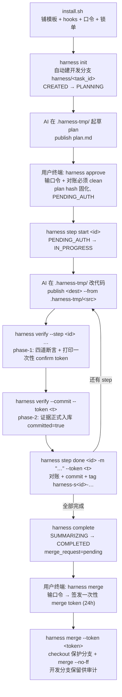

# AI Coding Harness 标准流程手册 与 异常处理转移机制

> **适用版本**: v3.1.x（feat/harness-v4，单一 CLI 网关 + hooks 硬拦截层）
> **依据源码**: `template/.harness/scripts/harness`、`template/.harness/state_machine.py`、
> `codex/hooks/{pre_tool_use.py, harness_hook_lib.py, stop.py}`、`install.sh`
> **配套文档**: 根 `SKILL.md`（AI 侧硬约束速览）、`CAPABILITY_LIMITS.md`（能力边界与威胁模型）、
> `1.0/docs/`（v2 归档文档）
> **设计原则**: 约束只存在于代码闸门，无提示词软约束。本文所有行为均以源码为准。

---

## 目录

1. [架构总览与信任边界](#1-架构总览与信任边界)
2. [标准流程（正常路径）](#2-标准流程正常路径)
3. [状态机与状态转移表](#3-状态机与状态转移表)
4. [授权体系与人工转移通道](#4-授权体系与人工转移通道)
5. [异常处理转移机制（核心）](#5-异常处理转移机制核心)
6. [阈值与限额速查](#6-阈值与限额速查)
7. [命令速查](#7-命令速查)
8. [已知能力边界](#8-已知能力边界)

---

## 1. 架构总览与信任边界

### 1.1 三层防御

```
┌─────────────────────────────────────────────────────────────┐
│ 第 1 层 · hooks 硬拦截（PreToolUse / PostToolUse / Stop …）   │
│   写工具 deny 项目文件 → 引导至 publish；                      │
│   shell 词法切分逐段白名单 → 未知命令生成授权票 + deny；        │
│   Stop 收尾一致性检查（未登记改动 / worklog 未同步）。          │
├─────────────────────────────────────────────────────────────┤
│ 第 2 层 · harness CLI 网关（唯一写入通道）                     │
│   publish = 审核(密钥/语法) → 原子写入 → manifest 审计；       │
│   verify = harness 亲自执行验收命令并固化证据；                │
│   人工授权（口令）与一次性 token 在此签发/校验。               │
├─────────────────────────────────────────────────────────────┤
│ 第 3 层 · 状态机 + 防篡改锁单 + git                           │
│   Task/Step 两级状态机强制合法转移；                           │
│   lock.json 固化脚本 hash，篡改即全局锁定；                    │
│   每 step 自动 commit + tag，全程可回溯。                     │
└─────────────────────────────────────────────────────────────┘
```

### 1.2 关键文件清单

| 路径 | 作用 | 谁可写 |
|---|---|---|
| `plan.md` | 任务规划（publish 后签字固化 hash） | publish（AI）；Revision History 由网关追加 |
| `.harness/state.json` | 状态机当前状态 + phase + merge_request | 仅 harness CLI |
| `.harness/manifest.jsonl` | 全部写入/验收审计（hash 链） | 仅 harness CLI |
| `.harness/worklog.jsonl` | 步骤日志（step done 自动追加） | 仅 harness CLI |
| `.harness/evidence/<step>/` | verify 固化的验收证据（纳入对账） | 仅 harness CLI |
| `.harness/pending/tkt-*.json` | 待批授权票（30 分钟有效） | hooks 创建，confirm 消费 |
| `.harness/allowlist.json` | 人工许可表（exact / bin） | confirm 写入 |
| `.harness/lock.json` | 防篡改锁单（脚本 hash 清单） | 仅 install.sh |
| `.harness/branches.json` | 保护分支策略 | 仅 `harness branch`（口令） |
| `.harness/denials.log` | 拦截记录 | hooks 追加 |
| `.harness-tmp/` | AI 起草区（无监管 tmp，对账/提交忽略） | AI 自由写 |
| `~/.config/ai-coding-harness/secret.json` | 授权口令（sha256+salt，0600） | 仅 install.sh / passwd；AI 不可读 |

### 1.3 信任模型（一句话）

证据建立在两件事上：**程序自证（harness 亲自执行并固化）** 与 **用户口令（AI 无法获取）**。
机制防的是「结构性绕过」（跳过闸门、伪造收尾、复活终态），不防受信模型本身作弊；
最终兜底是事后审计（manifest + evidence + worklog 全程留痕）。

---

## 2. 标准流程（正常路径）

### 2.1 全流程图



### 2.2 阶段要点

**阶段 0 · 安装**（人工执行一次）

```bash
./install.sh <project> --objective "..." --scopes src/
# 可选: --copy-only 只铺模板不初始化 / --upgrade 升级并重算锁单 /
#       --no-codex-hooks / --no-claude-hooks / --passphrase-file FILE
```

安装器完成：铺 `.harness/` 模板 → 注册 git pre-commit（备份原 hook）→ 复制 Codex/Claude
hook 脚本 → 设置授权口令（≥8 字符，TTY 输入）→ 生成 `lock.json` 防篡改锁单。
升级一律走 `install.sh --upgrade`（保留 state/manifest/worklog，重算锁单）。

**阶段 1 · init**：`harness init` 自动建任务（task_id 默认 `TASK-YYYYmmdd-HHMMSS`）。
若当前在保护分支（master/main 等），自动 `git checkout -b harness/<task_id>` 创建开发分支；
初始提交后打/移动 `harness-baseline` tag。AI 起草区 `.harness-tmp/` 同步创建。

**阶段 2 · plan 与签字**：plan.md 经 publish 写入（发布会使旧批准失效）；
approve 由**用户**执行：口令校验 → 工作区对账必须 clean（plan.md 自身除外）→
把 plan 的 sha256 固化进 state → `PLANNING → PENDING_AUTH`。

**阶段 3 · step 循环**（每步）：

1. `step start <id> --title "..."` —— 校验 plan 批准未被改动、无未完成 step、在开发分支。
2. 在 `.harness-tmp/` 起草，`publish` 发布（审核：确定性密钥指纹一律拒、高熵疑似密钥拒、
   语法检查、≤2MB、≤10 文件/次、二进制拒、目标不得是 `.git/.harness/.codex/.claude/`）。
3. `verify` phase-1：harness **亲自执行**验收命令（项目根、CI=1、超时上限 600s），
   捕获 stdout/stderr/exit/耗时并写证据；通过则打印一次性 confirm token（只存 sha256）。
4. `verify --commit --token <t> [--intent "覆盖层级=…; 交付对象=…"]` phase-2：
   token 与 phase-1 证据绑定的 hash 比对通过后，证据标记 `committed=true` 正式入账。
5. `step done <id> -m "做了什么/为什么"`：对账 clean → 有新鲜通过证据 → 有 phase-2 入账证据 →
   Task/Step 状态机推进 → 自动 commit + 打 tag `harness-s<id>-<slug>`。
   纯规划 step 用 `step done --no-verify --reason "..."`（理由入 worklog 可审计）。

**阶段 4 · 结项与人工合入**：全部 step 完成后 AI 运行 `harness complete`
（要求无 open step、有已完成 step、状态 IN_PROGRESS、对账 clean），进入
`SUMMARIZING → COMPLETED`，登记 merge_request（dev → 保护分支）。
用户在自己终端运行 `harness merge`（无参数，输口令）签发**一次性 merge token（24h）**；
把 token 交给 AI 执行 `harness merge --token <token>`（或用户自行执行同一命令）完成
`--no-ff` 合入。token 用掉即失效；开发分支保留供审计。

---

## 3. 状态机与状态转移表

状态机实现在 `template/.harness/state_machine.py`，harness CLI 每次合法操作后驱动转移；
非法转移抛 `ValueError`，CLI 转 `die()` 报错。**终态（ABORTED / COMPLETED / FAILED）
无出边，不可转回任何活动态。**

### 3.1 Task 级（11 态）

| 当前态 | 允许转移到 | 驱动命令 |
|---|---|---|
| CREATED | PLANNING, ABORTING | init |
| PLANNING | PENDING_AUTH, ABORTING | approve |
| PENDING_AUTH | PLANNING, IN_PROGRESS, ABORTING | step start（→IN_PROGRESS）；publish plan（→PLANNING） |
| IN_PROGRESS | PAUSED, ROLLING_BACK, ABORTING, SUMMARIZING, FAILED, **PLANNING** | abort（→ABORTING）；complete（→SUMMARIZING）；在途改 plan / replan（→PLANNING） |
| PAUSED | IN_PROGRESS, ABORTING | —（预留） |
| ROLLING_BACK | IN_PROGRESS, FAILED, ABORTING | —（预留） |
| ABORTING | ABORTED | abort 收尾 |
| SUMMARIZING | IN_PROGRESS, COMPLETED, ABORTING | complete |
| **ABORTED** | **∅（终态）** | 唯一出口：`init --force` 新任务 |
| **COMPLETED** | **∅（终态）** | — |
| **FAILED** | **∅（终态）** | — |

v3 的 `phase` 字段（PLANNED / APPROVED / IN_PROGRESS / COMPLETE）是面向用户的粗粒度视图，
由 `_task_status_for_phase()` 映射到底层状态；`harness status` 显示的是 phase，
**冲突时以底层 status 为准**。

### 3.2 Step 级（11 态）

正常路径由 `step start` / `step done` 驱动连续转移：
`PLANNED → CHECKPOINTING → EXECUTING →（step done）COMPLIANCE_REVIEW → COMMITTING
→ VERIFYING → COMPLETED`。

| 当前态 | 允许转移到 |
|---|---|
| PLANNED | CHECKPOINTING, FAILED |
| CHECKPOINTING | EXECUTING, FAILED |
| EXECUTING | COMPLIANCE_REVIEW, FAILED, PAUSED, ROLLING_BACK |
| COMPLIANCE_REVIEW | EXECUTING, COMMITTING, BLOCKED |
| COMMITTING | VERIFYING, FAILED |
| VERIFYING | COMPLETED, EXECUTING, ROLLING_BACK, FAILED |
| BLOCKED | PAUSED, EXECUTING |
| PAUSED | EXECUTING, ROLLING_BACK, FAILED |
| ROLLING_BACK | PLANNED, FAILED |
| **COMPLETED** | **∅（终态）** |
| **FAILED** | **∅（终态）** |

### 3.3 两条特殊的合法转移路径（在途改计划）

直接从 IN_PROGRESS → PENDING_AUTH 是**非法**的，因此「任务执行中改了 plan」走两跳：

- `publish plan.md`（任务执行中）→ `IN_PROGRESS → PLANNING`（event=replan_in_flight），
  原批准失效（plan_approved=False），提示用户重新 approve → `PLANNING → PENDING_AUTH`。
- `harness replan <op>`（任务执行中且已批准）→ 同上路径。

---

## 4. 授权体系与人工转移通道

### 4.1 口令授权（最强，AI 无法自取）

口令在安装时由用户设置（≥8 字符，sha256+salt 存 `~/.config/ai-coding-harness/secret.json`，
权限 0600，项目外）。以下操作强制口令校验：

| 命令 | 用途 |
|---|---|
| `harness approve` | plan 签字 |
| `harness adopt --path … --reason …` | 登记绕过 publish 的既有改动 |
| `harness abort [--to <tag>]` | 回退到 checkpoint |
| `harness confirm <tkt-id>` | 批准授权票 |
| `harness branch --add/--remove` | 变更保护分支 |
| `harness merge`（无参数） | 签发 merge token |
| `harness passwd` | 换口令（先验旧口令） |

**辅助防线**：授权调用若来自 agent 进程树（codex/claude/aider/cursor-agent 等进程名匹配）
直接拒绝——用户必须在自己的终端运行。**失败限流**：10 分钟窗口内失败 3 次 → 锁定 60 秒。

### 4.2 一次性 token（可转交）

| token | 生成 | 校验 | 时效 |
|---|---|---|---|
| **merge token** | 用户终端 `harness merge`（口令） | `merge --token`，hmac 比对 sha256 | 24h，一次性；丢失可重新签发，旧 token 随即作废 |
| **confirm token**（phase-2） | `verify` phase-1 通过时打印到终端 | `verify --commit --token`，与证据内 confirm_hash 比对 | 绑定单条证据，一次性；AI 可读取回填，用后失效 |

### 4.3 授权票（shell 白名单的转移通道）

shell 命令未过白名单时，hook 生成授权票 `tkt-HHMMSS-xxxx` 存 `.harness/pending/`
（**30 分钟有效**），同时 deny 本次调用，并在 deny 理由中给出用户终端命令：

```
python .harness/scripts/harness confirm <tid>
```

`confirm`（口令）后四种处置：
- **o · 仅一次**：exact argv + one_time 标记，**600 秒**内有效，命中即消费；
- **a · 总是放行此命令**：exact argv 永久条目；
- **p · 永久放行该程序**：按 realpath 的 bin 条目（会削弱网关，confirm 时有明确警告）；
- **d · 拒绝**：删票并记录。

许可表优先于内置分类检查（否则人工签发的许可永远无法命中）。

### 4.4 逃生阀（仅用户可设）

`HARNESS_HOOKS_DISABLE=1` 关闭全部 hook。hook 内部异常提示中会指明这一点；
AI 不得自行设置。

---

## 5. 异常处理转移机制（核心）

### 5.0 转移模型：每类异常只有三条出路

```
┌────────────┐   闸门拒绝    ┌──────────────────────────────────────┐
│ 异常发生    │──────────────▶│ 路径 A · 自愈（AI→AI）               │
│            │               │  AI 按 deny/die 理由修正后重试        │
│            │               └──────────────────────────────────────┘
│            │   需要人权    ┌──────────────────────────────────────┐
│            │──────────────▶│ 路径 B · 人工转移（AI→用户终端）      │
│            │               │  授权票 / 口令 / merge token /        │
│            │               │  phase-2 token；用户操作后 AI 重试    │
│            │               └──────────────────────────────────────┘
│            │   终态触发    ┌──────────────────────────────────────┐
│            │──────────────▶│ 路径 C · 终态固化（不可逆）           │
│                            │  ABORTED / COMPLETED / FAILED 无出边 │
│                            │  唯一出口 = 正式 init 新任务          │
└────────────┘               └──────────────────────────────────────┘
```

**铁律**：任何闸门的拒绝（deny/die）都不是终点，是**转移指令**——每条拒绝消息都附带
下一步该做什么；AI 不得绕过、不得硬刚、不得改 `.harness/` 伪造状态。

### 5.1 写通道类异常

| # | 触发 | 系统行为 | 转移 | 恢复 |
|---|---|---|---|---|
| W1 | Write/Edit/apply_patch 直写项目文件（含 `.harness/.codex/.git`） | hook deny，提示走 publish | A | 在 `.harness-tmp/` 起草 → `harness publish <dest> --from .harness-tmp/<src>` |
| W2 | 写工具解析不出目标路径 | **fail-closed** deny | A | 同上 |
| W3 | 符号链接绕过（scratch 内链接指向 src/ 等） | 按 realpath 解析最终目标再判定，改真实文件即拒 | A | 无绕过空间；正常走 publish |
| W4 | publish 审核不过：确定性密钥指纹（sk-/AKIA/PRIVATE KEY/ghp_/xox/AIza）或高熵疑似密钥 | die，指出行号 | A | 移除密钥（占位符/环境变量注入）后重试；**没有 override 通道** |
| W5 | publish 审核不过：语法错误（.py/.json/.jsonl/.toml/.yaml/.sh 按扩展名检查） | die | A | 修正语法重试 |
| W6 | publish 目标是保护路径 / 目录 / 符号链接 / 二进制（含 NUL）/ >2MB / 单次 >10 文件 | die | A | 拆分批次；大文件走 git（人工确认） |
| W7 | plan 未批准（或批准后已改动）却 publish 非 plan 文件 | die | **B** | 请用户运行 `harness approve` |
| W8 | 无进行中 step 却 publish 业务文件 | die | A | 先 `harness step start <id> --title "…"` |
| W9 | publish 前对账失败（存在未登记改动） | die | B | `harness adopt --path … --reason "…"`（用户口令），或先 publish 正常通道 |
| W10 | step start 时 plan hash 与批准时不一致 | die | **B** | plan 被改过 → 用户重新 `harness approve` |

### 5.2 shell 白名单类异常

| # | 触发 | 系统行为 | 转移 | 恢复 |
|---|---|---|---|---|
| S1 | 只读命令（SAFE_READ）及只读 git 子命令 | 自动放行 | — | — |
| S2 | 写操作 git（commit/push/checkout…）、带 `-c/--exec-path` 等全局参数 | deny + 授权票 | **B** | 用户终端 `harness confirm <tid>`（o/a/p/d）后 AI 重试 |
| S3 | sudo/doas 提权 | deny + 票（理由「提权必须人工批准」） | **B** | 同上 |
| S4 | 未知程序（pytest/make/python 脚本…） | deny + 票 | **B** | 同上；经常使用的命令选 `p` 永久放行 |
| S5 | 环境变量赋值不在安全清单（LANG/TZ/PAGER=cat…） | deny + 票 | **B** | 同上，或改用安全变量 |
| S6 | 重定向目标非 `/dev/null`、`/tmp`、`.harness-tmp/` | deny + 票 | **B** | 重定向到起草区，或 confirm 放行 |
| S7 | `$( )` 命令替换内含未授权操作 / shell 解析失败 | **fail-closed** deny | A | 拆简单命令，或 confirm 放行完整段 |
| S8 | `harness` 网关自身调用（python …/harness …） | 永久放行 | — | — |
| S9 | one-time 许可使用 | 命中即消费，过期条目跳过 | A | 过期后重新发起触发新票 |

### 5.3 防篡改锁单类异常（lock broken）

| # | 触发 | 系统行为 | 转移 | 恢复 |
|---|---|---|---|---|
| T1 | lock.json 缺失/为空，或任一受锁脚本 hash 失配（hook 检测） | **降级运行：只放行只读操作**，写工具与非白名单 shell 一律 deny | **B** | 用户运行 `install.sh --upgrade` 重铺脚本并重算锁单 |
| T2 | 同上，pre-commit 阶段检测 | 拒绝提交 | **B** | 同上 |
| T3 | 用户/外部进程篡改了 `.harness/` 内被 git 跟踪文件（state/evidence/manifest） | reconcile 判 hash 失配 → publish/step done/pre-commit 全部拒绝 | **B** | `git checkout -- .harness/`（用户），或 abort 回 checkpoint |
| T4 | 试图把 ABORTED 改回活动态（直接编辑 state.json） | 写工具对 `.harness/` 一律 deny；即便改了，`harness validate` 也拒绝非法转移 | **C** | 无恢复——必须 `init --force` 正式新任务 |

### 5.4 验收类异常（verify / step done）

验收由 harness **亲自执行**（AI 自述不算）。通过判据：`exit=0` 且未超时且四道断言全过。
**exit=0 只是必要条件。**

| # | 触发 | 系统行为 | 转移 | 恢复 |
|---|---|---|---|---|
| V1 | 验收命令 exit≠0 / 超时（上限 600s） | FAIL，证据入库（stdout/stderr/耗时/hash 全固化） | A | 修代码 → 重新 verify |
| V2 | `--out` 声明的产物运行后不存在或未更新（mtime/hash 与运行前一致） | FAIL：「疑似陈旧产物冒充新结果」 | A | 清理旧产物 / 确保命令真的生成产物 |
| V3 | `--require <regex>` 未命中 | FAIL：「路径激活正证据缺失」 | A | 目标路径根本没走——修实现，不要放宽断言 |
| V4 | `--forbid <regex>` 命中回退信号（fallback/FORCE_SWRAST…） | FAIL：「触发回退红线」 | A | 消除静默回退路径 |
| V5 | `--must-differ <label>`：产物与对照组完全一致 | FAIL：「一致在此是红灯——疑似根本没切换」 | A | 检查开关/路径是否真的生效 |
| V6 | 验收命令含危险模式（rm -rf / fork 炸弹 / mkfs / dd） | 直接拒绝执行 | A | 改用安全命令 |
| V7 | `step done` 无该 step 的任何证据 | 拒绝收尾 | A | 运行 `harness verify --step <id> -- <验收命令>`；纯规划 step 用 `--no-verify --reason "…"` |
| V8 | 证据已过期：最后一次 publish/adopt 晚于最近通过验收 | 拒绝收尾：「改了代码必须重新 verify」 | A | 重新 verify（不得拿旧证据收尾） |
| V9 | 只有 phase-1 暂存证据，未二次提交 | 拒绝收尾 | A | `verify --commit --token <phase-1 打印的 token> --intent "覆盖层级=…"` |
| V10 | phase-2 token 不匹配 / 缺失 | 拒绝（防伪造成交） | A | 原样使用 phase-1 打印的 token；丢失则重跑 verify 生成新证据 |
| V11 | `step done --token` 与已入账证据的 token 不一致 | 拒绝收尾 | A | 核对使用 phase-2 时用的那个 token |
| V12 | `--no-verify` 缺 `--reason` | die | A | 补理由（入 worklog，可审计） |

### 5.5 分支保护类异常

| # | 触发 | 系统行为 | 转移 | 恢复 |
|---|---|---|---|---|
| B1 | 在保护分支（master/main，及 origin/HEAD 兜底）上 publish / step / approve / verify | die：「任务只能在开发分支上执行」 | A | `harness init` 会自动建 `harness/<task_id>`；或用户手动 `git checkout -b` |
| B2 | 当前分支与任务 dev_branch 不一致 | die | A | `git checkout <dev_branch>` |
| B3 | 在保护分支上 git commit | pre-commit 拒绝 | A | 切开发分支；合入只能走 harness merge |
| B4 | merge 目标不是保护分支 | 拒绝合入 | A | 由 complete 自动选定保护分支，勿手工指向非保护分支 |
| B5 | 保护分支策略维护（--add/--remove 至少保留一个） | 需口令 | **B** | 用户终端 `harness branch --add <name>` |

### 5.6 结项与合入类异常（complete / merge）

| # | 触发 | 系统行为 | 转移 | 恢复 |
|---|---|---|---|---|
| M1 | 仍有 open step 就 complete | die | A | 先 `step done` |
| M2 | complete 时状态非 IN_PROGRESS / 重复 complete | die | A | 检查状态（`harness status` / `harness validate`） |
| M3 | 无 pending merge_request 就 `merge --token` | die：「先 complete」 | A | AI 运行 complete |
| M4 | merge token 过期（24h） | die | **B** | 用户重新 `harness merge` 签发 |
| M5 | merge token 不匹配 | die（hmac 比对） | **B** | 用最新签发的 token；旧 token 已被覆盖作废 |
| M6 | merge token 丢失 | — | **B** | 用户重跑 `harness merge`：新 token 覆盖签发，旧 token 立即作废（防卡死） |
| M7 | merge 时不在 dev 分支 | die | A | 切回开发分支 |
| M8 | checkout 目标分支失败（脏树） | merge 前自动 commit「状态快照」规避；仍失败则 die | A/B | 人工清理工作树 |
| M9 | `git merge --no-ff` 冲突 | die（停留在目标分支），打印冲突输出 | **B** | 人工解决冲突后按常规流程处理 |

### 5.7 超阈异常（规则级回退阈值）

| 阈值 | 默认值 | 性质 |
|---|---|---|
| 连续失败 | 3 次 | 规则闸 |
| 单 step 用时 | 30 min | 规则闸 |
| 修改文件数 | 10（publish 单批硬上限同为 10） | 批量为**代码硬闸** |
| 单步新增代码 | 500 LOC | 规则闸 |
| 用户介入次数 | 5 次 | 规则闸 |
| 同一问题回退 | 最多 2 次，第 3 次 → 暂停 + 用户咨询 | 升级闸 |

触发后的标准动作：**拆子步骤逐个验收**（超阈 step 不可标记验收通过），或精简冗余改动。
无法拆分的大改动需**用户授权豁免**，不得硬刚。回退本身走 `harness abort`（口令，路径 B）。

### 5.8 ABORTED 终态（路径 C 的代表）

**ABORTED 是终态**：转移表 `ABORTED: set()` 无出边，不存在 ABORTED → IN_PROGRESS 等
任何活动态转移。`harness status` 若显示 IN_PROGRESS 只是 phase 快照未同步，以底层为准。

`harness abort`（口令）的行为：列出将被撤销的发布 → 二次确认 `git reset --hard` →
删除未跟踪的新文件 → 清空 pending 授权票 → `ABORTING → ABORTED` → worklog 记录。
默认回退目标：最近的 `harness-s*` tag，否则 `harness-baseline`。

**接续流程（唯一合法路径）**：

1. `harness init --force` 正式重置计划、新建 task_id（不带 `--force` 会因已有 state 直接跳过）；
2. ABORTED 终止的是**流程**，不回滚已 publish 的代码——已完成 step 的代码、tag、worklog
   全部保留，新 plan 中引用即可，不得重做；
3. 新任务第一步 `git diff --stat` 盘点旧任务未验收 step 的残留改动，逐项决定
   保留 / 精简 / 顺延，并在 plan 中记录旧任务 ABORTED 原因（溯源链不断）；
4. 后续步骤拆到 ≤500 LOC 内逐步验收。

**禁止**：改 state.json 复活任务（见 T4）；视摘要 IN_PROGRESS 为准继续执行；
init 接续时重做已验收步骤。

### 5.9 状态机非法转移

非法转移抛 `ValueError` → CLI `die("非法任务/step 状态转换: …")`，消息中列出当前态的
合法去向。处置：按消息对照 §3 转移表找到正确驱动命令；`harness validate` 可离线校验
state.json 一致性；`harness inspect` 输出详细检查。**注意**：目标状态等于当前状态时
转移幂等 no-op（允许重复 step start 不报错）。

### 5.10 hook 层异常（fail 方向按 hook 类型固定）

| hook | 类型 | 异常策略 |
|---|---|---|
| PreToolUse | 闸门（安全关键） | **fail-closed**：内部异常一律 deny，理由中提示用户可设 `HARNESS_HOOKS_DISABLE=1`。理由：解析类异常若 fail-open，喂坏 JSON 即可放行 |
| SessionStart / UserPromptSubmit / PostToolUse / Stop | 上下文注入/收尾检查 | **fail-open**：异常放行并记 `.harness/hook_errors.log`，绝不锁死会话 |

其余 hook 层行为：

| # | 触发 | 行为 | 转移 |
|---|---|---|---|
| H1 | 无 `.harness/` 的仓库 | 全部 hook no-op | — |
| H2 | Stop：工作区有未登记改动 | block，提示 publish/adopt | A（publish）或 B（adopt 需口令） |
| H3 | Stop：open step 有发布/验收记录但未 step done | block（规则 10 日志必完整） | A |
| H4 | Stop：plan 未批准但工作区有改动 | block（规则 1 行动前先规划） | A/B |
| H5 | Stop 死循环防护 | `stop_hook_active` 标记后不再 block | — |
| H6 | SessionStart / UserPromptSubmit | 注入 12 条黄金法则 + 状态摘要（防遗忘） | — |

### 5.11 授权类异常

| # | 触发 | 行为 | 转移 | 恢复 |
|---|---|---|---|---|
| P1 | 口令错误 | 3 次机会；10 分钟窗口内失败 3 次 → 锁定 60 秒 | **B** | 用户重试；锁定期间等待 |
| P2 | 授权调用来自 agent 进程树 | 直接拒绝 | **B** | 用户在自己的终端运行 |
| P3 | 未设置口令（secret.json 缺失） | die，提示由用户运行 install.sh | **B** | 用户安装/设置口令 |
| P4 | 授权票过期（30 分钟） | 票被删除 | A | AI 重新发起原操作 → 生成新票 → 用户再 confirm |

### 5.12 环境/会话类异常

| # | 触发 | 行为 | 恢复 |
|---|---|---|---|
| E1 | 找不到 harness 项目根（向上查找 `.harness/state.json` 失败） | die | 确认在项目内运行；或先 init |
| E2 | git 操作超时（60s，防 GPG/ssh 提示挂死） | die 并提示检查 git 配置 | 配置 credential agent / 缓存 |
| E3 | replan/validate/inspect 子脚本超时（300s）或缺失 | die，提示 `install.sh --upgrade` | **B** |
| E4 | step id 含非法字符（只允许 `[A-Za-z0-9._-]{1,32}`） | die | 改名 |
| E5 | 新会话上下文丢失 | SessionStart hook 自动注入状态摘要；会话续接先读 state.json + worklog.jsonl | 按 §2.2 从 phase 对应步骤继续 |
| E6 | git 仓库缺提交身份 | commit 自动回退 harness 身份（ai-coding-harness） | — |

### 5.13 异常 → 转移路径总表

```
路径 A（自愈，AI 修正后重试）:
  W1-W3 直写拦截 · W5-W6 publish 校验 · W8 无 step · S7-S9 解析/许可消费
  V1-V6 验收失败四断言 · V7-V12 收尾校验 · B1-B4 分支闸 · M1-M2 M3 M7-M8
  P4 票过期重触发 · E1-E2-E4 环境参数错 · 5.9 非法转移按表纠偏

路径 B（人工转移，用户终端 + 口令/token）:
  W7  plan 未批准 → approve
  W9  旁路改动 → adopt
  S2-S6 未授权命令 → confirm（授权票, 30min）
  T1-T3 锁单/篡改 → install.sh --upgrade / git checkout
  B5  保护分支策略 → branch --add/--remove
  M4-M6 M9  token 签发/丢失/冲突 → merge
  5.7 超阈豁免 → 用户授权
  P1-P3 口令问题 → 用户重试/安装

路径 C（终态，不可逆，唯一出口是正式新任务）:
  ABORTED   ← harness abort（口令）  → init --force 接续
  COMPLETED ← harness complete      → merge 后归档
  FAILED    ← 状态机预留            → init --force 接续
  T4 篡改复活企图 → 被双重闸门拒绝（写 deny + validate）
```

---

## 6. 阈值与限额速查

| 项 | 值 | 执行层 |
|---|---|---|
| publish 单次文件数 | ≤10 | 代码硬闸 |
| publish 单文件大小 | ≤2 MB | 代码硬闸 |
| verify 单次超时 | ≤600 s | 代码硬闸 |
| 证据输出截断 | 2 MB | 代码硬闸 |
| git 单次操作超时 | 60 s | 代码硬闸 |
| replan/validate 子脚本超时 | 300 s | 代码硬闸 |
| 授权票有效期 | 30 min | 代码硬闸 |
| one-time 许可有效期 | 600 s（用一次即废） | 代码硬闸 |
| merge token 有效期 | 24 h，一次性 | 代码硬闸 |
| 口令失败限流 | 10 min 内 3 次失败 → 锁 60 s | 代码硬闸 |
| 口令长度 | ≥8 字符 | 代码硬闸 |
| 连续失败/用时/文件/LOC/介入 | 3 次 / 30 min / 10 个 / 500 / 5 次 | 规则闸（超阈必回退） |
| 同一问题回退上限 | 2 次，第 3 次暂停咨询 | 规则闸 |
| plan 用户授权 | 签字后固化 sha256，改动即失效 | 代码硬闸 |

---

## 7. 命令速查

### AI 侧（无需口令）

```bash
python .harness/scripts/harness status                 # 状态摘要（含对账结果）
python .harness/scripts/harness init [--force] --objective "…" --scopes …
python .harness/scripts/harness publish <dest> --from .harness-tmp/<src> [--note "…"]
python .harness/scripts/harness step start <id> --title "…"
python .harness/scripts/harness verify --step <id> [--label L] \
  [--out GLOB] [--require RX] [--forbid RX] [--must-differ L] [--timeout N] -- <命令>
python .harness/scripts/harness verify --step <id> --commit --token <T> \
  --intent "覆盖层级=…; 交付对象=…"
python .harness/scripts/harness step done <id> -m "做了什么/为什么" \
  [--token T | --no-verify --reason "…"]
python .harness/scripts/harness complete               # 结项，等待人工签发 token
python .harness/scripts/harness merge --token <T>      # 凭 token 执行合入
python .harness/scripts/harness evidence <step>        # 查看证据链
python .harness/scripts/harness log / log why <file>   # 发布历史与原因
python .harness/scripts/harness replan <op>            # insert/reorder/split/merge/delete/update/list
python .harness/scripts/harness validate / inspect / doctor / dashboard
python .harness/scripts/harness plan-gen <objective>   # plan 骨架
```

### 用户侧（自己的终端，需口令）

```bash
python .harness/scripts/harness approve                # plan 签字
python .harness/scripts/harness confirm <tkt-id>       # 处置授权票（o/a/p/d）
python .harness/scripts/harness adopt --path <p> --reason "…"
python .harness/scripts/harness abort [--to <tag>]     # 回退 checkpoint → ABORTED
python .harness/scripts/harness branch --add/--remove <name>
python .harness/scripts/harness merge                  # 签发一次性 merge token（24h）
python .harness/scripts/harness passwd                 # 换口令
```

### 维护侧（人工）

```bash
./install.sh <project> --upgrade                       # 升级脚本 + 重算锁单（锁单损坏的唯一修复）
HARNESS_HOOKS_DISABLE=1                                # 逃生阀：关闭全部 hook（仅用户）
```

---

## 8. 已知能力边界

完整分析见 `CAPABILITY_LIMITS.md`（面向维护者与审计者）。要点：

- 白名单是策略表，无法穷举同命令的不同副作用；`python/bash` 类解释器一旦被人工放行即可执行任意代码（所以 p 放行有明确警告）。
- publish 防的是**绕过通道**，不审查内容好坏；`.harness-tmp/` 起草区不纳入对账。
- 口令的进程树校验是辅助防线（进程名匹配可被规避），主防线是口令本身。
- phase-2 机制防「结构性绕过」，`--intent` 声明本身不被校验——「验证的层 = 用户看到的层」
  最终靠人审计证据链（这正是本手册 §5.4 存在的原因）。
- 最终兜底不是某行代码，而是**愿意打开 evidence 与本手册逐条比对的人**。
  harness 的职责是把缺口变得可见。

---

*本文档与源码同步维护：修改闸门行为时请同步更新对应小节（源文件见文首「依据源码」）。*
